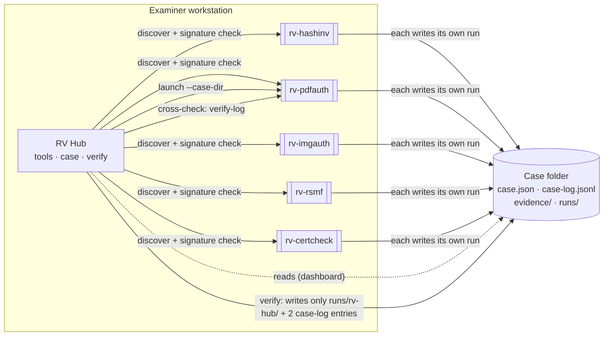
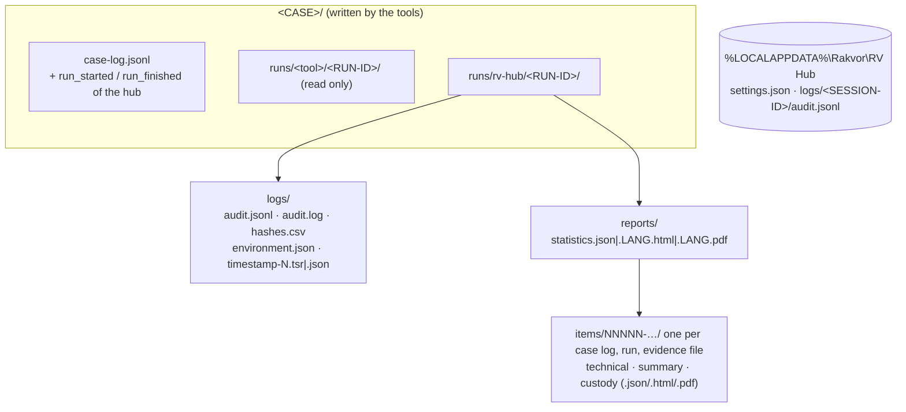

<p align="center"></p>

# RV Hub

<!-- forge:description -->
**Main app for the Rakvor tools.** Finds the installed tools, checks their signatures, launches them on a case folder, shows the case at a glance and verifies the whole case.
<!-- /forge:description -->

[](https://github.com/Panacota96/rv-hub/actions/workflows/ci.yml)


RV Hub is the one window an examiner opens first. The five Rakvor tools stay separate, separately signed
programs; the hub sits beside them and does five things:

1. **Finds** the installed tools (rv-hashinv, rv-pdfauth, rv-imgauth, rv-rsmf, rv-certcheck), with their version and
   the SHA-256 of each executable.
2. **Checks** each tool's Authenticode signature, and that its certificate chain ends at the Rakvor root bundled in
   the hub (Windows).
3. **Launches** a tool's desktop app on a case folder (`<tool>-gui.exe --case-dir CASE`), and records which
   executable was started, on which case, by whom.
4. **Shows** a read-only case dashboard: evidence, runs, findings by severity, timestamp status, and suggested next
   steps (which tool has not yet examined which item).
5. **Verifies the whole case** (`rv-hub verify`): the case log, every run's audit log, review log and timestamps, the
   links between them, and optionally every evidence file again; then it asks each run's own tool to verify its logs
   too (`<tool> verify-log`) and compares the two answers.



## Contents

- [What it does, and what it does not do](#what-it-does-and-what-it-does-not-do)
- [The five tools and how they are found](#the-five-tools-and-how-they-are-found)
- [Install](#install)
- [Quick start: desktop app](#quick-start-desktop-app)
- [Quick start: command line](#quick-start-command-line)
- [Outputs](#outputs)
- [Documentation](#documentation)
- [Project layout](#project-layout)
- [Contributing, security, licence](#contributing-security-licence)

## What it does, and what it does not do

| It does | It does not |
| --- | --- |
| List every Rakvor tool it finds, with version, source, folder and the SHA-256 of each executable | Install, update or download tools (no network in v1; the Rakvor Suite installer is planned, [rv-hub#2](https://github.com/Panacota96/rv-hub/issues/2)) |
| Check each executable's Authenticode signature and pin its chain to the bundled Rakvor root (Windows) | Check signatures on Linux or macOS: there the status is *not checked*, which is not a valid signature |
| Never run `describe` on an executable signed under another root, unsigned or with a broken signature; launch such a tool only after you confirm, and record that confirmation first | Make an untrusted build trustworthy: a confirmed launch is recorded as untrusted |
| Open a tool's desktop app on a case folder | Analyse evidence itself: analysis is the tools' job |
| Show the case read-only, and suggest next steps with their reason | Create a case: **only the intake tool (rv-hashinv) writes `case.json`**; the hub's *Create case* button starts rv-hashinv |
| Verify the case log, every run log, review log, timestamp token and link, and (with `--rehash`) every registered evidence file | **Edit, move or delete another tool's files**: a broken run stays as it is, for the examiner to explain |
| Ask each run's own tool for its `verify-log` verdict and report any disagreement (high severity) | Prove that a tool's findings are correct, or that the evidence is authentic: verification shows integrity, not content |
| Write its verification as a run of its own (`runs/rv-hub/<RUN-ID>/`), linked in the case log | Write anything else in the case: two case-log entries (`run_started`, `run_finished`) are its only change outside its own run folder |

## The five tools and how they are found

| Tool | Role | Accepts (built-in table) | Repository |
| --- | --- | --- | --- |
| **rv-hashinv** | intake: registers evidence as `E0001`, `E0002`, …; creates the case | any file | [Panacota96/rv-hashinv](https://github.com/Panacota96/rv-hashinv) |
| **rv-pdfauth** | analysis: PDF authenticity signals | `.pdf`, or content starting `%PDF-` | Panacota96/rv-pdfauth |
| **rv-imgauth** | analysis: image authenticity (JPEG, PNG, HEIC, WebP) | image extensions, or JPEG / PNG / WebP / HEIC / HEIF magic bytes | [Panacota96/rv-imgauth](https://github.com/Panacota96/rv-imgauth) |
| **rv-rsmf** | conversion: chat exports to RSMF 2.0 | `.txt` (only when it looks like a chat export), `.json`, `.html`, `.htm`, `.msg`, `.csv` | [Panacota96/rv-rsmf](https://github.com/Panacota96/rv-rsmf) |
| **rv-certcheck** | analysis: certificates, CRLs, timestamp tokens, keys, CSRs | `.crt .cer .der .pem .p7b .p7c .p12 .pfx .crl .tsr .tst .key .csr`, or DER / PEM content | [Panacota96/rv-certcheck](https://github.com/Panacota96/rv-certcheck) |

Discovery looks in four places, in this order, and lists an executable found by several sources once, with every
source ([theory.md B1](docs/theory.md#b1-discovery)):

1. the Windows uninstall registry, `HKCU\Software\Microsoft\Windows\CurrentVersion\Uninstall\{AppId}_is1`, for the
   tools' known installer AppIds;
2. `%LOCALAPPDATA%\Programs\Rakvor\*\` (where every Rakvor installer puts its tool);
3. the folders of `PATH` (the five known tool names only);
4. folders you add (for example portable zips on a USB stick), and their direct subfolders.

Each Rakvor-signed tool is asked `describe --json` (schema `rakvor.describe/1`, 10 s limit) for its version and what
it accepts. A tool version without `describe` is described from the hub's built-in table and shown with version
unknown.

## Install

**Windows 10/11**: from the [Releases](https://github.com/Panacota96/rv-hub/releases) page:

- `rv-hub-<version>-windows-x64-setup.exe`: per-user installer, no administrator rights (Start-menu group
  *Rakvor*, optional `rv-hub` on PATH), or
- `rv-hub-<version>-windows-x64.zip`: portable; unzip and run.

Check the download first (SHA256SUMS, build provenance, Authenticode against the Rakvor root), and expect a
SmartScreen warning for the internally signed build: see [docs/installation.md](docs/installation.md). From source
(Rust 1.88+): `cargo build --release --locked`.

## Quick start: desktop app

1. Start **RV Hub** from the Start menu (*Rakvor → RV Hub*), or `rv-hub-gui.exe`.
2. **Tools** tab: check that every tool you need has a green *Rakvor-signed* badge. Add a portable folder if a tool
   lives on a USB stick.
3. **Case** tab: *Open* a case folder (the folder with `case.json`), or *Create case*, which starts rv-hashinv on an
   empty folder. Read the evidence table, the runs and the *Suggested next steps*; one click opens the suggested
   tool on the case.
4. **Verify** tab: tick *re-hash the registered evidence* if you want the evidence read again, then *Start
   verification*. *Open report* opens the result.

Window by window: [docs/usage-gui.md](docs/usage-gui.md).

## Quick start: command line

```powershell
rv-hub self-test                                    # every hash algorithm against published test vectors

rv-hub tools                                        # inventory: tool, version, source, signature, folder
rv-hub tools --add-folder E:\rakvor-portable --check-signatures

rv-hub case --case-dir D:\cases\CASE-2026-014       # read-only summary and suggested next steps
rv-hub launch rv-pdfauth --case-dir D:\cases\CASE-2026-014

# Verify the whole case: logs, links, timestamps, cross-check with each run's own tool. The hub's own run is
# timestamped by an online TSA by default (only its chain head is sent); --no-timestamp for offline labs.
rv-hub verify --case-dir D:\cases\CASE-2026-014 --actor "Ana Ruiz"

# ...validating the TSA certificate chain of every token against your CA bundle
rv-hub verify --case-dir D:\cases\CASE-2026-014 --tsa-ca C:\certs\tsa-roots.pem

# ...and read every registered evidence file again (copies moved to F:\copies)
rv-hub verify --case-dir D:\cases\CASE-2026-014 --rehash --evidence-dir F:\copies --lang es
```

| Exit code | `verify` | `tools` | `launch` |
| :-: | --- | --- | --- |
| 0 | no high-severity finding: the case verifies | inventory printed | tool started |
| 1 | runtime error (case log locked, output not writable) | session log not writable | not installed, or could not start |
| 2 | usage error (not a case folder, unknown evidence id, …) | usage error | unknown tool, or no `case.json` for an analysis tool |
| 3 | at least one high-severity finding | an executable signed under another root, or with an invalid signature | refused: not Rakvor-signed (no `--yes-untrusted`), or the executable changed |
| 130 | cancelled (partial reports written) | | |

Every command, option and exit code: [docs/usage-cli.md](docs/usage-cli.md) (generated from `--help`). The
end-to-end walkthrough: [docs/usage.md](docs/usage.md). A real sample case: [examples/](examples/README.md).

## Outputs



- **Verification run:** `<CASE>\runs\rv-hub\<RUN-ID>\`, linked in the case log. When the case log itself is broken
  it is never extended, and the run goes to `--out` (default `.\rakvor-out`) instead.
- **Hub session log:** every inventory, launch, confirmation and window action, hash-chained, in
  `%LOCALAPPDATA%\Rakvor\RV Hub\logs\<SESSION-ID>\` (override with `RV_HUB_DATA_DIR`).
- Every finding code, its severity, what it shows and what it does not prove: [docs/reports.md](docs/reports.md).

## Documentation

| Page | For |
| --- | --- |
| [docs/usage.md](docs/usage.md) | End-to-end walkthrough: tools, case, launch, verify, reading the result, troubleshooting |
| [docs/usage-gui.md](docs/usage-gui.md) | The desktop app, tab by tab |
| [docs/usage-cli.md](docs/usage-cli.md) | Every command and option (generated from `--help`) |
| [docs/theory.md](docs/theory.md) | How it works: plain-language part for clients and courts, expert part for examiners and opposing experts |
| [docs/admissibility.md](docs/admissibility.md) | Colombia, France/EU, ISO/IEC, SWGDE and US/UK requirements mapped to the hub; limits and gaps (draft pending legal review) |
| [docs/reports.md](docs/reports.md) | Report kinds, every finding code with its severity, what it shows and what it does not prove |
| [docs/case-folder.md](docs/case-folder.md) | What the hub reads in a case folder and the only things it writes |
| [docs/forensic-audit.md](docs/forensic-audit.md) | The hub's audit trail: session log, verification run, hash chain, ISO/IEC 27037 mapping |
| [docs/architecture.md](docs/architecture.md) | Engine, CLI and GUI; discovery, signature, launch and verify in sequence diagrams |
| [docs/installation.md](docs/installation.md) | Installing and verifying the hub, SmartScreen, signatures against the Rakvor root, where files live, the planned Suite installer |
| [docs/development.md](docs/development.md) | Building, testing, CI/CD and releasing |
| [docs/adr/0001-language.md](docs/adr/0001-language.md) | Why Rust |

## Project layout

```text
rv-hub/
├── src/
│   ├── core/      rv_hub_core: tools, signature, launch, session, case_view, suggest, checks, run (never prints)
│   ├── cli/       rv-hub command line (clap)
│   └── gui/       rv-hub-gui desktop app (egui); src/state/ holds every testable rule
├── i18n/          wording of findings, limitations, suggestions and the window: en.json, es.json, fr.json
├── schemas/       JSON Schemas: describe, hub-tools, hub-case, statistics and per-item reports
├── packaging/     Windows installer (Inno Setup) and the Rakvor code-signing root (signing/)
├── docs/          documentation (Mermaid diagrams render on GitHub)
├── tests/         independent Python verifier, tampered-case generator, golden case
├── examples/      a real case folder made by the tools, expected findings and hashes
└── .github/       CI and release workflows
```

## Contributing, security, licence

- How to contribute: [CONTRIBUTING.md](CONTRIBUTING.md) · Changes: [CHANGELOG.md](CHANGELOG.md)
- Report a vulnerability privately: [SECURITY.md](SECURITY.md)
- Rakvor Source-Auditable Licence ([LICENSE](LICENSE), draft pending legal review): used locally by Rakvor; customers, courts and their experts may inspect and rebuild the source for audit; no redistribution. Third-party notices: [NOTICE](NOTICE).
