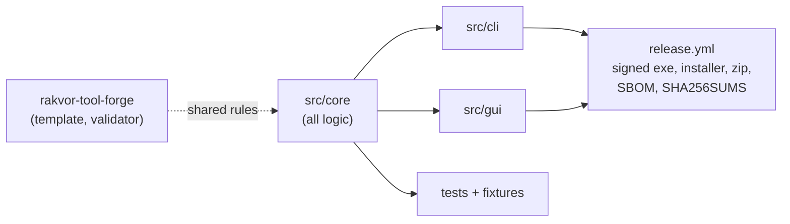

# Handover — rv-hub 0.3.0

State on 2026-11-11 (commit `de9798c` on `main`). **rv-hub** — the suite's front door: finds and launches the other tools on a case folder, shows the case, and verifies the whole case (case log, every run, evidence re-hash, cross-check by each run's own tool).

This page is for whoever picks the project up next: where things are, how to build, test and release it, the decisions already made and what is
still open. The user-facing guides are [usage.md](usage.md) and [installation.md](installation.md).



## 1. State at handover

| Item | Value |
| --- | --- |
| Version | 0.3.0 (release-please, `version.txt`) |
| Toolchain | Rust pinned in `rust-toolchain.toml`; `rust-version` = 1.88 (minimum) |
| CI | `ci.yml`: Linux + Windows tests, fmt, clippy `-D warnings`, `cargo deny check advisories licenses bans sources`, docs drift |
| Releases | signed with the internal Rakvor code-signing certificate; the chain ends at "Rakvor Internal Code Signing Root CA", SHA-256 `DC:9B:A1:A2:FC:D4:F0:63:3C:52:14:B7:CC:EB:25:BE:D8:F3:F7:D9:EB:AF:11:15:90:25:0C:BC:AA:83:DF:60`, valid to 2036-10-20 |
| Forge | the contract this repository follows and its validator live in [rakvor-tool-forge](https://github.com/Panacota96/rakvor-tool-forge) (the pinned version is listed in its README, "Using a pinned commit") |

## 2. Where things are

| Path | What it holds |
| --- | --- |
| `src/core` | everything that decides a result: inputs, checks, findings, reports, audit log, case folder, trust (`src/core/src/trust.rs`) |
| `src/cli`, `src/gui` | thin front ends over the core (the GUI records every user action as a `ui_*` audit entry) |
| `docs/` | theory (Part A for non-experts, Part B for experts), admissibility (Colombia, France), usage, installation, ADRs |
| `tests/fixtures/tsa-chains` | 34 TSA certificate chains with OpenSSL's verdicts (shared by every tool and both forge profiles) |
| `packaging/` | Inno Setup script, signing root (public certificate only) |
| `deny.toml` | licence allow-list (no GPL/AGPL/LGPL), sources, advisory exceptions with reasons |

**Shared code.** `src/core/src/trust.rs` is byte-identical in rv-hub, rv-hashinv, rv-rsmf, rv-certcheck, rv-imgauth,
rv-pdfauth and the forge template. Change it in all of them in one go (and `core/trust.py` of the forge's Python
template, graded by the same fixtures). `src/core/src/outputs.rs` (re-hash of the outputs an audit log records, used by
`verify-log`, `verify-case` and `rv-hub verify`) is shared the same way: it depends only on `crate::hash` and
`serde_json`; its module documentation lists every audit shape of every tool; rv-hashinv holds the reference copy.
The installer AppId table in `src/cli/tests/packaging.rs` lists every tool; a new tool's AppId goes into every
repository's copy.

## 3. Everyday commands

```bash
cargo fmt --all -- --check
cargo clippy --workspace --all-targets --locked -- -D warnings
cargo test --workspace --locked
cargo deny check                                    # advisories, licences, bans, sources
python <forge>/scripts/validate_project.py . --run --tests   # the Rakvor contract (forge checkout)
```

`docs/usage-cli.md` is generated from `--help` (`<tool> docs-cli`); a test fails when it drifts.

## 4. Releasing

Conventional Commits drive release-please: `feat:` minor, `fix:` patch, `docs:`/`test:`/`chore:` no release.
Merging the release PR tags the version and the release workflow builds, signs, packages and uploads. Full steps,
secrets (`SIGN_PFX_BASE64`, `SIGN_PFX_PASSWORD`) and the manual fallback: rv-hashinv's [release-process.md](https://github.com/Panacota96/rv-hashinv/blob/main/docs/release-process.md) (same workflow).

Practical notes from this project:

- CI on release-please's own PRs can stop at *action required*: approve the run (Actions tab) before merging.
- After a release, verify it independently: `SHA256SUMS` over the downloaded assets, and every `.exe` (installer,
  CLI, GUI) chaining to the root above (`signtool verify /pa /v` on Windows, or any Authenticode verifier).
- Repository settings: enable *Automatically delete head branches*; merged branches are not deleted otherwise.

## 5. Decisions

| ADR | Decision |
| --- | --- |
| [0001](adr/0001-language.md) | Implementation language |
| [0002](adr/0002-tsa-token-verification.md) | How RFC 3161 tokens and TSA chains are verified |
| [0003](adr/0003-dependency-advisories.md) | Dependency advisories, exceptions and RSA blinding |
| [0004](adr/0004-case-verdicts-and-cross-check.md) | Case verdicts and the cross-check |

Standing rules: no private key, password or real personal data in the repository; secrets only through environment
variables or prompts and never logged; no GPL/AGPL/LGPL components; tools report signals, not verdicts.

## 6. Open work

- Known tools (`tools::KNOWN_TOOLS`): rv-hashinv, rv-pdfauth, rv-imgauth, rv-rsmf, rv-certcheck, rv-mailauth. A new
  tool needs its entry in `KNOWN_TOOLS`, `APP_IDS` and `builtin` (`src/core/src/tools.rs`), a reason key in
  `suggest.rs` and `i18n/*.json` (`suggest`), and the docs that list the tools.
- `.msg` routing between rv-mailauth and rv-rsmf relies on PR_MESSAGE_CLASS (`suggest::MsgKind`); it was tested on
  synthetic compound files only. Confirm the classes on real Purview Teams exports and real Outlook emails.
- Suite installer (rv-hub#2): needs the `RAKVOR_SUITE_TOKEN` secret (a token that can read the other tools' releases).
- The GUI has the TSA CA bundle and evidence-folder fields since 0.3.0; tool overrides (`--tool-exe`) and evidence ids (`--evidence`) remain CLI-only.
- The licence (`LICENSE`) and the admissibility analysis (`docs/admissibility.md`) are drafts pending a lawyer's review (Colombia and France).
- Revocation of the TSA certificate is never checked by the tools (gap G18): it is established separately from CRL/OCSP evidence covering genTime ([ADR 0002](adr/0002-tsa-token-verification.md)).
- Recorded outputs (gap G19): `rv-hub verify` re-hashes every run's recorded outputs with `outputs.rs`
  (`RUN_OUTPUT_CHANGED`, high, one per file; tally `runs_outputs_changed`). Tool releases made before their
  `verify-log` re-hashed outputs answer *intact* on a run with an edited report: the hub reports that as
  `TOOL_VERIFY_DISAGREES` with the reason ([ADR 0004](adr/0004-case-verdicts-and-cross-check.md), decision 5). It
  goes away as each tool ships `outputs.rs` (rv-hashinv and rv-certcheck have it; rv-rsmf, rv-imgauth, rv-pdfauth,
  rv-mailauth to do). The forge's Python template has no equivalent yet.
- RUSTSEC-2023-0071 is a documented exception until a stable `cms` 0.3 (rsa 0.10) exists ([ADR 0003](adr/0003-dependency-advisories.md)).

The gap table in [admissibility.md](admissibility.md) lists every known limitation with its owner (engineering,
counsel, examiner, firm).
