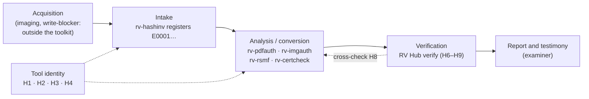

# Admissibility and reliability

> **Draft pending legal review. Not legal advice.** This page maps legal and technical requirements to what RV Hub
> actually does, so that a client, a lawyer or an opposing expert can see what the hub checks, how, with what limits,
> and under which legal frame. It was prepared from Rakvor's sourced research note dated 2026-10-21 (pass 2:
> verification) and from the hub's source code at this commit, and **must be reviewed by counsel in each
> jurisdiction before it is relied on or quoted**.

## Contents

- [1. Purpose and how to read this page](#1-purpose-and-how-to-read-this-page)
- [2. Where the hub sits in the evidence lifecycle](#2-where-the-hub-sits-in-the-evidence-lifecycle)
- [3. The reliability argument](#3-the-reliability-argument)
- [4. Colombia](#4-colombia)
- [5. France and the European Union](#5-france-and-the-european-union)
- [6. International standards: ISO/IEC 27037, 27041, 27042, 17025](#6-international-standards-isoiec-27037-27041-27042-17025)
- [7. SWGDE, United States and United Kingdom](#7-swgde-united-states-and-united-kingdom)
- [Limits of the hub](#limits-of-the-hub)
- [Consolidated gap list](#consolidated-gap-list)
- [Examiner checklist before relying on a verification](#examiner-checklist-before-relying-on-a-verification)
- [Sources](#sources)

## 1. Purpose and how to read this page

RV Hub is used **locally** by Rakvor; it is not distributed. Clients, courts and opposing experts may audit it and
rebuild it from source under the Rakvor Source-Auditable Licence ([LICENSE](../LICENSE), draft pending legal
review).

RV Hub produces no analysis of evidence. Its contribution to a case is **procedural**: it identifies which tool
builds were used (version, executable SHA-256, Authenticode signature pinned to the Rakvor root), it records which
build was started on which case, and it verifies that the case's records (case log, run logs, review logs, registry,
timestamps and, on request, the evidence files) are unchanged since they were written. Admissibility and weight are
decided by a court about the **examiner's evidence**; the hub's verification is one exhibit supporting the chain of
custody and the integrity of the tools' outputs.

Status values:

| Status | Meaning |
| --- | --- |
| **met** | A hub feature satisfies or directly supports the requirement (the feature key is named) |
| **partial** | Supported, with a named shortfall |
| **examiner** | An obligation of the examiner or of Rakvor as a firm, not a hub feature |
| **gap** | Not met today; listed in the [consolidated gap list](#consolidated-gap-list) |
| **context** | Background that frames the other rows |

Verification marks, kept from the research note and **never upgraded here**:

| Mark | Meaning |
| --- | --- |
| **[V]** | Article or clause number and substance checked against the primary text (project document, official gazette or a faithful mirror). |
| **[S]** | Checked against a secondary source. The number is reliable; check the wording before quoting. |
| [to verify] | Marked UNVERIFIED in the research note, or not covered by it. **Do not cite before a lawyer or engineer has checked it against the primary source.** |

Research limits that still apply: the Colombian project PDFs (`Ley_906_de_2004.pdf`, `Ley_1564_de_2012.pdf`,
`manualcadena2.pdf`) were verified against official web copies, not the project files; the ISO/IEC 27037 copy was the
free preview (table of contents and clauses 1–4), and the clause text of 27037 §5–7, 27041 and 27042 is paywalled;
Légifrance refused automated access (French texts read from the Pappers LEGI mirror). Still [to verify]: the
Daubert/Kumho citations; CPP art. 427, Code civil art. 1358 and CPC arts. 16, 233, 237, 238, 276; loi Informatique et
Libertés art. 46 and Directive 2016/680; NIST FIPS 180-4/202; Decreto 2364/2012; CSJ penal 29.877; C-604/16; the
annex of Implementing Regulation (EU) 2025/1929.

### Hub features referred to in the tables

| Key | Feature | Where |
| --- | --- | --- |
| H1 | Tool inventory: every Rakvor executable found, with source, folder, version (`describe`) and SHA-256 | `tools.rs`, `rv-hub tools` |
| H2 | Authenticode check (`WinVerifyTrust`) with the chain root **pinned** to the bundled Rakvor root; Windows only; no revocation check | `signature/` |
| H3 | Launch control: re-hash and re-check at launch, refusal of a changed executable, untrusted launch only after a confirmation that is logged first | `launch.rs` |
| H4 | Hub session log: hash-chained record of inventories, launches, confirmations and window actions | `session.rs` |
| H5 | Read-only case dashboard and next-step suggestions (a prompt, not a finding) | `case_view.rs`, `suggest.rs` |
| H6 | Whole-case verification: case-log chain, `case.json` and registry digests, every run's audit chain, case links, end-of-run head, timestamp tokens, review logs, unannounced runs, unknown logs | `checks.rs`, `run.rs` |
| H7 | Re-hash of every registered evidence file and comparison with the registry (`--rehash`) | `checks.rs` |
| H8 | Cross-check: each run's own tool's `verify-log` verdict compared with the hub's (full and chain-only verdicts) | `run.rs` `crosscheck` |
| H9 | The verification is itself a run: hash-chained audit log, `environment.json`, `hashes.csv`, statistics and per-item technical / summary / custody reports (en/es/fr), linked in the case log | `run.rs`, `report/` |
| H10 | Never edits, moves or deletes another tool's file; a broken case log is never extended | `run.rs` `open_target` |
| H11 | Every finding states what it shows and what it does not prove; four limitations are printed in every report | `i18n/*.json` |
| H12 | Independent verifier in standard-library Python (chain and hash register); a real sample case made by the tools, with seven tampered variants and their expected findings | `tests/verify_chain.py`, `tests/samples/`, `examples/sample/` |
| H13 | RFC 3161 timestamp of the verification's own audit head (non-qualified TSA by default) and optional PDF signature with the examiner's certificate | `trust.rs` |
| H14 | Source auditable by customers and opposing experts; release with SHA256SUMS, SBOM and build-provenance attestation | `LICENSE`, `release.yml` |

## 2. Where the hub sits in the evidence lifecycle

The hub covers two points: **before** a tool runs (which build, signed by whom: H1–H4) and **after** the tools ran
(are their records intact and consistent: H6–H9). It has nothing to say about acquisition, nor about what the
evidence means.

## 3. The reliability argument

What an opposing expert can test, and how:

| Claim | How it can be tested |
| --- | --- |
| The checks are exact, not statistical | Each check is a hash comparison or a link comparison ([theory.md Part B](theory.md#part-b-for-examiners-and-opposing-experts)); a single changed byte in a log line or an evidence file changes the SHA-256 |
| The hub's verdicts are reproducible by someone else | `tests/verify_chain.py` re-implements the chain and the hash register in standard-library Python, including the append-only case-log prefix rule ([theory.md B8](theory.md#b8-the-hash-register-and-the-append-only-case-log-prefix-rule)) |
| The hub detects the tampering it claims to detect | The sample case and its seven variants (edited case-log line, edited audit entry, deleted run folder, unlinked run, re-anchored review log, changed evidence byte) with the exact expected codes ([examples/](../examples/README.md)); the validator runs them in CI |
| Two verifier implementations agree | The cross-check (H8) asks each run's own tool; a disagreement is a high finding. The tools do not all check the same things yet (rv-hub#21); the hub's rule for that is stated in [theory.md B6](theory.md#b6-the-cross-check-rule-two-verdicts) |
| The hub never altered what it verifies | H10; every file in the case is opened read-only; the only writes are the hub's own run folder and two appended case-log lines, both recorded in its own audit log |
| Which hub was used | `environment.json` of the verification run (version, compiler, dependencies, OS, host, user), and the release's SHA256SUMS and provenance (H14) |

There are **no validated error rates** for the hub as a method (see [gap HG5](#consolidated-gap-list)). The hub's
checks have a known *mathematical* failure mode (a SHA-256 collision) and known *coverage* limits, listed under
[Limits of the hub](#limits-of-the-hub); they have not been measured on an independent corpus, and there is no
per-release validation record.

## 4. Colombia

### 4.1 Ley 906 de 2004 (Código de Procedimiento Penal)

Chain of custody rests on arts. 254–266 and 277; laboratory reports must describe procedures and instruments
(art. 210); experts are examined on instruments, methods and corroboration (arts. 417, 420); novel techniques must
meet at least one reliability criterion (art. 422).

| # | Requirement | Source | Hub feature | Status |
| --- | --- | --- | --- | --- |
| CO-P2 | The chain of custody evidences identity, original state, conditions, and the changes made by each custodian | Art. 254 [V] | H6 (each run's link to the case log: who, when, which run), H7 (identity and state by hash), H9 (the verification is itself a recorded custody step) | met (digital) / examiner (physical) |
| CO-P5 | Each custodian prevents destruction, substitution, alteration or deterioration | Art. 261 [V] | H10 (read-only; never edits another tool's file), H6, H7 | met |
| CO-P6 | Peritos certify that the item is the one collected and was always in custody | Art. 265 [V] | H7 + H6 support that statement for the period from intake; H13 signs the report | met (support) / examiner (signs) |
| CO-P9 | A laboratory report describes the procedures, the instruments used and their state | Art. 210 [V] | H1 + H2 (instrument identity and signature), H9 `environment.json` (the hub's own version and environment), H11 | met |
| CO-P14 | The perito is examined on instruments, methods and "corroboración … por otros expertos" | Art. 417 [V] | H8 (second implementation), H12 (independent verifier), H14; no validation dossier (HG5) | partial |
| CO-P15 | The court weighs acceptance of the principles and the instruments used | Art. 420 [V] | Hash chains and SHA-256 comparisons are widely used; H12 lets another expert re-run them | partial (HG5) |
| CO-P16 | A novel technique meets at least one criterion: verifiable; published; measured reliability; academic acceptance | Art. 422 [V] | Criterion 1 (verifiable): H12. Measured reliability: not done (HG5) | partial (criterion 1 met) |
| CO-P17 | Peritos have access to the material referred to in reports | Art. 416 [V] | H14 (auditable source, exact release); the verification report names every file it read (`hashes.csv`) | met |

### 4.2 Ley 1564 de 2012 (Código General del Proceso)

| # | Requirement | Source | Hub feature | Status |
| --- | --- | --- | --- | --- |
| CO-C1 | The dictamen explains the exams, methods and technical bases | Art. 226 [V] | H9 technical reports per item with facts; H11; [theory.md](theory.md) | met (support) / examiner |
| CO-C3 | Disclosures #8–#10: whether methods differ from prior practice; list and attach the documents used | Art. 226 #8–10 [V]; look-back periods of #4/#5 [to verify] | H9 `environment.json` pins the hub version; `hashes.csv` and the audit log list every file read | met (#8–10) / examiner (#1–7) |
| CO-C5 | The opposing party may summon the expert or file a competing dictamen | Art. 228 [V] | H12, H14: a competing expert can re-run the verification and the independent verifier | met (support) |
| CO-C8 | Data messages count as such only in their native format or an exact reproduction | Art. 247 [V] | H7 shows, by hash, that the registered native file is unchanged | met (support) / examiner (produce the natives) |

### 4.3 Ley 527 de 1999 (data messages)

| # | Requirement | Source | Hub feature | Status |
| --- | --- | --- | --- | --- |
| CO-L2 | "Original" is satisfied by a "garantía confiable de que se ha conservado la integridad de la información" | Art. 8 lit. a [V] | H7 (from intake onward), H6, H13 | met from intake; integrity before intake cannot be shown (limitation) |
| CO-L4 | Weight by sana crítica: reliability of archiving, of how integrity was kept, and of the originator's identification | Art. 11 [V] | Integrity: H6, H7, H13. Process reliability: H1–H3, H12. Originator identity: not addressed by the hub | partial |
| CO-L8 | A *firma digital* carries the presumption only when it meets the regulations (authorised certification entity) | Art. 28 parágrafo [V]; arts. 29–30 [V] | H13 signs PDFs with the examiner's own certificate; the hub's code-signing root is Rakvor's internal root, not an ECD | gap (G3 of the research note) |
| CO-L9 | *Estampado cronológico* is a service of authorised certification entities | Art. 30 #5 [V] | H13 uses an RFC 3161 TSA; unless it is a Colombian ECD, the stamp has no statutory status | gap (G2) |
| — | Regulation of art. 7 signatures | Decreto 2364 de 2012 [to verify] | — | context |

### 4.4 Fiscalía chain-of-custody manuals and case law

| # | Requirement | Source | Hub feature | Status |
| --- | --- | --- | --- | --- |
| CO-F1 | Validity requirements incl. *identidad, integridad, continuidad, registro* | Manual 2018 §5.3 [S] | identidad / integridad: H7; continuidad / registro: H6 (every run linked in the case log, unannounced runs flagged), H9 | met / examiner |
| CO-F2 | One *Registro de Cadena de Custodia* per item | Manual 2018 §6 [S] | H9 custody form per verified item is an internal, "Fiscalía-style" record, not the official form | partial (G9) |
| CO-J2 | *Inalterabilidad*: unchanged after its final form | CSJ Civ. 16-12-2010 via cartilla [S] | H6, H7, H13 | met |
| CO-J8 | Tested procedures, known tool error rates, two tools to cross-check, audits of tool efficacy | Cartilla §9.10.1 [V] | Two implementations: H8 + H12; tested: H12; error rates: not measured | partial (HG5) |
| — | CSJ Sala Penal, proceso 29.877 (2011): holding | cited in the cartilla [S]; holding [to verify] | — | context |

### 4.5 Ley 1581 de 2012 (personal data)

The hub processes metadata about evidence (paths, file names, digests, examiner names) and, with `--rehash`, reads
evidence content to hash it; it keeps everything local and sends nothing anywhere except the 32-byte chain head to
the TSA when a timestamp is requested (H13). The legal basis, roles (Responsable / Encargado) and RNBD registration
(art. 25 [V]; thresholds [to verify]) are **examiner** matters.

## 5. France and the European Union

### 5.1 Code de procédure pénale (CPP)

Evidence is free in criminal matters (principle of art. 427; wording [to verify]), so the issue is weight and
procedural regularity. **Article numbers change on 1 January 2029** (ordonnance n° 2025-1091 [S]); this page cites the
current numbering.

| # | Requirement | Source | Hub feature | Status |
| --- | --- | --- | --- | --- |
| FR-P4 | A qualified person copies sealed data "sans porter atteinte à leur intégrité" and reports under arts. 163 and 166 | Art. 60-3 [V] | H7 shows, from intake, that the copies examined are unchanged; H10 | met (support) |
| FR-P9 | Experts record the opening and re-sealing of scellés in the report | Art. 163 al. 2 [V] | H9 custody form (fr); physical scellés are outside the hub | examiner |
| FR-P10 | The report describes the operations, is signed, and names the qualified people who assisted | Art. 166 [V] | H9 (operations: audit log, per-item facts), H13 (signature), `environment.json` (operator) | met (support) / examiner |
| FR-P11 | The parties may request a complément d'expertise or a contre-expertise | Art. 167 [S] | H12, H14: the verification can be re-run by the other side | met (support) |
| FR-P14 | Plan for the renumbering of 2029 | Ordonnance 2025-1091 [S] | Documentation | gap (G14) |

### 5.2 Civil side

| # | Requirement | Source | Hub feature | Status |
| --- | --- | --- | --- | --- |
| FR-C1 | An electronic writing has probative force if its author is identifiable and it is kept in conditions that guarantee integrity | C. civ. art. 1366 [V] | For the tools' outputs: H6 + H7 show integrity since they were written; for the hub's own report: H9, H13 | met (integrity) / partial (author identity) |
| FR-C2, FR-C3 | The presumption of reliability of an electronic signature needs a qualified signature | C. civ. art. 1367 [V]; décret 2017-1416 art. 1 [V] | H13 is not a QES unless the examiner uses a qualified certificate on a QSCD | gap (G3) |
| FR-C4, FR-C5 | The technician acts personally and impartially; the parties can discuss the technical bases | CPC arts. 233, 237, 238, 16, 276 [to verify] | H11 (no legal verdict), H14 | met (support) / examiner |

### 5.3 eIDAS: Regulation (EU) 910/2014 as amended by (EU) 2024/1183

| # | Requirement | Source | Hub feature | Status |
| --- | --- | --- | --- | --- |
| EU-3 | A time stamp cannot be denied legal effect solely because it is not qualified | Art. 41(1) [V] | H13 | met (no presumption) |
| EU-4, EU-5 | Only a qualified electronic time stamp enjoys the presumption of accurate time and integrity; compliance presumed when the CIR (EU) 2025/1929 standards are met | Art. 41(2), art. 42(1)–(1a) [V]; CIR 2025/1929 [S], annex [to verify] | H13 with the default TSA is not qualified; `--tsa-url` can point to a QTSP | gap (G2) |
| — | Code signing of the tools | not an eIDAS trust service as used here | H2 pins Rakvor's internal root: it identifies the Rakvor build, it does not carry a legal presumption | context |

### 5.4 GDPR and loi Informatique et Libertés

Local processing, no telemetry, no cloud (GDPR art. 25 [V]: by design and by default, supported). Lawful basis
(art. 6 [V]), special categories (art. 9(2)(f) [V]), offence data (art. 10 [V]; LIL art. 46 [to verify]), processor
contracts (art. 28 [V]) and transfers to Colombia (not on the adequacy list; art. 46 safeguards [V]) are **examiner**
matters.

## 6. International standards: ISO/IEC 27037, 27041, 27042, 17025

### 6.1 ISO/IEC 27037:2012

| # | Requirement | Source | Hub feature | Status |
| --- | --- | --- | --- | --- |
| ISO-1 | Auditability: an independent assessor can evaluate every action | §5.3.2 [V title / S content] | H4 (launches), H9 (verification audit log), H12 (independent verifier) | met |
| ISO-2 | Repeatability: same results in the same environment | §3.17 [V]; §5.3.3 | Same case + same tools + same options → same items, findings and digests ([theory.md B11](theory.md#b11-exit-codes-and-determinism)) | met |
| ISO-3 | Reproducibility: same results with a different environment and operator | §3.18 [V]; §5.3.4 | H12 (Python verifier on any OS), CI on Linux and Windows; the signature check itself is Windows-only (HG1) | met / partial (H2) |
| ISO-5 | A copy includes verification means | §3.6 [V] | H7 compares each copy with the registry's verification means (hashes) | met |
| ISO-6 | The verification function must not match non-identical data (collision resistance) | §3.25 [V] | Chains use SHA-256 only. `--hash` for the hub's own register accepts md5 / sha1 as one of two; evidence is compared with the registry's algorithms, which may be MD5/SHA-1 for older records | partial (G11) |
| ISO-7 | Avoid spoliation and tampering | §3.19, §3.21 [V] | H10; files opened read-only | met (logical) |
| ISO-8 | Chain-of-custody record | §6.1 [V title]; content [to verify] | H6, H9 | met (subject to content check) |
| ISO-9 | Documentation of all actions | §6.6 [V title] | H4, H9 | met |

### 6.2 ISO/IEC 27041:2015 and 27042:2015

Clause text of both is paywalled and remains **[to verify]**; the rows below rest on the iso.org abstracts [V].

| # | Requirement | Source | Hub feature | Status |
| --- | --- | --- | --- | --- |
| 27041 | Methods and processes used in investigations are fit for purpose; levels of validation | iso.org abstract [V]; EVS scope [S]; clauses [to verify] | H12 (sample + tampered variants with expected codes), CI; **no per-release validation report** | gap (HG5 / G6) |
| 27042 | Continuity, validity, reproducibility, repeatability of analysis; interpretation with limitations | iso.org abstract [V]; clauses [to verify] | Continuity: H6. Reproducibility: H12. Limitations: H11 | met (support) |

### 6.3 ISO/IEC 17025:2017

| # | Requirement | Source | Hub feature | Status |
| --- | --- | --- | --- | --- |
| ISO-12, ISO-13 | Validate methods before use and after any change; software changes authorised, documented, validated | §7.2.2, §7.11.2 [V] | H12 + CI give evidence; no signed validation record per release | gap (G6) |
| ISO-14 | Verify by the user before casework | §7.2.1 [V title] | `rv-hub self-test` and the sample ([installation.md](installation.md#6-first-run-self-test-and-sample)) | met |
| ISO-16 | Equipment records include the software version | §6.4.13 [V] | H1 (each tool's version and SHA-256), H9 `environment.json` | met |
| ISO-18 | Accreditation (COFRAC, ONAC) | 17025 [V]; Global ACI-TECH-1-004 [S] | — | gap (G1) |

## 7. SWGDE, United States and United Kingdom

None of these binds a Colombian or French court; opposing experts use them as the vocabulary of reliability, and
Ley 906 art. 422 mirrors Daubert.

| # | Requirement | Source | Hub feature | Status |
| --- | --- | --- | --- | --- |
| US-1 | Opinion based on sufficient facts or data | FRE 702(b) [V] | H9 lists every item read; H6 covers every run in the folder, announced or not | met |
| US-2, US-3 | Reliable principles and methods, reliably applied | FRE 702(c)–(d) [V] | H12, H8; no validation report | partial (G6) |
| US-6 | Known or potential error rate; SWGDE: document error sources and mitigations | Daubert [to verify]; SWGDE Error Mitigation Analysis v2.0 [V] | Error sources and mitigations are listed under [Limits of the hub](#limits-of-the-hub); no measured rate | gap (HG5) |
| US-8 | General acceptance | Daubert [to verify] | Hash chains, SHA-256 and Authenticode are standard techniques | partial |
| US-9 | Evidence describing a process that produces an accurate result | FRE 901(b)(9) [V] | [theory.md](theory.md), H12 | met (support) |
| US-10, US-11 | Self-authentication of copied data by hash, and of records generated by an electronic process, by certification | FRE 902(13)–(14) [V]; 2017 note [S] | H7 + H9 support a qualified person's certification | met (template needed) |
| US-12 | Test before casework and at every revision; tester independent of the developer; separate test dataset; record of the test | SWGDE 18-Q-001-2.1 §4–6 [V] | H12 known dataset and expected results; CI at every change. Missing: §6-style test record, independent tester, separate dataset | partial (G6) |
| US-13 | Hash choice: move to SHA-2 / SHA-3 | SWGDE 12-f-002 [V]; NIST FIPS 180-4 / 202 [to verify] | Chains and signatures: SHA-256. Register: examiner's `--hash` (default sha256) | partial (G11) |
| — | Daubert v. Merrell Dow, 509 U.S. 579 (1993); Kumho Tire v. Carmichael, 526 U.S. 137 (1999) | [to verify] | — | context |
| UK-1 | Methods fit for purpose and validated before implementation | FSR Code v2 §24 [V] | as US-12 | gap if UK work is in scope (G1, G6) |

## Limits of the hub

These are stated here so that nobody has to find them by cross-examination. Each is also in
[theory.md](theory.md) with the code that causes it.

1. **Signature checks run on Windows only.** On Linux and macOS every tool is *not checked*. That is not a valid
   signature; there, nothing is Rakvor-signed for the cross-check, and discovery runs `describe` on any `rv-*`
   executable it finds in the scanned folders ([theory.md B1](theory.md#b1-discovery)). Revocation of the signing
   certificate is not checked on Windows either ([B2](theory.md#b2-the-signature-check)).
2. **The cross-check needs the tools installed.** It runs a tool only when that tool is discovered and Rakvor-signed,
   or given with `--tool-exe` (any signature; recorded as an override). Otherwise the run is
   `CROSSCHECK_UNAVAILABLE` and only the hub's own verification applies. The CLI's cross-check does not look in added
   portable folders; the GUI's does.
3. **Verification shows integrity, not content.** An intact run log does not make a tool's findings correct; a
   matching evidence hash does not make the evidence authentic, nor show anything that happened before intake. A
   timestamp proves when a log existed, not that the examined copy matches the original source.
4. **The tools' `verify-log` commands differ** ([rv-hub#21](https://github.com/Panacota96/rv-hub/issues/21)).
   rv-hashinv, rv-rsmf and rv-certcheck check the run against the case log; rv-pdfauth and rv-imgauth do not. For
   these two only, the hub accepts an answer that equals either its full or its chain-only verdict; where the two
   verdicts differ (truncation against the case log, or a broken case log), the cross-check cannot detect that they
   miss that check. Every other tool is compared with the full verdict. The hub's own `RUN_LOG_BROKEN` / `CASE_LOG_BROKEN` findings are unaffected
   ([theory.md B6](theory.md#b6-the-cross-check-rule-two-verdicts)).
5. **There are no validated error rates**, and no per-release validation record (plan, acceptance criteria, results,
   sign-off). The tests and the sample variants are evidence towards one, not a substitute.
6. **Who issued a timestamp token is proven only up to the CA bundle you supply.** The hub verifies the TSA's CMS
   signature on every token, but validates the TSA certificate chain only with `--tsa-ca` ("chain not checked"
   otherwise), and never checks revocation: a TSA certificate revoked before `genTime` still validates; revocation
   must be established separately from CRL/OCSP evidence covering `genTime`. Certificate-policy processing and
   non-directoryName name constraints are not evaluated (such chains are rejected, fail closed)
   ([theory.md B9](theory.md#b9-timestamps-what-the-hub-checks-and-what-it-does-not)).
7. **The dashboard and suggestions are not verified.** They read the tools' reports as they are, and suggestions
   read evidence at its registered path or in the `--evidence-dir` folders (CLI; the GUI's Case tab uses registered
   paths only).
8. **`evidence/registry.csv` is not covered** by the registry digest (only `registry.json` is). The hub records the
   SHA-256 it found in its own audit log (`registry_csv_sha256`), so a later change is visible, not an earlier one.
9. **Launch swap window (Linux, macOS):** on Windows the executable is locked against writes, renames and deletes
   from the hash to the start; elsewhere it is re-hashed just before the start, and a swap in the short window
   between that hash and the start is not excluded ([theory.md B3](theory.md#b3-launch)). The cross-check runs a
   discovered tool under the same protection (a tool changed since discovery is not run:
   `TOOL_CHANGED_SINCE_DISCOVERY`), with the same residual window outside Windows.
10. **`RUN_LOG_INTACT` reflects the hub's own checks** (and needs the hub's full verify-log verdict to be intact). It is withdrawn when the run's own tool disagrees
    (`TOOL_VERIFY_DISAGREES`), but it is still given when the tool could not be asked (`CROSSCHECK_UNAVAILABLE`);
    read every code ([reports.md](reports.md#finding-codes)).

## Consolidated gap list

`G*` numbers are those of the research note (shared by every Rakvor tool); `HG*` are specific to the hub.

| ID | Gap | Affects | Mitigation now | Remedy |
| --- | --- | --- | --- | --- |
| HG1 | Signature check Windows only; no revocation check | CO-P9, ISO-3 | Verify on Windows; keep the inventory (`rv-hub tools --json`) with the case | Revocation (CRL/OCSP) of the Rakvor signing certificate; rv-certcheck can validate the chain offline |
| HG2 | Cross-check depends on Rakvor-signed tools being found (installed, or in an `--add-folder` folder) | CO-P14, CO-J8 | Install the tools on the verifying workstation, pass `--add-folder`, or use `--tool-exe` and state it | Bundle the tools with the hub (Rakvor Suite) |
| HG3 | Integrity, not content | all content claims | Limitation printed in every report (H11) | — (by design) |
| HG4 | `verify-log` semantics differ between tools; chain-level fallback for rv-pdfauth and rv-imgauth | CO-P14, US-2 | Read the cross-check reason in the technical report | rv-hub#21: one semantics across the tools; then empty `VERIFY_LOG_WITHOUT_TRUNCATION` |
| HG5 | No validated error rates, no per-release validation record | CO-P15, CO-P16, CO-J8, 27041, ISO-12, US-6, US-12, UK-1 | H12 sample and variants; CI | Validation report per release (17025 §7.2.2.4, SWGDE §6), independent tester, separate dataset (G6) |
| HG6 | TSA chain validated only with `--tsa-ca`; no revocation check of the TSA certificate | EU-4, CO-L9 | Pass `--tsa-ca` with the TSA's roots; establish revocation separately from CRL/OCSP evidence covering `genTime` (`openssl verify -crl_check` with that CRL, or rv-certcheck `--crl`/`--ocsp`); `openssl ts -verify` alone is a signature/chain check, not a revocation check ([forensic-audit.md](forensic-audit.md#timestamps)) | Offline CRL/OCSP response checking |
| HG7 | `--tool-exe` accepts any signature | CO-P9 | Recorded as `override: true`; state it in the report | Show overrides in the statistics report |
| HG8 | Suggestions read registered paths, or the folder given with `--evidence-dir` (CLI) or *Evidence copies in* (GUI Case tab) — **closed** in the GUI: both front ends offer the folder | none (not a finding) | Treat suggestions as prompts; give the folder where the evidence is now | — |
| G1 | Not accredited (COFRAC / ONAC) | ISO-18 | State "not accredited" | Roadmap |
| G2 | TSA not qualified, not a Colombian ECD | EU-4, EU-5, CO-L9 | `--tsa-url` to a QTSP / ECD | Dual stamping for cross-border cases |
| G3 | Examiner's certificate is not a QES or a *firma digital* | FR-C2, FR-C3, CO-L8 | Print and publish the certificate fingerprint | Qualified / ECD certificate |
| G6 | No validation record (see HG5) | as HG5 | | |
| G9 | Custody forms are internal, not the official forms | CO-F2 | Label as internal record | Map to the official forms |
| G11 | MD5 / SHA-1 accepted as one of two | ISO-6, US-13 | Keep sha256 (the default) | Require SHA-2/3 as one of the two |
| G12 | Host clock; only the chain head is stamped | CO-L4 | Check time sync before a verification | Record clock source and offset |
| G14 | CPP renumbering on 1 Jan. 2029 | FR-P14 | — | Concordance table |
| G17 | No defined source-inspection protocol | CO-P17, FR-P11 | — | Standard NDA and inspection protocol |

## Examiner checklist before relying on a verification

1. **The hub is genuine:** the release's SHA256SUMS and provenance checked, and `rv-hub-gui.exe` / `rv-hub.exe`
   Rakvor-signed ([installation.md](installation.md#4-check-the-signatures-against-the-rakvor-root)); `rv-hub self-test` passes.
2. **The tools are genuine:** `rv-hub tools --check-signatures` on Windows shows every tool used in the case as
   `TOOL_SIGNED_RAKVOR`; save `rv-hub tools --json` with the case file.
3. **Verify on Windows**, with the case's tools installed, `--crosscheck auto` (the default). Note any
   `CROSSCHECK_UNAVAILABLE` and why.
4. **Re-hash** (`--rehash`) before hand-over, with `--evidence-dir` if the copies moved; explain any
   `EVIDENCE_MISSING`.
5. **Exit code 0**, or every high finding explained in the report: which file, what changed, and why it does or
   does not affect the conclusions.
6. **Read every code** of each run item, not only `RUN_LOG_INTACT`; read the cross-check reason ("same verdict at
   chain level" means the tool does not check the case log).
7. **Timestamps:** verify with `--tsa-ca <the TSA's roots>` so the TSA chain is validated (not only its signature),
   establish the TSA certificate's revocation status separately from CRL/OCSP evidence covering `genTime` (the
   `openssl ts -verify` cross-check does not do it), and note whether the TSA is qualified (EU) or an ECD
   (Colombia).
8. **Keep** the verification run folder (`runs/rv-hub/<RUN-ID>/`), the hub session log of the launches
   (`%LOCALAPPDATA%\Rakvor\RV Hub\logs\`), and the hub release used.
9. **State the limits** in the expert report: integrity not content; Windows-only signature check; the cross-check
   rule; no validated error rates.
10. **Counsel review** of this page for the jurisdiction concerned before quoting it.

## Sources

From Rakvor's research note of 2026-10-21 (pass 2), which lists the full URLs:

- Colombia: Ley 906 de 2004 (Secretaría del Senado; Colpensiones normograma); Ley 1564 de 2012 (Colpensiones
  normograma); Ley 527 de 1999 (project file, Función Pública EVA copy); Ley 1581 de 2012 (Secretaría del Senado);
  Fiscalía, *Manual del Sistema de Cadena de Custodia* v4 (2018) and the earlier manual; Rama Judicial, Escuela
  Judicial, *Guía … evidencia digital … No. 2: Procedimientos Técnicos* (2020).
- France: CPP arts. 56, 60, 60-3, 97, 157, 160, 163, 166 (Pappers LEGI mirror); Code civil arts. 1366–1368; décret
  n° 2017-1416; ordonnance n° 2025-1091.
- EU: Regulation (EU) 910/2014, consolidated 2024-10-18 (EUR-Lex); Regulation (EU) 2024/1183; Implementing
  Regulation (EU) 2025/1929; GDPR (via gdpr-info.eu); European Commission adequacy decisions page.
- Standards: iso.org catalogue pages for ISO/IEC 27037, 27041, 27042, 27043, 17025; ISO/IEC 17025:2017 public copy;
  UKAS Technical Bulletin 2026-08-17.
- US/UK: FRE 702, 901, 902 (Cornell LII); SWGDE 18-Q-001-2.1 v2.1, 12-f-002 v1.0, Error Mitigation Analysis v2.0;
  NIST CFTT programme page; UK FSR Code of Practice v2.
- RV Hub: the source code at this commit, the GitHub issues rv-hub#2 and rv-hub#21.
