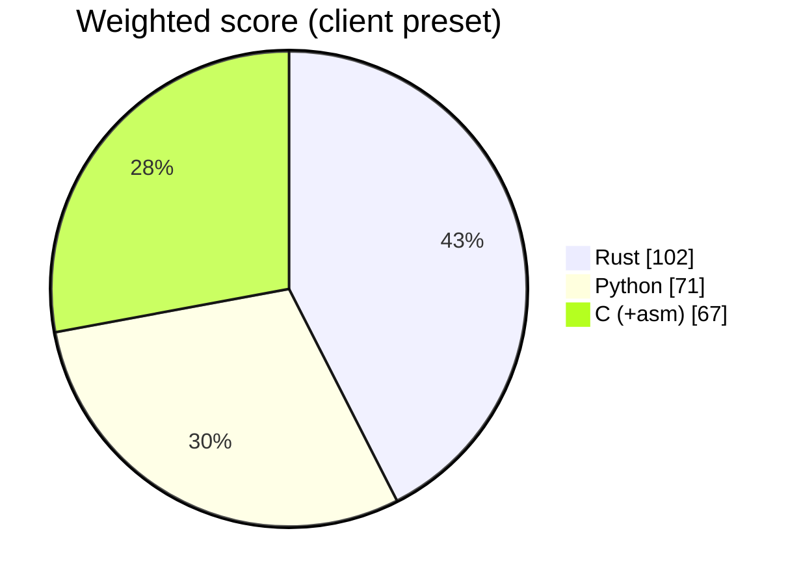

# ADR 0001 — Implementation language: Rust (Profile A)

- Status: accepted
- Date: 2026-10-29
- Deciders: language council (Rust, Python and C/assembly advocates + rebuttal round), approved by the project owner

## Context

Launcher and case dashboard for the four Rust Rakvor tools (rv-hashinv, rv-pdfauth, rv-rsmf, rv-imgauth): finds installed tools, checks their Authenticode signatures against the bundled Rakvor root, launches them with --case-dir, shows a read-only case dashboard, suggests the next tool, verifies the whole case (case log, every run's audit and review log) with reports in EN/ES/FR; hub and Rakvor Suite installers; no network in v1. Users: Rakvor examiners; verification reports go to clients and courts. 8 GB Windows laptops and GPU-less VMs.

Weight preset: **client**. Score overrides argued by the council:

- Rust · Team velocity: 3 → 4 (reuses the template's audit chain, case folder, reports, i18n and CI unchanged; only discovery, launch and dashboard are new)
- Python · Windows GUI maturity: 4 → 5 (the dashboard is mostly sortable, filterable tables; QTableView + QSortFilterProxyModel are mature with native accessibility)
- Python · Transferability (Win10/11 x64 + ARM64, Linux): 4 → 3 (all four tools are Rust; a Python hub is a second stack and cannot reuse their crates)
- Python · Memory safety / court auditability: 3 → 2 (the whole-case verification would be a second, Python implementation of the hash-chain checks that could drift from the tools)
- C (+asm) · Transferability (Win10/11 x64 + ARM64, Linux): 3 → 2 (no reuse of the tools' registry, audit-chain or describe code; hash-chain logic written twice)
- C (+asm) · Memory safety / court auditability: 2 → 1 (court-facing verification parsing possibly tampered JSONL without memory safety, duplicating the verify logic)
- C (+asm) · Team velocity: 3 → 2 (JSON, i18n, PDF and tests are slower to write in C for a Rust-trained team)

## Options scored (1–5, weighted)

| Criterion | Weight | Rust | Python | C (+asm) |
| --- | :-: | :-: | :-: | :-: |
| Speed (throughput, startup) | 3 | 5 | 3 | 5 |
| Transferability (Win10/11 x64 + ARM64, Linux) | 3 | 5 | 3 | 2 |
| Storage (executable / installer size) | 2 | 4 | 2 | 5 |
| Hardware / RAM (8 GB laptops, VMs without GPU) | 2 | 5 | 3 | 5 |
| Windows GUI maturity | 2 | 4 | 5 | 2 |
| CLI --help quality | 2 | 5 | 5 | 2 |
| Packaging, signing, antivirus false positives | 2 | 4 | 2 | 4 |
| Memory safety / court auditability | 3 | 5 | 2 | 1 |
| Team velocity | 2 | 4 | 5 | 2 |
| CI/CD complexity (5 = simple) | 1 | 5 | 3 | 3 |
| **Weighted total** (max 110) | | **102** | 71 | 67 |

## Decision

Profile A (Rust workspace: core + clap CLI + egui GUI). 

## Consequences

- Two static executables (CLI + GUI), no runtime to install; one core library powers both.
- Contributors need Rust; Windows binaries are built on GitHub's `windows-latest` runners.
- No hand-written assembly: hash and parsing crates already use SIMD/CPU intrinsics.

## Rebuttal round

Rejected overrides (with the reason):

- `rust.hardware=4` (eframe's glow backend needs OpenGL 2+): the Rakvor tools build eframe with the `wgpu`
  backend, which falls back to DirectX WARP software rendering on GPU-less VMs; the hub uses the same features.
- `rust.packaging=5`: a private Rakvor root gives no SmartScreen reputation; packaging stays 4.
- `python.speed=4`, `python.hardware=4`, `python.velocity=4`, `python.dfir_ecosystem=4`, `c.gui=3`,
  `c.dfir_ecosystem=3`: beyond the three-override cap, or criteria with little weight for a hub (speed, DFIR
  ecosystem) that do not change the ranking.

## Consequences for the design

- **One verifier lineage.** All three advocates named the same top risk: a hub whose whole-case verification
  disagrees with the tools'. The hub is scaffolded from the same reference code as the four tools (audit chain,
  case folder, `verify-case`), and in addition **asks each run's own tool** (`<tool> verify-log`, when installed)
  to verify that run's logs; any disagreement between the hub and a tool is itself a finding.
- **Signatures through the OS.** WinVerifyTrust (Windows' own Authenticode check), then the signer chain's root is
  compared with the Rakvor root certificate bundled in the hub (`packaging/signing/rakvor-code-signing-root.cer`):
  a binary signed under any other trusted root is reported as not Rakvor-signed. CI fixtures: unsigned, tampered,
  wrong root.
- **Read-only on cases.** The hub never appends to a tool's logs or the case log; it keeps its own audit log.
