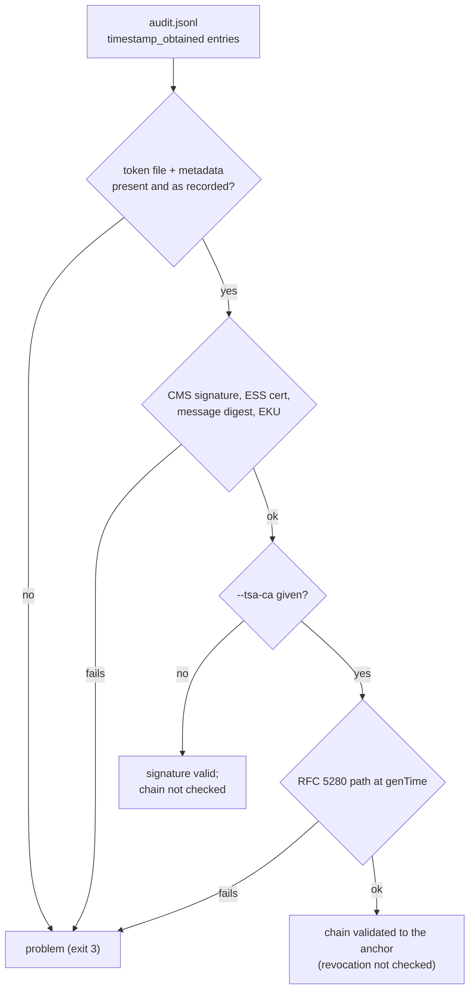

# ADR 0002 — Verification of RFC 3161 tokens and TSA certificate chains

- **Status:** accepted (2026-11-11)
- **Scope:** every Rakvor tool (shared `src/core/src/trust.rs`) and both forge profiles (Python: `core/trust.py`)

## Context

Each run's audit chain head is timestamped by an RFC 3161 TSA. Until the releases of 2026-11-10 the tools checked only that the token
file was unchanged and that its imprint was the logged head; the TSA's signature was not checked, so a forged token
with a matching imprint passed. A review of the first fix also found that deleting a token's metadata skipped its
check, that the RFC 3161 rules for the TSA certificate were missing, and that the path search did not backtrack.

## Decision

1. **Driven by the log, fail closed.** Every `timestamp_obtained` entry names a token whose `.tsr` (recorded SHA-256)
   and `.json` metadata must exist and agree; a token file that no entry or metadata names is a problem.
2. **The CMS signature is always checked:** one SignerInfo whose certificate is in the token; content-type
   `id-ct-TSTInfo`; message-digest over the TSTInfo; ESS signing-certificate (v1/v2) binding that certificate;
   RSA PKCS#1 v1.5 signature; the certificate's EKU critical and only `id-kp-timeStamping` (RFC 3161 §2.3).
3. **The chain only with `--tsa-ca`,** at genTime: an RFC 5280 subset (CA flag, keyCertSign, pathLenConstraint with
   self-issued rollover, directoryName name constraints, unknown critical extensions rejected), depth-first over
   every candidate issuer and anchor, at most 8 deep. Without it the output says "chain not checked".
4. **Revocation is never checked.** The docs give the CRL/OCSP procedure, including that `openssl verify -attime`
   also applies to the CRL's own validity dates.
5. **Exit codes:** unreadable bundle 1; signature or chain failure 3.
6. **One implementation, graded externally.** The code is byte-identical in every tool; `tests/fixtures/tsa-chains`
   (34 cases from `make_chains.py`, each with OpenSSL's verdict) grade it, and the Python profile passes the same
   cases. Four deliberate differences from OpenSSL are recorded in `expected.json`.

## Alternatives considered

- *Leave it to `openssl ts -verify` by hand:* rejected — an unchecked default is what produced the original gap.
- *Link OpenSSL for path validation in every tool:* rejected — FFI and a C build in every tool for one check.
- *A Python validator library (pyhanko-certvalidator) for the Python profile:* measured 28/34 on the fixtures; it
  misses anchor checks and a directoryName permitted-subtree case, so the Python profile ports these rules instead.

## Consequences

- A token that verifies proves who signed it; with `--tsa-ca` it proves the signer chains to roots the examiner
  chose. Neither proves the TSA certificate was not revoked at genTime.
- RSA signers only; an ECDSA TSA fails as "signature not checked" and is reported, not accepted.
- A rule change touches every tool repository, the forge template and possibly the fixtures in one change.
