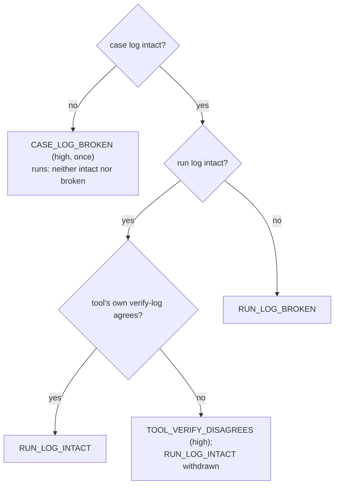

# ADR 0004 — Case verdicts and the cross-check

- **Status:** accepted (2026-11-11)
- **Scope:** rv-hub (`checks.rs`, `verify.rs`, `run.rs`, `proc.rs`); details in [theory.md](../theory.md)

## Context

`rv-hub verify` gives one verdict per item of a case: the case log, each run, each re-hashed evidence file. Two
questions needed a rule: what an edited case log means for runs that were not touched, and when the hub may run a
tool's own `verify-log` as a second opinion.

## Decision

1. **An edited case log** is one `CASE_LOG_BROKEN` finding. An untouched run then gets no code at all — neither
   intact nor broken — because the broken case log can no longer vouch for the run's length
   (`verify::CASE_LOG_CANNOT_VOUCH`). Every other problem of a run's log is `RUN_LOG_BROKEN`.
2. **Cross-check:** each run's own installed tool re-verifies its logs. A disagreement is `TOOL_VERIFY_DISAGREES`
   and withdraws `RUN_LOG_INTACT`. rv-pdfauth and rv-imgauth (`tools::VERIFY_LOG_WITHOUT_TRUNCATION`) lack the
   truncation check in their `verify-log`, so for them either the full or the chain-only verdict is accepted;
   every other tool is compared with the full verdict. The list shrinks as rv-hub#21 aligns the tools.
3. **What the hub runs:** an unknown `rv-*` executable only if it is Rakvor-signed or in a folder the examiner
   added; the executable is re-validated just before it runs (`TOOL_CHANGED_SINCE_DISCOVERY` otherwise, and it is
   not run). When the hub launches a tool on Windows, it opens the executable with `FILE_SHARE_READ` only (it
   cannot be replaced while checked) and re-hashes it before the start.
4. **Process control:** a deadline bounds the run and the reading of its output; on Unix the whole process group is
   killed; Ctrl-C does not reach the child.

## Consequences

- An edited case log is reported once, where it happened, instead of as a failure of every run.
- The cross-check is a second implementation, not a second opinion from the same code: a disagreement is high.
