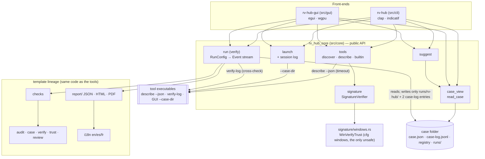
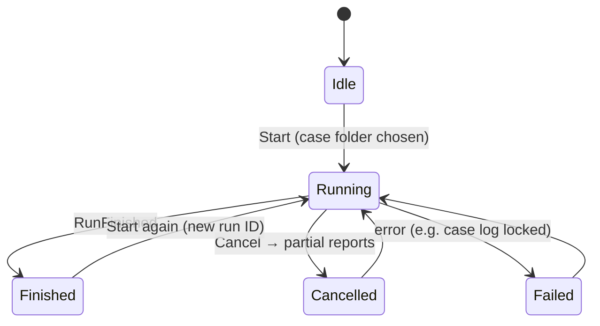

# Architecture

One engine, two front-ends. The engine (`src/core`, crate `rv_hub_core`) does all the work and never prints; the
CLI and the GUI turn user input into calls of its public API and render what it returns (for the main verb, the
`Event` stream). Both interfaces therefore produce identical logs and reports.

RV Hub is the main app of the four Rakvor tools (rv-hashinv, rv-pdfauth, rv-imgauth, rv-rsmf). Each tool stays a
separate signed program; the hub discovers them, checks their signatures, launches them on a case folder, shows a
read-only case dashboard with next-step suggestions, and verifies the whole case.



## Frozen public API (`rv_hub_core`)

The CLI and GUI stages code against these modules and types only.

| Module | Entry points | Types |
| --- | --- | --- |
| `tools` | `discover(&DiscoverOptions, &dyn SignatureVerifier) -> Vec<ToolInfo>`, `DiscoverOptions::from_env(user_folders)`, `describe(cli, timeout)`, `parse_describe(bytes)`, `builtin(tool)`, `catalog(&[ToolInfo]) -> Vec<Describe>`, `read_uninstall_registry()`, `sha256_of(path)` | `ToolInfo`, `Describe`, `Accepts`, `SignatureSpec`, `MagicPart`, `ToolRole`, `Source`, `DescribeSource`, `DescribeProblem`, `RegistryEntry`, `KnownAppId`, consts `KNOWN_TOOLS`, `APP_IDS`, `SCHEMA_DESCRIBE`, `LOG_AUDIT`, `LOG_REVIEW` |
| `signature` | `SignatureVerifier::verify(exe)`, `OsVerifier`, `StaticVerifier`, `classify(outcome, root, rakvor_root)`, `trust_outcome(hresult)`, `rakvor_root_sha256()`, `SignatureStatus::finding(tool, exe)` | `SignatureStatus { SignedRakvor, SignedOtherRoot{root_sha256}, Invalid{reason}, Unsigned, NotChecked{reason} }`, `TrustOutcome` |
| `launch` | `launch(&mut Session, &ToolInfo, case_dir, confirm_untrusted) -> Result<Launched, LaunchError>`, `launch_with(…, verifier, spawner)` | `Launched`, `LaunchError`, `Spawner`, `DetachedSpawner` |
| `session` | `Session::start(data_dir, actor, frontend, args)`, `Session::start_default(…)`, `Session::record(action, details)`, `data_dir()` | `Session` |
| `case_view` | `read_case(dir) -> CaseView` | `CaseView`, `EvidenceRow`, `RunRow`, `RunStatus`, `TimestampStatus`, `SeverityTotals` |
| `suggest` | `suggest(&CaseView, &[Describe]) -> Vec<Suggestion>`, `accepts(…)`, `looks_like_chat(…)` | `Suggestion`, `Action { Launch, Timestamp }` |
| `run` | `run(&RunConfig, &mut sink, &AtomicBool) -> Result<RunSummary, CaseError>`, `preflight(&RunConfig)` | `RunConfig`, `RunSummary`, `CrossCheckMode { Auto, Off }` |
| `findings` | `Finding::of(code)`, `severity_of(code)` | `Finding`, `Severity`, consts `CODES`, `LIMITATIONS` |
| `report` | (written by `run`) | `Item`, `ItemKind`, `Verdict`, `CrossCheck`, `Tally`, `CaseInfo` |

Template modules kept unchanged in behaviour: `audit`, `case` (`verify_case`, `rehash_registry` for `verify-case`),
`verify` (`verify-log`, now also checking `review.jsonl`), `trust`, `hash`, `env`, `events`, `i18n`, `time`.

## Discovery and signatures

```mermaid
sequenceDiagram
    autonumber
    participant F as Front-end
    participant T as tools::discover
    participant S as SignatureVerifier
    participant X as rv-tool executable
    F->>T: DiscoverOptions::from_env(user folders)
    T->>T: HKCU Uninstall\{AppId}_is1 → InstallLocation (Windows)
    T->>T: %LOCALAPPDATA%\Programs\Rakvor\*\rv-*.exe, PATH (known tools), user folders
    T->>S: verify(cli), verify(gui)
    S-->>T: SignedRakvor | SignedOtherRoot | Invalid | Unsigned | NotChecked
    alt Rakvor-signed (or not checkable: not Windows)
        T->>X: describe --json (timeout 10 s)
        X-->>T: rakvor.describe/1 (extra fields kept; other schema refused)
    else signed by someone else / unsigned / invalid
        T->>T: never executed
    end
    T-->>F: Vec<ToolInfo> (paths, SHA-256, sources, describe or builtin, signatures, warnings)
```

`signature/windows.rs` calls `WinVerifyTrust` (`WINTRUST_ACTION_GENERIC_VERIFY_V2`, `WTD_UI_NONE`, no revocation,
cache-only URL retrieval: no network in v1), reads the signer chain built by the provider
(`WTHelperProvDataFromStateData` → `WTHelperGetProvSignerFromChain` → the chain context of
`CertGetCertificateChain`), copies the root certificate and closes the state. `classify` (safe, tested everywhere)
compares the root's SHA-256 with the bundled `packaging/signing/rakvor-code-signing-root.cer`. A valid signature
whose root is not in the Windows store (`CERT_E_UNTRUSTEDROOT`) is still `SignedRakvor` when that root is the
Rakvor root: the root is pinned, not taken from the OS store.

Why `unsafe` there: the WinTrust API is C, with raw pointers in and out. The crate is `forbid(unsafe_code)` on
every other platform; on Windows `forbid` cannot be relaxed by a module, so the crate is `deny(unsafe_code)` and
only `signature/windows.rs` allows it. Every pointer stays inside one function, is checked for null, and only an
HRESULT and a copy of the certificate bytes leave it.

| Status | Inventory finding | Severity |
| --- | --- | --- |
| `SignedRakvor` | `TOOL_SIGNED_RAKVOR` | info |
| `SignedOtherRoot` | `TOOL_SIGNED_OTHER_ROOT` | high |
| `Invalid` | `TOOL_SIGNATURE_INVALID` | high |
| `Unsigned` | `TOOL_UNSIGNED` | medium |
| `NotChecked` | none (limitation `SIGNATURE_CHECK_WINDOWS_ONLY`) | — |

## Launch

`launch` refuses a missing GUI executable, re-hashes it (refused when it changed since discovery), re-checks its
signature and, unless it is `SignedRakvor`, requires `confirm_untrusted = true`, audited as
`tool_untrusted_confirmed` before the process starts. It then starts `<gui_exe> --case-dir CASE` detached and
records `tool_launched` (tool, version, exe SHA-256, signature, case, pid) in the hub's session log:
`%LOCALAPPDATA%\Rakvor\RV Hub\logs\<SESSION-ID>\audit.jsonl` (Linux: `$XDG_DATA_HOME/rakvor/rv-hub/logs/…`;
override `RV_HUB_DATA_DIR`). A folder without `case.json` can only be opened with the intake tool.

## Whole-case verification (`run`, main verb `verify`)

```mermaid
sequenceDiagram
    autonumber
    participant UI as CLI / GUI
    participant R as run.rs
    participant C as case folder
    participant H as runs/rv-hub/RUN-ID
    participant X as <tool> verify-log
    UI->>R: run(RunConfig{case_dir, rehash, crosscheck, …})
    R->>C: preflight (case.json, --case, evidence ids)
    R->>C: snapshot: case log bytes + entries, run folders, registry
    alt case log intact
        R->>C: case-log run_started (under lock, after re-verifying)
        R->>H: audit: run_started, case_linked
    else case log broken (never extended)
        R->>H: written to --out instead; audit: case_not_extended
    end
    loop each item: case log, each run, (--rehash) each evidence file
        R->>H: item_started, item_hashed
        R->>R: checks.rs (audit chain, links, timestamps, review, unknown logs, registry)
        opt run item and --crosscheck auto
            R->>X: verify-log <run>/logs (installed + Rakvor-signed, or --tool-exe)
            X-->>R: exit 0 / 3 → compared with the hub's verdict
            R->>H: crosscheck
        end
        R->>H: item_verified{findings, facts, verdict}
    end
    R->>H: hashes.csv, per-item technical/summary/custody, statistics, timestamp
    R->>H: run_finished
    R->>C: case-log run_finished (audit head + entries)
    R-->>UI: RunSummary (codes, tally) → exit 0 / 3
```

Run items carry two verdicts. **Full** is exactly `verify::verify_log` (chain, timestamp tokens, review log and
truncation against the timestamp and the case log): what rv-hashinv and rv-rsmf's `verify-log` answer.
**Chain** leaves out the truncation check against the case log: what rv-pdfauth and rv-imgauth's current
`verify-log` answer. The cross-check accepts the tool's verdict when it equals either; anything else is
`TOOL_VERIFY_DISAGREES` (high). The hub's own findings never depend on the tool.

| Code | Severity | Raised when |
| --- | --- | --- |
| `CASE_LOG_BROKEN` | high | case-log chain, case.json digest, registry digest, or run_finished without run_started |
| `RUN_LOG_BROKEN` | high | run audit chain, case_linked link, run_finished head, entries after run_finished, timestamp token, or the run folder missing |
| `REVIEW_LOG_BROKEN` | high | `review.jsonl` chain or anchor (to this run's run_finished) |
| `RUN_NOT_IN_CASE_LOG` | high | a run folder the case log never announced |
| `TOOL_VERIFY_DISAGREES` | high | the run's own tool's verify-log differs from both hub verdicts |
| `EVIDENCE_REHASH_MISMATCH` | high | `--rehash`: digest differs from the registry |
| `EVIDENCE_MISSING` | high | `--rehash`: not at its path nor in `--evidence-dir`, or unreadable |
| `UNKNOWN_LOG_FORMAT` | medium | another `*.jsonl` in a run's `logs/` |
| `TIMESTAMP_PENDING` | low | `timestamp_pending` without a later `timestamp_obtained` |
| `CROSSCHECK_UNAVAILABLE` | info | tool not installed / not Rakvor-signed / failed / run folder missing |
| `RUN_LOG_INTACT` | info | a run item with no high finding |

The hub never writes another tool's file: only `runs/rv-hub/<RUN-ID>/` and its two case-log entries
(`role: analysis`, `purpose: verification`). The case log is hashed as found, before those entries; since it is
append-only, the digests cover its first *N* bytes (recorded in the item's facts).

## Case dashboard and suggestions

`case_view::read_case` never fails: a missing, extra or malformed file is a line in `problems`. It reads
`case.json`, the registry, the case log (runs in order, then unannounced run folders), each run's audit log
(timestamp status) and `reports/statistics.json` (findings by severity, examined evidence ids).
`suggest::suggest` applies the table in `suggest.rs` using each tool's `accepts` (describe or built-in), reading
at most the first few kilobytes of an evidence file, read-only, and only when it exists.

## Run states (as the GUI sees them)



## Why Rust

See [ADR 0001](adr/0001-language.md).
