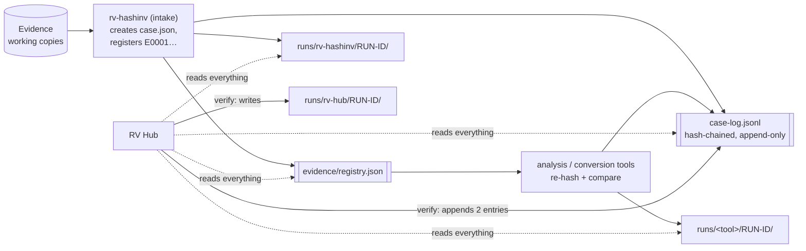
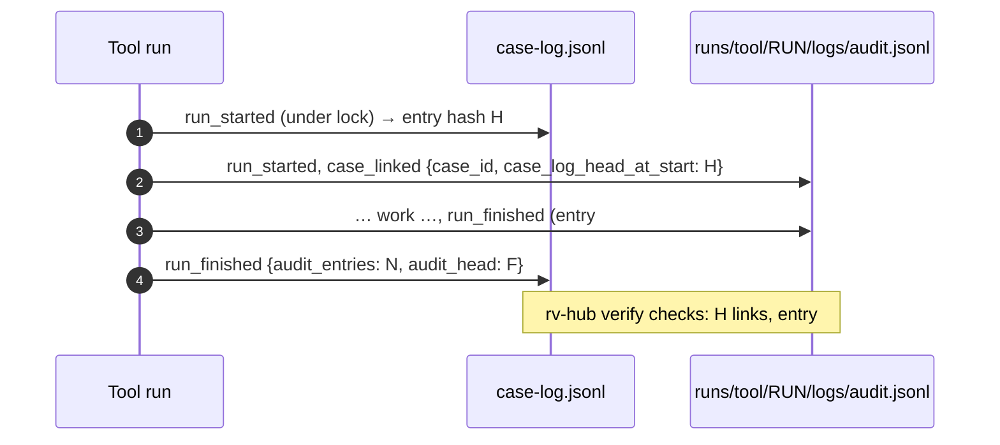

# Case folder

The Rakvor tools of one engagement share **one case folder** (`--case-dir`). The intake tool, rv-hashinv, creates
it and registers each evidence file once, as `E0001`, `E0002`, …; every analysis or conversion tool re-hashes the
items it examines against that registry and links its own run to the case log. RV Hub reads the whole folder, and
writes into it only when it verifies it.



## Layout (`rakvor.case/1`)

```text
<CASE>/
  case.json                    {"schema":"rakvor.case/1","case_id","jurisdiction":"co"|"fr","created_utc",
                                "created_by":{"tool","version","run_id","actor"}}      written once, by the intake tool
  case-log.jsonl               hash-chained case log (same rule as audit.jsonl), append-only
  case-log.lock                exists only while a tool appends (created exclusively, then removed)
  evidence/registry.json       {"schema":"rakvor.registry/1","items":[{"evidence_id","path","size","hashes",
                                "registered_by":{…},"registered_utc"}]}
  evidence/registry.csv        the same, as CSV
  runs/<tool>/<RUN-ID>/logs/     audit.jsonl, audit.log, hashes.csv, environment.json, timestamp-*.tsr|.json,
                                 review.jsonl (rv-imgauth, after the run)
  runs/<tool>/<RUN-ID>/reports/  statistics.*, items/<NNNNN>-<NAME>/{technical,summary,custody}.*
  runs/rv-hub/<RUN-ID>/          the hub's verification runs (same layout)
```

Schemas: [case.schema.json](../schemas/case.schema.json), [registry.schema.json](../schemas/registry.schema.json).
The sample in [`examples/sample/case/`](../examples/README.md) is a real case folder made by the tools.

## What RV Hub reads

| Command | Reads | Never |
| --- | --- | --- |
| `rv-hub case`, Case tab | `case.json`, `case-log.jsonl` (with a quick chain check), `evidence/registry.json`, each run's `logs/audit.jsonl` and `reports/statistics.json`; up to 4 KiB of each evidence file at its registered path, to recognise its type for the suggestions | writes anything, anywhere (not even the session log) |
| `rv-hub verify`, Verify tab | all of the above, every `logs/` folder (`audit.jsonl`, `review.jsonl`, `timestamp-*`, any other `*.jsonl`), and with `--rehash` every registered evidence file in full | opens a case file for writing, except the case log (append) |
| `rv-hub launch`, Launch buttons | whether `case.json` exists | reads or writes anything else in the case; the launched tool does its own work |

## What RV Hub writes, and the rules it keeps

Only `rv-hub verify` writes into a case, and only this:

1. **Two case-log entries**, appended under the case lock after re-verifying the case log, exactly like every tool:
   - `run_started`: `tool: rv-hub`, version, `run_dir: runs/rv-hub/<RUN-ID>`, frontend, **`role: analysis`**,
     **`purpose: verification`**, `evidence_ids` (the `--evidence` selection), `rehash`;
   - `run_finished`: status (`completed`, `cancelled` or `failed`), `audit_head`, `audit_entries`,
     `timestamp_status`, totals by severity, the verification tally and the finding codes.
2. **Its own run folder** `runs/rv-hub/<RUN-ID>/` (logs and reports).

The rules:

- **The hub never creates `case.json`.** A folder without it is not a case for the hub: `verify` and `case` refuse
  or report it, and `launch` opens such a folder only with the intake tool (the GUI's *Create case* starts
  rv-hashinv on it).
- **The hub never edits, moves or deletes another tool's file**, and never rewrites the case log or the registry.
  A broken run stays exactly as found, for the examiner to explain.
- **A broken case is never extended.** When the case log, `case.json` or the registry digest fails verification, the
  hub appends nothing; its run goes to `--out` (`<OUT>/logs/<RUN-ID>/`, `<OUT>/reports/<RUN-ID>/`) and its audit log
  records `case_not_extended`.
- **Locking.** The hub takes `case-log.lock` like every tool and waits up to 30 s. A lock older than 10 minutes is
  reported as stale and is never removed automatically: if no tool is working on the case, delete it by hand.
- The hub's own runs become items of the next verification; their cross-check is skipped (the hub's verdict is the
  tool's).

## Roles

| Role | Tools | In the case |
| --- | --- | --- |
| intake | rv-hashinv | creates `case.json` and the case log; registers evidence; the only role that may open a folder without `case.json` |
| analysis | rv-pdfauth, rv-imgauth, rv-certcheck, **and RV Hub** (`CASE_ROLE`) | re-hashes registered items and compares them with the registry; links its run |
| conversion | rv-rsmf | like analysis, and writes derived files (RSMF) in its own run folder |

The hub is recorded as an analysis tool because `rakvor.describe/1` and the case log have no "hub" role; its
`purpose: verification` tells its runs apart. It needs no evidence input.

## Links between the case log and each run



## `verify` and `verify-case`

The hub has both. `verify-case` is the check every Rakvor tool carries (same code in each); `verify` is the hub's
whole-case verification, which adds reports, the review-log check, the cross-check and the re-hash with
`--evidence-dir`. (`rv-hub verify-log <run>/logs` does check a run's review log.)

| | `rv-hub verify-case CASE` | `rv-hub verify --case-dir CASE` |
| --- | --- | --- |
| Case-log chain, `case.json`, registry digest | ✔ | ✔ (`CASE_LOG_BROKEN`) |
| Every announced run: chain, `case_linked`, end-of-run head, timestamps | ✔ | ✔ (`RUN_LOG_BROKEN`) |
| A run folder the case log never announced | **warning, exit 0** | **`RUN_NOT_IN_CASE_LOG`, high, exit 3** |
| Review logs | — (not checked by the hub's `verify-case`) | ✔ (`REVIEW_LOG_BROKEN`) |
| Unknown `*.jsonl` logs | — | `UNKNOWN_LOG_FORMAT` |
| Cross-check with each run's tool | — | ✔ (`--crosscheck auto`) |
| Re-hash | `--rehash`, registered paths only | `--rehash`, `--evidence`, `--evidence-dir` |
| Writes | nothing | its own run + 2 case-log entries |

Use `verify` for a case that will be handed over; `verify-case` is a quick, write-free check, and is what the other
tools run.

## How a reviewer verifies a case independently

1. Copy the case folder (never work on the original).
2. `rv-hub verify --case-dir <copy> --rehash --evidence-dir <evidence copies>` on Windows with the tools installed
   (for the cross-check and the signature check).
3. Re-check the hub's own record with the independent verifier, from the same working folder as step 2:
   `python3 tests/verify_chain.py <copy>/runs/rv-hub/<RUN-ID>/logs` → `chain: intact | register: matches`
   ([theory.md B8](theory.md#b8-the-hash-register-and-the-append-only-case-log-prefix-rule)).
4. Check each timestamp token's TSA signature with OpenSSL or rv-certcheck
   ([forensic-audit.md](forensic-audit.md#timestamps)).
