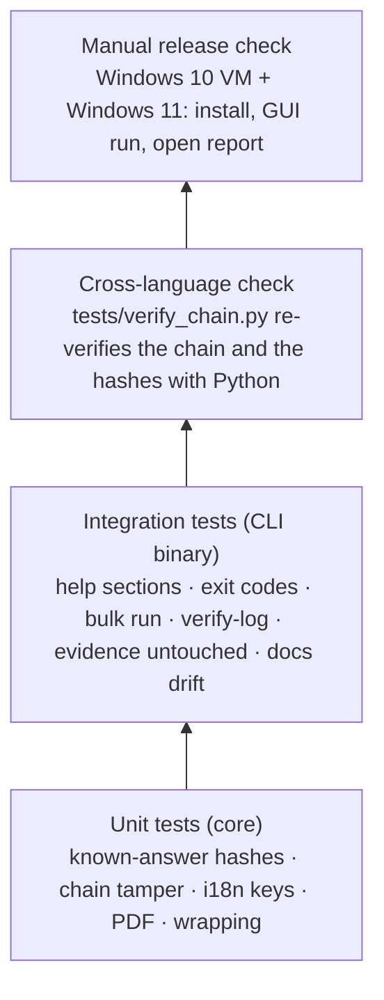
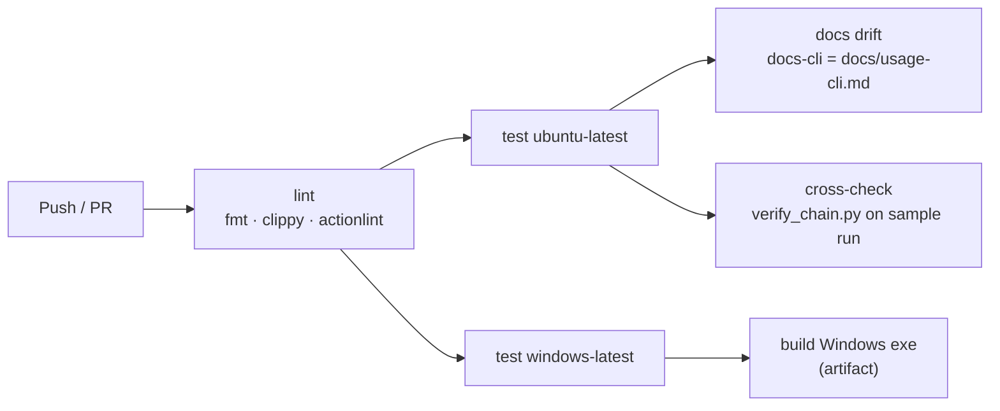
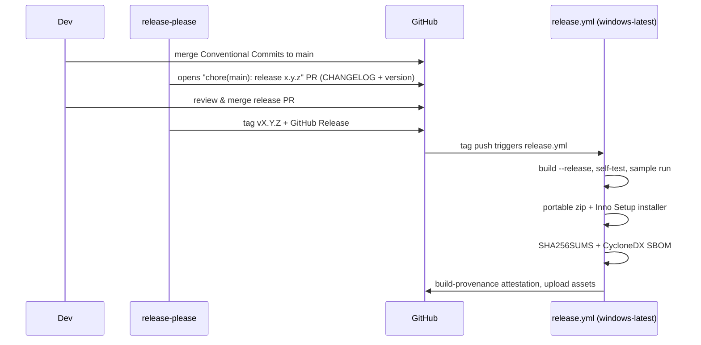

# Development, CI/CD and releases

## Build and test locally

```bash
cargo build --workspace                 # debug build of core, CLI and GUI
cargo test  --workspace                 # unit + integration tests (GUI tests are headless)
cargo clippy --workspace --all-targets -- -D warnings
cargo fmt --all -- --check
examples/sample/run.sh target/debug/rv-hub   # verify the sample case on a copy (after cargo build)
cargo run -p rv-hub-gui
cargo run -p rv-hub-cli -- docs-cli > docs/usage-cli.md     # regenerate the CLI reference
```

The GUI screenshots in `docs/images/` are rendered headless (no display, no GPU) by an example, with a faked
discovery of the released tool versions:

```bash
cargo run --release -p rv-hub-gui --example hub_screenshot -- docs/images/hub-tools.png tools en
cargo run --release -p rv-hub-gui --example hub_screenshot -- docs/images/hub-case.png case en
```

Linux needs no system packages to build. On Windows use the MSVC toolchain (`rustup default stable-msvc`);
binaries are linked with the static C runtime (`.cargo/config.toml`), so they run on a clean Windows 10/11.

## Test pyramid



## Continuous integration



`ci.yml` runs on every push and pull request with read-only permissions.

### Authenticode tests on Windows (real signed binaries)

The signature check (`src/core/src/signature/`) is proven on `windows-latest` with executables signed at run time;
no key or certificate is committed. `tests/signing/make-fixtures.ps1` makes throwaway roots named
`CN=RV Hub CI Test …` (trusted in `LocalMachine\Root`, since adding to `CurrentUser\Root` opens a confirmation
dialog), signs copies of `src/cli/examples/sig_fixture.rs` with `signtool /fd SHA256` and exports their paths as
`RV_SIGTEST_*`; `tests/signing/remove-test-roots.ps1` deletes the certificates at the end of the job (`if: always()`).

| Fixture | Pinned test root | Bundled Rakvor pin (production) |
| --- | --- | --- |
| signed by the test root's leaf | `SignedRakvor` | `SignedOtherRoot` (test root thumbprint) |
| unsigned | `Unsigned` | `Unsigned` |
| signed, then one byte changed | `Invalid` (0x80096010) | `Invalid` |
| signed by another trusted root's leaf | `SignedOtherRoot` (its thumbprint) | `SignedOtherRoot` |
| root not installed, embedded with `/ac` | `SignedRakvor` (0x800B0109 + pin) | `SignedOtherRoot` |

- `src/core/src/signature/fixture_tests.rs` (unit tests, `cfg(all(test, windows))`) runs the real verifier with the
  test-only `PinnedRootVerifier` and with `OsVerifier`, and checks the finding codes. `OsVerifier` has no way to
  change its pin; a test on every platform checks that it pins `packaging/signing/rakvor-code-signing-root.cer`.
- `src/cli/tests/signature_windows.rs` puts the fixtures in an `--add-folder` as a fake `rv-pdfauth` and checks
  `rv-hub tools --json` (statuses, findings, exit 3 for other-root and invalid) and `rv-hub launch` (exit 3 and the
  program not started, unless `--yes-untrusted`).
- Without the variables the tests are skipped; CI sets `RV_SIGTEST_REQUIRED=1` on Windows so they cannot be
  skipped there. To run them on a Windows machine, run `make-fixtures.ps1` in an elevated PowerShell, set the
  printed variables, run `cargo test --workspace`, then `remove-test-roots.ps1`.

## Releasing



| Artifact | Built by |
| --- | --- |
| `rv-hub-X.Y.Z-windows-x64.zip` | portable: both exes + README + LICENSE + NOTICE + examples |
| `rv-hub-X.Y.Z-windows-x64-setup.exe` | Inno Setup (`packaging/windows/installer.iss`), per-user install, adds CLI to PATH |
| `SHA256SUMS` | `sha256sum` over the assets |
| `sbom.cdx.json` | `cargo cyclonedx` |
| Attestation | `actions/attest-build-provenance` |

### Code signing

Unsigned executables trigger SmartScreen warnings. Options (decide per legal entity):

| Option | Notes |
| --- | --- |
| Azure Artifact Signing (Trusted Signing) | Low cost, integrates with GitHub Actions; available to organisations in eligible countries (the French entity qualifies, the Colombian one currently does not). |
| OV code-signing certificate (HSM/cloud key) | Works for either entity; slower reputation build-up. |

Signing is a step in `release.yml` guarded by `if: secrets…` so unsigned builds still work for testing.

### Release checklist (manual)

- [ ] `rv-hub self-test` on the released exe passes on Windows 10 **and** Windows 11
- [ ] GUI opens, runs the sample, *Open report* works
- [ ] `SHA256SUMS` matches the downloaded files; `gh attestation verify` passes
- [ ] CHANGELOG entry reviewed by a human
