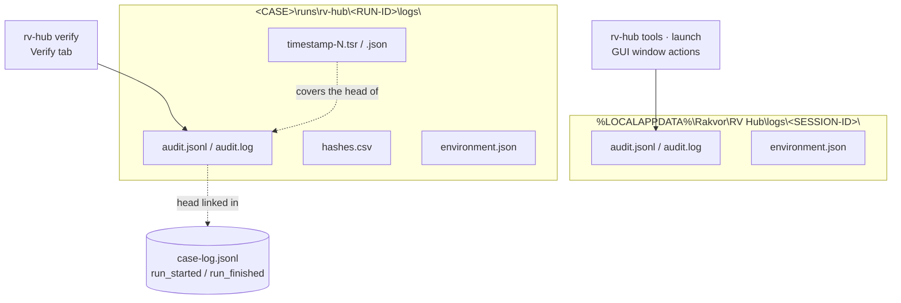
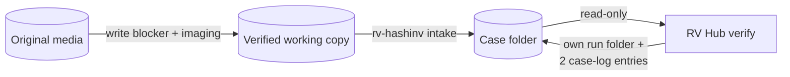

# Forensic audit trail

RV Hub keeps two kinds of records, both hash-chained with the same rule as every Rakvor tool's `audit.jsonl`:

- the **hub session log**: what the hub did outside a case run (inventories, launches, untrusted confirmations, window
  actions), one log per hub process, in the hub data folder;
- the **verification run log**: what `rv-hub verify` checked, in the case (`runs/rv-hub/<RUN-ID>/logs/`), with its hash
  register, environment record, optional RFC 3161 timestamp, and reports.



## The hash chain

```text
entry_hash      = SHA-256( canonical JSON of the entry without "entry_hash" )
canonical JSON  = keys sorted at every level, no whitespace, UTF-8
prev_entry_hash = entry_hash of the previous entry (64 zeros for #1); seq = 1, 2, 3, …
entry fields    = seq, ts_utc, run_id, actor, action, [item], details, prev_entry_hash, entry_hash
```

Editing, inserting, deleting or re-ordering a line breaks the chain from that line on; `rv-hub verify-log <folder>`
and the independent [`tests/verify_chain.py`](../tests/verify_chain.py) (standard-library Python) both detect it.
`audit.log` is a human-readable twin of the same actions and is not part of the chain.

### Truncation: what anchors the end of a log

A chain alone cannot show that its **last** lines were removed. `verify-log` anchors the end against records kept
outside the log:

| Log | Anchored by |
| --- | --- |
| a tool's run log in a case | `run_finished` in the case log (`audit_entries`, `audit_head`), and its RFC 3161 timestamp if any |
| the hub's verification run log in a case | the same: the hub appends `run_finished` with its own head |
| a verification run written to `--out` (broken case) | its timestamp only |
| the hub session log | nothing: **its truncation is not detectable** (`verify-log` says "truncation not detectable without a timestamp or case record"); archive session logs with the case |

## Hub session log

`<hub data>\logs\<SESSION-ID>\` with `audit.jsonl`, `audit.log` and `environment.json` (hub version, OS, host, user,
front-end). `<hub data>` is `%LOCALAPPDATA%\Rakvor\RV Hub` on Windows, `$XDG_DATA_HOME/rakvor/rv-hub` or
`~/.local/share/rakvor/rv-hub` on Linux, or `RV_HUB_DATA_DIR`. Case folders are never written here.

| Action | Written by | Key details |
| --- | --- | --- |
| `session_started`, `environment_recorded` | every session | hub version, front-end; digest of `environment.json` |
| `tools_listed` | `rv-hub tools` | added folders; per tool: version, folder, CLI and GUI SHA-256 and signature, `describe_source`; exit code |
| `tool_untrusted_confirmed` | launch of a tool that is not `SignedRakvor`, after confirmation, **before** it starts | tool, version, exe, exe SHA-256, signature, case, actor |
| `tool_launched` | every launch | tool, version, exe, **exe SHA-256**, signature, case folder (or null), arguments, **pid**, `confirmed_untrusted` |
| `tool_launch_failed` | the process could not start | the same, with the error |
| `tool_launch_refused` | CLI: refused (not Rakvor-signed without `--yes-untrusted`, or executable changed) | tool, version, exe, case, reason |
| `ui_*` (GUI) | every window action | `at_utc` and the action's details: tab, language, tools refreshed / listed, folder added / removed, launch clicked / confirmed / cancelled / failed, case opened / refreshed / closed, create case, verify started, report / run folder opened, cancel ([usage-gui.md](usage-gui.md#what-the-app-records)) |

`rv-hub case` and `rv-hub describe` write no session log; `rv-hub verify` writes its own run log instead.

What the session log proves: which executable (by SHA-256) was started, on which case, when, by whom, and whether an
untrusted build was knowingly used. It does not prove what the started tool then did; that is in the tool's own run
log in the case.

## Verification run log

`<CASE>\runs\rv-hub\<RUN-ID>\logs\audit.jsonl` (or `<OUT>\logs\<RUN-ID>\` for a broken case), in this order:

| Action | When | Key details |
| --- | --- | --- |
| `run_started` | first | version, front-end, verb `verify`, algorithms, languages, case id and folder, `rehash`, evidence ids and folders, `crosscheck`, tool overrides, jurisdiction, TSA, signing certificate path, `out_dir` |
| `case_linked` / `case_not_extended` | | case id, `case_log_seq_at_start`, `case_log_head_at_start`, registry SHA-256 and items / the reason the case is not extended |
| `ui_*` | GUI only | the Verify-tab settings changed before the start (the run's audit preamble) |
| `environment_recorded` | | digests of `environment.json` |
| `signing_certificate_loaded` | with `--sign-cert` | subject, certificate SHA-256 (never the password) |
| `tools_inventoried` | `--crosscheck auto` | each discovered tool: version, CLI path, SHA-256, signature, `describe_source`; overrides |
| `evidence_superseded` | `--rehash` | an item replaced by a later registration of the same path |
| `inputs_resolved` | | number of items, bytes, runs, evidence items |
| `item_started`, `item_hashed` | each item | index, kind, path, size; digests and bytes read |
| `crosscheck` | each run item, `--crosscheck auto` | tool, exe, exe SHA-256, arguments, exit code, first 20 lines of output, outcome, reason, hub full and chain-only verdicts, `override` |
| `item_verified` | each item | findings, verdict, facts, status |
| `item_cancelled`, `run_cancelled` | on cancel | processed count |
| `hash_register_written` | | digests of `hashes.csv` |
| `item_reports_written` | each item | digests of every report file |
| `timestamp_obtained` / `timestamp_pending` | with a TSA | token file and digest, `genTime`, covered entry / reason |
| `statistics_report_written` | | digests of the statistics files |
| `run_finished` (or `run_failed`) | last | totals, severities, elapsed time, cancelled, finding codes |

`hashes.csv` is the hash register: every file the hub read (the case log as found, each run's `audit.jsonl`, each
re-hashed evidence file). The case-log row covers its **first N bytes**, because the case log is append-only and
grows after the hub read it ([theory.md B8](theory.md#b8-the-hash-register-and-the-append-only-case-log-prefix-rule)).

## Timestamps

When a TSA is set (default `http://timestamp.digicert.com`; `--no-timestamp` or `RV_NO_TIMESTAMP=1` to disable),
the verification run's chain head is sent to it at the end of the run, and the reply is stored as
`timestamp-<SEQ>.tsr` (DER) with `timestamp-<SEQ>.json` (TSA, `genTime`, `covers_seq`, head, token SHA-256). Offline,
the run records `timestamp_pending`; `rv-hub timestamp <log folder>` adds the token later (it re-verifies the chain
first and appends `timestamp_obtained`).

When verifying a case, the hub checks every token the run's audit log records (`timestamp_obtained`; a recorded
token whose `.tsr` or `.json` is missing is a problem, never skipped) and any token file next to the log that no
entry records: the covered entry still exists, the token file is unchanged, the token's message imprint equals that
entry's hash, and the TSA's CMS signature verifies (ESS signing-certificate, message digest, RSA signature, critical
`timeStamping`-only key usage). The **TSA certificate chain** is checked only with `--tsa-ca <CA bundle>`
(`verify-log` and `verify`); without it the output says "chain not checked". **Revocation is never checked.**

An **independent signature and chain check** with OpenSSL (it does not check revocation either: these commands
supply no CRL and OpenSSL does not query OCSP, so "Verification: OK" says nothing about revocation):

```bash
# the covered entry's hash, from timestamp-<SEQ>.json ("head"), as hex
openssl ts -reply -in timestamp-47.tsr -text                       # shows the TSA, policy, genTime, imprint
openssl ts -verify -digest <head-hex> -in timestamp-47.tsr \
        -CAfile tsa-root.pem -untrusted tsa-chain.pem              # "Verification: OK": signature + chain, not revocation
```

or analyse the `.tsr` with rv-certcheck (CMS signature, ESS signing-certificate, TSA chain at `genTime`).
**Revocation must be established separately**, from CRL/OCSP evidence that covers `genTime` (a CRL published after
`genTime` by the TSA's CA, or an OCSP response archived at stamping time): for example `openssl verify -crl_check
-CRLfile tsa-ca.crl -CAfile tsa-root.pem -untrusted tsa-chain.pem -attime <genTime-epoch> tsa.pem`, or
`rv-certcheck analyze` with `--crl` / `--ocsp`. Keep that evidence with the case. A token
from a non-qualified TSA proves the log existed at that time; it carries no eIDAS presumption and no Colombian
statutory status ([admissibility.md](admissibility.md#53-eidas-regulation-eu-9102014-as-amended-by-eu-20241183)).

> **CRL dates and `-attime`.** OpenSSL applies `-attime` to the CRL as well, so `openssl verify -crl_check -attime <genTime-epoch>` only works with a CRL whose `thisUpdate`–`nextUpdate` interval contains genTime; a CRL issued after genTime fails with "CRL is not yet valid". To use a later CRL as evidence, check its signature (`openssl crl -in tsa-ca.crl -CAfile <TSA root.pem> -noout -verify`), then look up the TSA certificate's serial in it (`openssl crl -in tsa-ca.crl -noout -text`): absent, or listed with a revocation date after genTime, means not revoked at genTime. A CA may drop expired certificates from its CRLs, so for a TSA certificate that has since expired an absent serial is not conclusive: use a CRL from before its expiry, or an OCSP response archived at stamping time.

## Signed PDF reports

With `--sign-cert examiner.p12` (password from `--sign-pass-env`, default `RV_SIGN_PASSWORD`, or asked for), every
PDF of the verification is signed with a CMS detached signature; the certificate's subject and SHA-256 are logged
(`signing_certificate_loaded`) and printed in every report. The password is never logged.

## Chain-of-custody form per item

Each verified item gets a custody form for the case's jurisdiction (`co`: Colombian *registro de cadena de
custodia* style, Spanish; `fr`: French *fiche de scellé / suivi*, French) plus an English copy, pre-filled from the
run (case, item, size, digests, UTC times, tool, examiner, audit entries). For the hub the item is the case log, a
run's audit log or an evidence file, as verified; the form records that verification step. It is an internal
working record, not the official Fiscalía or court form.

## Evidence handling



- Every file in the case is opened read-only; evidence files are streamed in chunks.
- The hub never edits, moves or deletes another tool's file. A broken case log is never extended.
- The hub is not an imaging tool or a write blocker; the evidence it re-hashes should be the working copies.

## Mapping to ISO/IEC 27037:2012

| 27037 principle / activity | How RV Hub supports it |
| --- | --- |
| Auditability (5.3.2) | Every launch and every check is a chained entry with actor and UTC time; `verify-log` and `tests/verify_chain.py` check the chains |
| Repeatability (5.3.3) | `environment.json` records the hub's exact version and dependencies; the same case gives the same findings and digests |
| Reproducibility (5.3.4) | Independent verifier in another language; the cross-check asks a second implementation (each run's own tool) |
| Justifiability (5.3.5) | Every finding states what it shows and what it does **not** prove; four limitations in every report |
| Preservation (7.1.4) | Read-only access; re-hash against the registry; digests of every report written |
| Documentation / chain of custody | The session log (which tool build, on which case) and the verification run (what was checked, with what result) |

Colombian practice (Ley 906 de 2004, Fiscalía custody manual) and French practice (Code de procédure pénale, arts.
156 ff.) both expect the method to be documented and integrity preserved; the session log, the verification run
folder and the tools' own run folders together are that documentation.
