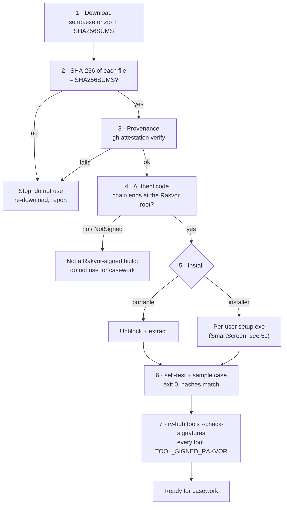
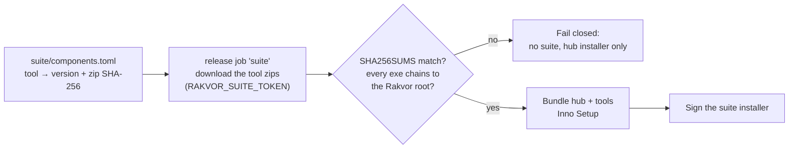

# Installation and verification (Windows 10/11)

RV Hub runs **locally** on the examiner's Windows 10 or 11 PC (x64). It needs no administrator rights and no
runtime (static C runtime). Its only network access is the optional RFC 3161 timestamp of a verification run. This
page covers: getting a release, **proving it is the genuine build**, the SmartScreen warning, checking signatures
against the Rakvor root, installing (portable zip or per-user installer), the first-run self-test, where the hub keeps
its session log and settings, the tools themselves, the planned Rakvor Suite installer, building from source and
uninstalling.

Why verification matters: a court may ask how you know the program you ran is the one whose source an expert
reviewed. Steps 2–4 and 6 produce that answer; keep their output with the case file
([admissibility.md](admissibility.md#examiner-checklist-before-relying-on-a-verification), step 1).



## Requirements

| Item | Requirement |
| --- | --- |
| Operating system | Windows 10 or 11, x64 (`MinVersion=10.0`, `ArchitecturesAllowed=x64compatible`). Linux: build from source; the signature check is then *not checked* ([theory.md B2](theory.md#b2-the-signature-check)). |
| Rights | Standard user. The installer is per-user (`PrivilegesRequired=lowest`). |
| Disk | The two executables and the docs (a few MB). A verification run writes about 11 report files per item for one language. |
| Graphics | None required: the GUI also runs on VMs without a GPU driver (software rendering). |
| Network | None, except the optional timestamp request of `verify` (see [step 8](#8-offline-and-air-gapped-use)). |
| The Rakvor tools | Installed separately (their own installers or portable zips), or later by the Rakvor Suite installer ([step 10](#10-the-planned-rakvor-suite-installer)). The hub works without them; it then has nothing to launch and the cross-check is not available. |

## 1. Download

From the GitHub Releases page of `Panacota96/rv-hub`:

| Asset | What it is |
| --- | --- |
| `rv-hub-X.Y.Z-windows-x64-setup.exe` | Inno Setup installer, per-user |
| `rv-hub-X.Y.Z-windows-x64.zip` | Portable: `rv-hub.exe`, `rv-hub-gui.exe`, README, LICENSE, NOTICE, CHANGELOG, `docs/`, `examples/` |
| `SHA256SUMS` | SHA-256 of the zip, the installer and the SBOM (`sha256sum` format) |
| `sbom.cdx.json` | CycloneDX software bill of materials |

Put them in one folder, e.g. `C:\Rakvor\downloads\rv-hub-0.1.0\`.

## 2. Verify the download

```powershell
cd C:\Rakvor\downloads\rv-hub-0.1.0
Get-Content .\SHA256SUMS | ForEach-Object {
    $hash, $name = $_ -split '\s+', 2
    $name = $name.TrimStart('*').Replace('./', '')
    if (Test-Path $name) {
        $actual = (Get-FileHash -Algorithm SHA256 $name).Hash.ToLower()
        if ($actual -eq $hash) { "OK    $name" } else { "FAIL  $name  (got $actual)" }
    } else { "skip  $name (not downloaded)" }
}
```

Every downloaded file must print `OK`. `SHA256SUMS` comes from the same workflow and is not attested itself; step 3
is the stronger check.

## 3. Verify build provenance

Each zip and installer carries a GitHub build-provenance attestation: a signed statement that this exact file was
built by the repository's release workflow from a given commit.

```powershell
gh attestation verify .\rv-hub-0.1.0-windows-x64.zip --repo Panacota96/rv-hub
gh attestation verify .\rv-hub-0.1.0-windows-x64-setup.exe --repo Panacota96/rv-hub
```

Record the workflow and the commit it names. For an air-gapped lab, verify on a connected machine and carry the
verified files on write-protected media.

## 4. Check the signatures against the Rakvor root

Rakvor signs its releases with an **internal code-signing certificate** whose root CA is
`packaging/signing/rakvor-code-signing-root.cer` (in the source tree and installed on Rakvor machines). The release
workflow signs `rv-hub.exe`, `rv-hub-gui.exe` and the installer only when the signing secret is configured
(`SIGN_PFX_BASE64`; SHA-256 with an RFC 3161 timestamp), and then proves on the runner that the signatures chain to
that root (`signtool verify /pa`).

The root's SHA-256 thumbprint, the value the hub compiles in and compares with:

```text
dc9ba1a2fcd4f0633c5214b7cceb25bed8f3f7d9ebaf111590250cbcaa83df60
```

Check an executable (the installer before running it; `rv-hub.exe` and `rv-hub-gui.exe` after extracting or
installing) with PowerShell. This builds the chain the way Windows does and prints the SHA-256 of its root:

```powershell
function Test-RakvorSignature($path) {
    $sig = Get-AuthenticodeSignature $path
    if ($sig.Status -eq 'NotSigned') { return "$path : NOT SIGNED" }
    $chain = New-Object Security.Cryptography.X509Certificates.X509Chain
    $chain.ChainPolicy.RevocationMode = 'NoCheck'
    [void]$chain.Build($sig.SignerCertificate)
    $root = $chain.ChainElements[$chain.ChainElements.Count - 1].Certificate
    $sha = [BitConverter]::ToString(
        [Security.Cryptography.SHA256]::Create().ComputeHash($root.RawData)).Replace('-', '').ToLower()
    "$path : $($sig.Status) ; root $($root.Subject) ; SHA-256 $sha"
}
Test-RakvorSignature .\rv-hub-0.1.0-windows-x64-setup.exe
```

| Result | Meaning |
| --- | --- |
| `Valid` and root SHA-256 `dc9ba1a2…df60` | Rakvor-signed and intact |
| `UnknownError` / "not trusted" and root SHA-256 `dc9ba1a2…df60` | Rakvor-signed and intact, but the Rakvor root is not installed in this Windows: install it (below) or accept that SmartScreen and Windows will call it untrusted. The hub itself accepts it: it pins the root, it does not use the Windows store |
| Root SHA-256 different | **Not** a Rakvor build: do not use it |
| `HashMismatch` | Modified after signing: do not use it |
| `NotSigned` | Built without the signing secret: not for casework |

The chain can only end at the Rakvor root if Windows can find that root: either installed in the user's or the
machine's *Trusted Root Certification Authorities*, or included in the signature. On a machine without it, the chain
may stop at the intermediate certificate and the check above (and the hub) will not see the Rakvor root. To install
it for the current user only:

```powershell
Import-Certificate -FilePath .\rakvor-code-signing-root.cer -CertStoreLocation Cert:\CurrentUser\Root
```

Windows asks for confirmation and shows the certificate's SHA-1 thumbprint; compare the certificate's SHA-256
(`(Get-FileHash .\rakvor-code-signing-root.cer).Hash`, which is the SHA-256 of its DER bytes) with the value above
before accepting.

After installing, the hub does the same check for every tool it finds: `rv-hub tools --check-signatures` (step 7).

## 5. Install

### 5a. Portable zip

```powershell
Unblock-File .\rv-hub-0.1.0-windows-x64.zip
Expand-Archive .\rv-hub-0.1.0-windows-x64.zip -DestinationPath C:\Rakvor\tools\rv-hub-0.1.0
C:\Rakvor\tools\rv-hub-0.1.0\rv-hub.exe --version
```

Keep one folder per version, so a past verification can be re-run with the exact version recorded in its
`environment.json`.

### 5b. Installer (per-user, no administrator)

Run `rv-hub-X.Y.Z-windows-x64-setup.exe` (English, Spanish or French wizard). It installs to
`%LOCALAPPDATA%\Programs\Rakvor\RV Hub\`, creates a **Rakvor** Start-menu group (*RV Hub* and *RV Hub
documentation*) and offers two tasks: **Add the rv-hub command to PATH** (user PATH, checked on first install) and a
desktop icon. Its AppId is `{703D49A5-7B83-4C62-A97F-ED13C341CC23}`, distinct from every tool's. Open a new terminal
afterwards for PATH to apply.

Unattended:

```powershell
.\rv-hub-0.1.0-windows-x64-setup.exe /VERYSILENT /SUPPRESSMSGBOXES /NORESTART /TASKS="addtopath"
```

The installer copies the executables, README, LICENSE, NOTICE, CHANGELOG, `docs\` and the sample evidence; the
sample case folder and scripts are in the zip and the source tree.

### 5c. SmartScreen

Windows SmartScreen judges a download by the **reputation** of its publisher certificate. Rakvor's code-signing
certificate is private, so it has no public reputation, and SmartScreen shows *"Windows protected your PC"* for the
installer and the first start of the executables, even when they are correctly signed.

Only after steps 2–4 have passed: *More info → Run anyway*. The warning says nothing about the file's integrity; the
SHA256SUMS, the provenance and the Rakvor root do. Installing the Rakvor root (step 4) makes Windows show the
publisher, but does not by itself give SmartScreen reputation.

## 6. First-run self-test and sample

```powershell
rv-hub --version
rv-hub self-test
```

`self-test` prints `PASS` for md5, sha1, sha256, sha512, sha3-256 and blake3 (known answers for `"abc"`), exit code 0.

Then verify the sample case (a real case folder made by the tools, see [examples/](../examples/README.md)) from the
portable zip:

```powershell
$env:RV_NO_TIMESTAMP = "1"           # optional: no TSA request
.\examples\sample\run.ps1 -Bin .\rv-hub.exe
```

Expected: the self-test, then `DONE`, **10 items** (the case log, four runs, five evidence files), **findings high 0,
medium 0, low 0, info 4**, codes `RUN_LOG_INTACT`, `case: SAMPLE-1 … runs 4 (intact 4 …) | evidence re-hashed 5
(match 5 …)`, then `OK … chain intact` from `verify-log`, and
`hashes.csv matches expected_hashes.csv (5 files: size, SHA-256, MD5)`; exit code 0. The script works on a copy in
`examples\sample\out\`; the committed case is never changed. It runs with `--crosscheck off`, so the cross-check is
not part of this check.

Keep the console output as the record of this verification.

## 7. The Rakvor tools

Install each tool from its own release, checked the same way (steps 2–4). Each tool's installer puts it in
`%LOCALAPPDATA%\Programs\Rakvor\<Tool title>\`, where the hub finds it; a portable copy is found once its folder is
added (*Tools → Add a portable folder*, or `--add-folder`). Then:

```powershell
rv-hub tools --check-signatures
```

Every executable you will use should show `TOOL_SIGNED_RAKVOR`. `tools` exits 3 when any executable is signed under
another root or has an invalid signature. Save the inventory with the case: `rv-hub tools --json > tools.json`.

**rv-imgauth 0.2.0 and rv-pdfauth share an installer AppId** (`{B2454915-…}`), inherited by mistake. Installing one
can upgrade or uninstall the other. If you installed RV ImgAuth 0.2.0 after RV PDFAuth, **reinstall RV PDFAuth**;
the hub shows this warning on a tool found under that key. rv-imgauth uses its own AppId from 0.2.1.

## 8. Offline and air-gapped use

The hub has no telemetry, update check or licence check, and does not download tools. Its only outbound access is the
RFC 3161 request of `rv-hub verify` (one HTTP POST of a 32-byte hash, default `http://timestamp.digicert.com`).

| To disable the timestamp | How |
| --- | --- |
| One verification | `--no-timestamp` |
| Every CLI run in the session or on the PC | `$env:RV_NO_TIMESTAMP = "1"` (or a user environment variable) |
| GUI | untick *Trusted timestamp* in the Verify tab |

With the timestamp enabled but no network, the run completes with `timestamp_pending`; later
`rv-hub timestamp <log folder>` adds it. `--tsa-url` selects an internal or qualified TSA. Launching tools,
`describe` and `verify-log` are local process starts, not network access.

## 9. Where things live

| What | Location |
| --- | --- |
| Program (installer) | `%LOCALAPPDATA%\Programs\Rakvor\RV Hub\` (`rv-hub.exe`, `rv-hub-gui.exe`, `docs\`, `examples\sample\evidence\`, `unins000.exe`) |
| Program (portable) | the folder you extracted |
| **Hub data folder** | `%LOCALAPPDATA%\Rakvor\RV Hub\` (override: `RV_HUB_DATA_DIR`; Linux: `$XDG_DATA_HOME/rakvor/rv-hub` or `~/.local/share/rakvor/rv-hub`) |
| **Session log** | `<hub data>\logs\<SESSION-ID>\audit.jsonl`, `audit.log`, `environment.json`: one hash-chained log per hub process (inventories, launches, confirmations, window actions). Check with `rv-hub verify-log <that folder>` |
| **Settings** (GUI) | `<hub data>\settings.json` (`rakvor.hub-settings/1`: added portable folders, recent cases, interface language). If the data folder cannot be written, `%TEMP%\rakvor-rv-hub\` is used and the window says so; if neither can, settings last for the session only |
| Verification runs | `<CASE>\runs\rv-hub\<RUN-ID>\`; when the case log is broken, `--out` (default `.\rakvor-out`, relative to the current folder): `logs\<RUN-ID>\`, `reports\<RUN-ID>\` |
| Signing certificate | wherever you keep it; only its path, subject and SHA-256 fingerprint are logged, never the password |

The CLI writes a session log for `tools` and `launch`; `case`, `describe` and `verify` do not (a verification
writes its own run log in the case). The GUI starts one session log per window; when it cannot create one, the
window says so and every launch is refused, because a launch must be recorded.

## 10. The planned Rakvor Suite installer

Not available yet: tracked as [rv-hub#2](https://github.com/Panacota96/rv-hub/issues/2). The plan is one
`rakvor-suite-<version>-setup.exe` that installs RV Hub and the tools:



- `suite/components.toml` pins each tool's version and its release zip SHA-256;
- the release job downloads those zips, checks `SHA256SUMS` and each executable's signature against the Rakvor root,
  bundles, and signs the suite installer, failing closed on any mismatch;
- it **needs the repository secret `RAKVOR_SUITE_TOKEN`**: a fine-grained token with read access to the tool
  repositories. Without it the job is skipped and only the hub installer ships.

Neither `suite/` nor the `suite` job exists in this version.

## 11. Build from source for auditors

| Item | Version |
| --- | --- |
| Rust | pinned by [rust-toolchain.toml](../rust-toolchain.toml): **1.97.0** (rustup selects it inside the source tree); minimum `rust-version = "1.85"` |
| Windows linker | Visual Studio 2022 Build Tools (MSVC + Windows SDK); static CRT set in `.cargo/config.toml` |
| Optional | Python 3 (standard library) for `tests/verify_chain.py`; `pyhanko` for the PDF-signature tests |

```powershell
git clone https://github.com/Panacota96/rv-hub.git
cd rv-hub
git checkout v0.1.0                              # the tag under review
cargo build --release --locked -p rv-hub-cli -p rv-hub-gui
.\target\release\rv-hub.exe self-test
.\examples\sample\run.ps1 -Bin .\target\release\rv-hub.exe
cargo test --workspace --locked
```

```bash
# Linux (CLI; the signature check reports "not checked")
cargo build --release --locked -p rv-hub-cli
examples/sample/run.sh target/release/rv-hub
```

`--locked` refuses to build if `Cargo.lock` would change, so the dependency set equals `environment.json` →
`dependencies` and the SBOM. The executables are not guaranteed bit-identical to the release (link-time data); the
provenance attestation binds the released binary to the commit, and the sample run shows functional equivalence.

## 12. Uninstall

- **Installer:** *Settings → Apps → Installed apps → RV Hub → Uninstall*, or `unins000.exe` in the program folder.
  The user PATH entry is not removed in this version:

  ```powershell
  $dir = "$env:LOCALAPPDATA\Programs\Rakvor\RV Hub"
  $p = [Environment]::GetEnvironmentVariable("Path", "User").Split(";") | Where-Object { $_ -and $_ -ne $dir }
  [Environment]::SetEnvironmentVariable("Path", ($p -join ";"), "User")
  ```

- **Portable:** delete the folder.
- **Kept on purpose:** the hub data folder (`%LOCALAPPDATA%\Rakvor\RV Hub\`: session logs and settings) and every
  case folder. The session logs are part of the record of which tool builds were launched on which case; archive
  them with the cases before deleting them.

## 13. Installation troubleshooting

| Symptom | Cause and fix |
| --- | --- |
| SmartScreen "Windows protected your PC" | Private certificate, no reputation ([5c](#5c-smartscreen)). After steps 2–4: *More info → Run anyway*. |
| Every tool shows *Invalid signature* or *Signed by another root* although it is a Rakvor release | The chain could not reach the Rakvor root on this machine (root not installed, not in the signature). Install the root (step 4) and refresh. A different root thumbprint means it is not a Rakvor build. |
| Every tool shows *Signature not checked* | Not Windows. Signatures are checked on Windows only. |
| A tool is missing from the list | Not in the registry, `%LOCALAPPDATA%\Programs\Rakvor\*\`, `PATH` (known names only) or an added folder: add its folder. |
| A tool shows version unknown, "+builtin" | That version has no `describe`, or it was not run (not Rakvor-signed). The built-in table is used. |
| RV PDFAuth disappeared after installing RV ImgAuth | Shared AppId of rv-imgauth 0.2.0: reinstall RV PDFAuth ([step 7](#7-the-rakvor-tools)). |
| The window says no session log could be created, and launches are refused | No session log could be created (data folder and temp folder not writable). Fix the permissions or set `RV_HUB_DATA_DIR`. |
| `self-test` prints `FAIL` | Do not use this build; re-download and repeat steps 2–4. |
