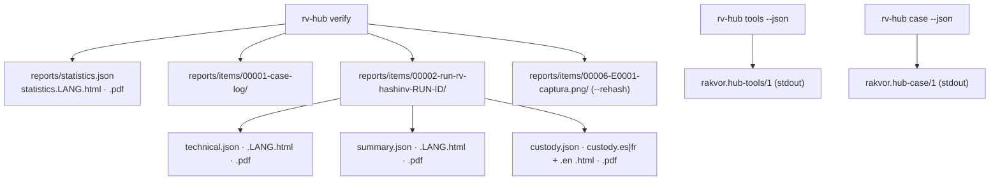
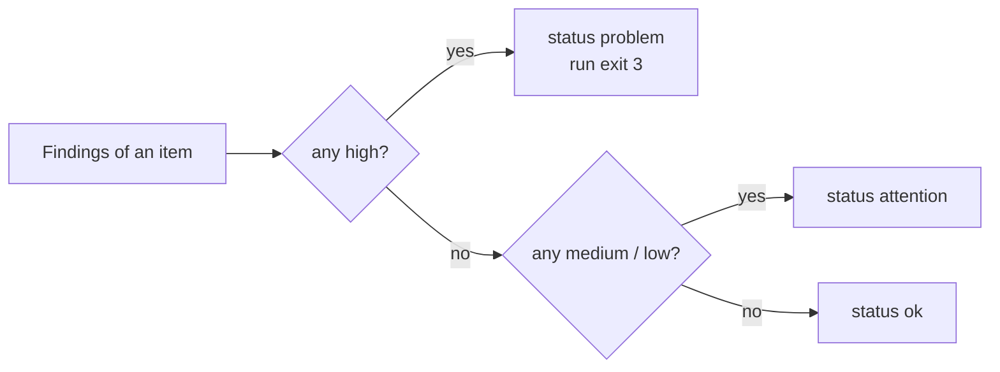

# Reports

RV Hub writes reports in two places:

- **`rv-hub verify`** writes a full report set, like every Rakvor tool, into its own run folder
  `<CASE>/runs/rv-hub/<RUN-ID>/reports/` (or `--out` when the case log is broken): one **statistics report** for the
  verification, and for **each item** (the case log, each run, each re-hashed evidence file) a **technical review**,
  a **customer summary** and a **chain-of-custody form**. Each is JSON (language-neutral) plus HTML and PDF in each
  selected language.
- **`rv-hub tools`** and **`rv-hub case`** print an inventory and a case summary (text, or one JSON document with
  `--json`). They write no report files; `tools` records what it found in the hub's session log.

## Contents

- [What each verification report contains](#what-each-verification-report-contains)
- [Item status, verdict and severity](#item-status-verdict-and-severity)
- [Finding codes](#finding-codes)
- [Limitations printed in every report](#limitations-printed-in-every-report)
- [Inventory and case summary documents](#inventory-and-case-summary-documents)
- [JSON schemas](#json-schemas)
- [PDF notes](#pdf-notes)

## What each verification report contains

| Section | Statistics | Technical review (per item) | Customer summary (per item) |
| --- | :-: | :-: | :-: |
| Run id, case, examiner, start/end, elapsed time, interface (cli/gui) | ✔ | ✔ | case, date |
| Hash algorithms, totals (items, bytes, errors) | ✔ | | |
| Findings by severity and by code; items by kind (case log, run, evidence) and status | ✔ | | |
| Case tally: runs intact / broken / not in case log, review logs broken, evidence matched / differing / missing, cross-checks agreed / disagreed / not done | ✔ | | |
| Item: kind, label (`runs/<tool>/<RUN-ID>`, `E0001 file`), path read, size, digests | | ✔ | label, fingerprint |
| Facts: tool, version, run status, case link, entries, timestamp, truncation line, `verify-log` verdict, cross-check result, registry digest, case-log bytes as found (`fact_as_found`), registered and located path | | ✔ | |
| Verdict of a run (`intact`, `broken`, `not verifiable`) and the cross-check (tool, exe, SHA-256, exit code, outcome, reason) | | ✔ | |
| Findings with **what it shows / what it does not prove** | | ✔ | plain sentence |
| Audit entries covering the item (`#first – #last`) | | ✔ | |
| Limitations | ✔ | ✔ | |
| Trusted timestamp of the verification (or pending) | ✔ | | |

The hub's own audit log (`logs/audit.jsonl`) holds more than the reports: the tool inventory used for the
cross-check (`tools_inventoried`), each cross-check with the first 20 lines of the tool's output (`crosscheck`), and
every finding and fact per item (`item_verified`). Every report file's digest is recorded there
(`item_reports_written`, `statistics_report_written`).

**Brand and signing.** HTML and PDF reports carry the Rakvor header band. With `--sign-cert`, each PDF is signed
with the examiner's certificate and every report shows the certificate subject and SHA-256
(`run.pdf_signer_certificate_sha256` in the JSON).

**Custody form.** One per item, for the case's jurisdiction (`co`: Colombia, Spanish; `fr`: France, French), plus
an English copy. For the hub, the "item" of a custody form is what it verified (the case log, a run's audit log, an
evidence file), not a seized object; see [forensic-audit.md](forensic-audit.md#chain-of-custody-form-per-item).

## Item status, verdict and severity

| Item status | When |
| --- | --- |
| `problem` | at least one high-severity finding |
| `attention` | a medium or low finding, no high |
| `ok` | only info findings, or none |

A run item also has a **verdict**, the `verify-log` result: `intact`, `broken`, or `not verifiable` (no log
folder). The hub keeps a second, chain-only verdict for the cross-check ([theory.md B6](theory.md#b6-the-cross-check-rule-two-verdicts)),
recorded in the audit log's `crosscheck` entry.

`rv-hub verify` exits **3** when any item has a high finding, **0** otherwise.

## Finding codes

Every code is worded in `i18n/en.json`, `es.json` and `fr.json` (title, *shows*, *does not prove*); the severities are
in `src/core/src/findings.rs` (`CODES`). The parameters in `%{…}` are filled per finding.

### Whole-case verification (`rv-hub verify`)

| Code | Severity | Raised when | What it shows | What it does not prove |
| --- | --- | --- | --- | --- |
| `CASE_LOG_BROKEN` | high | the case-log chain is broken; entry #1 is not `case_created`; `case.json` differs from its recorded digest or case id; `registry.json` differs from the last recorded registry digest (or is missing, or present with no digest); a `run_finished` has no `run_started` | The case log (case-log.jsonl), case.json or the registry digest fails verification: %{problem}. | Who changed the file or when; the runs' own logs are checked separately and may still be intact. |
| `RUN_LOG_BROKEN` | high | a run's audit chain is broken; the run folder or `audit.jsonl` is missing; `case_linked` is missing, names another case or does not point to its `run_started`; the case log's recorded audit head is not entry #N; entries other than `timestamp_obtained` follow `run_finished`; a timestamp token is missing, altered or does not cover its entry | The audit log of run %{run} fails verification: %{problem}. | What the edit changed or who made it; the run's reports cannot be relied on until it is explained. |
| `REVIEW_LOG_BROKEN` | high | `review.jsonl` is out of sequence, not anchored to this run's `run_finished`, names another run, or a link or entry hash fails | The review log (review.jsonl) of run %{run} fails verification: %{problem}. | That the run's own audit log or reports were changed; only the record of what was viewed after the run is in doubt. |
| `RUN_NOT_IN_CASE_LOG` | high | a folder `runs/<tool>/<RUN-ID>/` that no `run_started` in the case log announces | The folder %{run} holds a run that the case log never announced (no run_started entry for it). | That the run's content is false; it may have been copied in from another case or its case-log entries removed. |
| `TOOL_VERIFY_DISAGREES` | high | the run's own tool's `verify-log` verdict differs from the hub's full verdict (for rv-pdfauth and rv-imgauth, which lack the truncation check: from both its full and its chain-only verdict) | RV Hub found the logs of run %{run} %{hub}, but %{tool} verify-log answered %{tool_verdict} (exit code %{exit_code}). | Which of the two is right; a disagreement means the two verifier implementations differ and must be examined before the case is relied on. |
| `EVIDENCE_REHASH_MISMATCH` | high | `--rehash`: a digest of the file now differs from the registry's | Evidence %{evidence_id} (%{path}) now has %{algorithm} %{actual}, but was registered with %{expected}: the file is not bit-identical to the registered item. | Who changed the file or when; a different copy may have been found under the same name. |
| `EVIDENCE_MISSING` | high | `--rehash`: the file is neither at its registered path nor in any `--evidence-dir`, cannot be read, or the registry holds no supported algorithm for it | Evidence %{evidence_id} (registered at %{path}) could not be re-hashed: %{reason}. | That the evidence was lost or destroyed; it may be stored elsewhere (give its folder with --evidence-dir). |
| `UNKNOWN_LOG_FORMAT` | medium | a `*.jsonl` file in a run's `logs/` other than `audit.jsonl` and `review.jsonl` | Run %{run} holds %{file}, a log RV Hub does not know how to verify. | That the file was tampered with or is harmless; it is simply not checked. |
| `TIMESTAMP_PENDING` | low | a run's log has `timestamp_pending` and no later `timestamp_obtained` | Run %{run} has no RFC 3161 timestamp yet: the authority could not be reached when the run finished. | That the log is wrong; until a timestamp is added with `timestamp`, nothing outside the case proves when the log existed. |
| `CROSSCHECK_UNAVAILABLE` | info | `--crosscheck auto`, and the tool is not installed, not Rakvor-signed, or its `verify-log` could not answer (timeout, other exit code), or the run has no logs | The logs of run %{run} were not also verified by %{tool} itself: %{reason}. | Any problem with the run; RV Hub's own verification of the run still applies. |
| `RUN_LOG_INTACT` | info | a run item with no high finding from the hub's own checks; withdrawn when the run's tool disagrees (`TOOL_VERIFY_DISAGREES`) | The audit log of run %{run} (%{entries} entries) is an unbroken chain, linked to the case log as recorded. | That the analysis results are correct or the evidence authentic; only that the record of the run was not altered since it was written. |

Notes for the reader of a report:

- `RUN_LOG_INTACT` and `TOOL_VERIFY_DISAGREES` never appear on the same run: when the run's own tool disagrees
  with the hub, the run is not reported intact (and not counted in `runs_intact`). Read every code of the item.
- When the case log is broken, the runs can still be `RUN_LOG_INTACT` (their own chains and links are checked), but
  their full `verify-log` verdict is *broken*, because a broken case log cannot vouch for their length.
- A matching evidence file gives **no** finding; the statistics report counts it (`evidence_matched`).

### Tool inventory (`rv-hub tools`, the Tools tab)

These come from the signature check of each executable (CLI and GUI) and appear in `rv-hub tools --check-signatures`,
in `rv-hub tools --json` (`tools[].findings`, `cli.finding`, `gui.finding`) and as badges in the GUI. They are not
part of a verification run's reports; the verification records the inventory it used in its audit log.

| Code | Severity | Raised when | What it shows | What it does not prove |
| --- | --- | --- | --- | --- |
| `TOOL_SIGNED_RAKVOR` | info | valid Authenticode signature whose chain ends at the bundled Rakvor root | %{exe} carries a valid code signature that chains to the Rakvor root certificate. | That the program is free of defects; only that it is the build Rakvor signed, unchanged. |
| `TOOL_SIGNED_OTHER_ROOT` | high | valid signature, chain ends at another root (thumbprint given) | %{exe} is signed, but its certificate chain ends at another root (SHA-256 %{root_sha256}), not the Rakvor root. | That the program is malicious; it is not the Rakvor build and its results must not be presented as Rakvor's. |
| `TOOL_SIGNATURE_INVALID` | high | the signature does not verify (e.g. modified after signing), or no chain is available | The code signature of %{exe} does not verify: %{reason}. | Who changed the program or why; do not use it for evidence until it is reinstalled from a verified release. |
| `TOOL_UNSIGNED` | medium | no Authenticode signature (e.g. a developer build) | %{exe} carries no code signature (for example a development build). | That the program is faulty or malicious; only that nothing shows it is the Rakvor release. |

A *not checked* status (not Windows) gives **no** finding: it is covered by the limitation
`SIGNATURE_CHECK_WINDOWS_ONLY`. Revocation of the signing certificate is not checked
([theory.md B2](theory.md#b2-the-signature-check)).

### Worded but never emitted by the hub

`EVIDENCE_HASH_MISMATCH_WITH_CASE` and `EVIDENCE_NOT_IN_CASE_REGISTRY` are worded in the catalogues because every
Rakvor tool's catalogue carries them (the analysis tools raise them when an input differs from, or is absent from,
the case registry). RV Hub does not examine inputs and never raises them; its re-hash finding is
`EVIDENCE_REHASH_MISMATCH`.

## Limitations printed in every report

| Key | Text (en) |
| --- | --- |
| `VERIFICATION_PROVES_INTEGRITY_NOT_CONTENT` | Verification shows that the case log, the run logs and (with --rehash) the evidence files have not changed since they were recorded; it does not show that the tools' findings are correct or that the evidence is authentic. |
| `SIGNATURE_CHECK_WINDOWS_ONLY` | The code signatures of the tools are checked on Windows only (Authenticode); elsewhere they are reported as not checked. |
| `CROSSCHECK_NEEDS_INSTALLED_TOOLS` | A run's logs are also verified by the run's own tool only when that tool is installed on this workstation and signed by Rakvor; otherwise only RV Hub's verification applies. |
| `TIMESTAMP_PROVES_EXISTENCE_ONLY` | A trusted timestamp proves the audit log existed in this exact form at the stated time; it does not prove that the examined copy matches the original source. |

Two further limits are documented here rather than in the reports: the hub checks that a timestamp token covers
the right hash, not the TSA's signature on it ([theory.md B9](theory.md#b9-timestamps-what-the-hub-checks-and-what-it-does-not));
and a `--tool-exe` override is used whatever its signature (recorded as `override: true` in the `crosscheck` audit
entry), which the limitation `CROSSCHECK_NEEDS_INSTALLED_TOOLS` does not mention.

## Inventory and case summary documents

| Command | Document | Content |
| --- | --- | --- |
| `rv-hub tools --json` | `rakvor.hub-tools/1` | hub version, `signature_check` (`authenticode_rakvor_root` or `not_available`), the Rakvor root SHA-256, each tool (version, role, folder, sources, `describe_source`, `describe_problem`, CLI and GUI: path, SHA-256, signature, finding; warnings), the known tools not installed, signature counts, the session log path, the exit code |
| `rv-hub case --json` | `rakvor.hub-case/1` | case id, jurisdiction, created, case-log quick check, evidence rows (with *examined by*), run rows (status, findings by severity, timestamp status), totals, problems, suggestions (tool, action, reason key and text, evidence ids, run folders) |

`case` reads the tools' `statistics.json` as they are; it is a summary, not a verification.

## JSON schemas

| File | `schema` value | Schema |
| --- | --- | --- |
| `statistics.json` | `rakvor.statistics/1` | [schemas/statistics.schema.json](../schemas/statistics.schema.json) |
| `technical.json` | `rakvor.item-technical/1` | [schemas/item-technical.schema.json](../schemas/item-technical.schema.json) |
| `summary.json` | `rakvor.item-summary/1` | [schemas/item-summary.schema.json](../schemas/item-summary.schema.json) |
| `custody.json` | `rakvor.item-custody/1` | [schemas/item-custody.schema.json](../schemas/item-custody.schema.json) |
| `rv-hub tools --json` | `rakvor.hub-tools/1` | [schemas/hub-tools.schema.json](../schemas/hub-tools.schema.json) |
| `rv-hub case --json` | `rakvor.hub-case/1` | [schemas/hub-case.schema.json](../schemas/hub-case.schema.json) |
| `rv-hub describe --json` | `rakvor.describe/1` | [schemas/describe.schema.json](../schemas/describe.schema.json) |

The statistics schema is shared with the tools, so a few fields are always empty for the hub
(`duplicate_groups`). Adding a field is a minor change; removing or renaming one bumps the `/N` version.

## PDF notes

PDFs are generated by a small built-in writer (A4, Helvetica/Courier, WinAnsi encoding), so no external program is
needed. WinAnsi covers English, Spanish and French. A report altered after the run is detected by comparing its
digest with the audit log.
