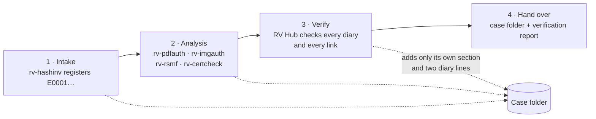
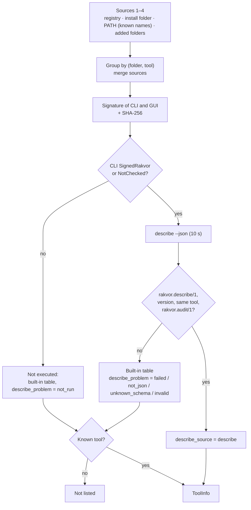
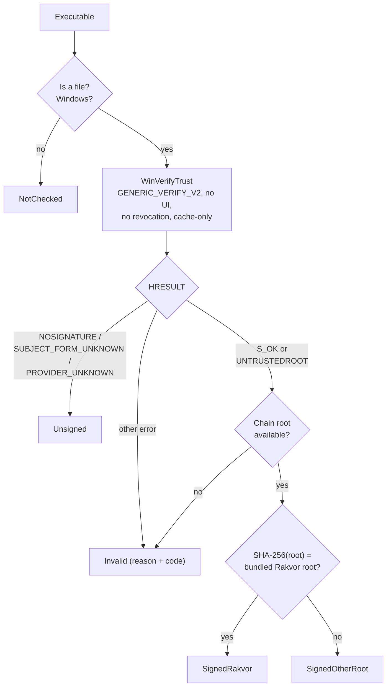
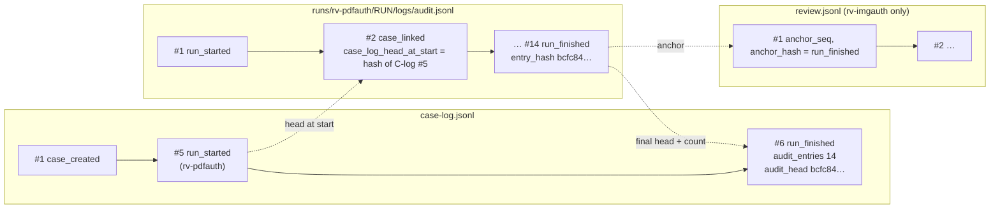
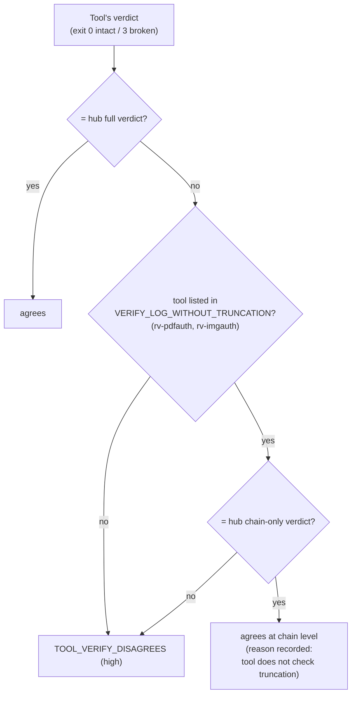
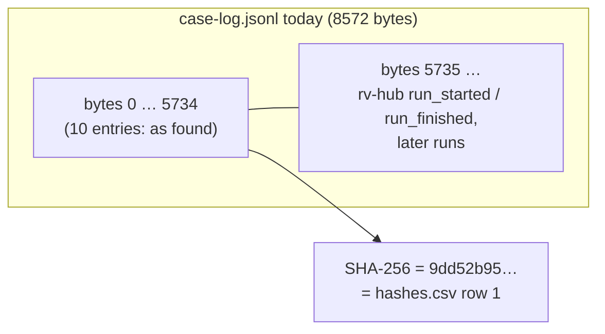

# Theory of operation

This page explains what RV Hub checks and why those checks can be relied on. It has two parts:

- **Part A** is for clients, lawyers and judges. It needs no technical background.
- **Part B** is for examiners and opposing experts. It names the source file and function behind every rule, gives
  the constants, and works through real values from the sample case in [`examples/sample/`](../examples/README.md).

The hub does not analyse evidence. Each Rakvor tool has its own theory page for what *it* finds (for example
[rv-imgauth](https://github.com/Panacota96/rv-imgauth/blob/main/docs/theory.md)). This page covers only what the
hub adds: finding and trusting the tools, launching them, summarising a case, and verifying a whole case.

## Contents

- [Part A: for clients, lawyers and judges](#part-a-for-clients-lawyers-and-judges)
  - [A1 What RV Hub is (and is not)](#a1-what-rv-hub-is-and-is-not)
  - [A2 The case folder](#a2-the-case-folder)
  - [A3 Why each tool stays a separate signed program](#a3-why-each-tool-stays-a-separate-signed-program)
  - [A4 The diaries: case log, run logs, review logs](#a4-the-diaries-case-log-run-logs-review-logs)
  - [A5 What "verify the whole case" means](#a5-what-verify-the-whole-case-means)
  - [A6 Asking each tool for a second opinion](#a6-asking-each-tool-for-a-second-opinion)
  - [A7 What a clean verification can and cannot show](#a7-what-a-clean-verification-can-and-cannot-show)
- [Part B: for examiners and opposing experts](#part-b-for-examiners-and-opposing-experts)
  - [B1 Discovery](#b1-discovery)
  - [B2 The signature check](#b2-the-signature-check)
  - [B3 Launch](#b3-launch)
  - [B4 The hash chain shared by every log](#b4-the-hash-chain-shared-by-every-log)
  - [B5 Case-log, run-log and review-log checks](#b5-case-log-run-log-and-review-log-checks)
  - [B6 The cross-check rule: two verdicts](#b6-the-cross-check-rule-two-verdicts)
  - [B7 Re-hashing the evidence](#b7-re-hashing-the-evidence)
  - [B8 The hash register and the append-only case-log prefix rule](#b8-the-hash-register-and-the-append-only-case-log-prefix-rule)
  - [B9 Timestamps: what the hub checks and what it does not](#b9-timestamps-what-the-hub-checks-and-what-it-does-not)
  - [B10 The dashboard and the suggestion rules](#b10-the-dashboard-and-the-suggestion-rules)
  - [B11 Exit codes and determinism](#b11-exit-codes-and-determinism)

---

# Part A: for clients, lawyers and judges

## A1 What RV Hub is (and is not)

RV Hub is the "front desk" of the Rakvor tools. An examiner uses it to see which tools are on the workstation and
whether they are genuine, to open a tool on a case, to see what has been done in a case and what is still to do,
and, before a case is handed over, to check that nothing recorded in the case has changed.

RV Hub does **not** examine evidence. It does not decide whether a document is forged or a photo edited; the
analysis tools (rv-pdfauth, rv-imgauth, rv-certcheck) report signals for an examiner to weigh, and each of them
documents its own method. RV Hub never changes what the tools wrote. When it finds a problem, it reports it and
leaves the files exactly as they were, so the examiner can explain them.

## A2 The case folder

All the Rakvor tools of one case share one folder. Think of it as a case binder:

- a **cover sheet** (`case.json`): the case number and the country whose custody form applies (Colombia or France);
- an **evidence register** (`evidence/registry.json`): every item received, with a number (`E0001`, `E0002`, …) and
  its digital fingerprint (a hash, see [A4](#a4-the-diaries-case-log-run-logs-review-logs));
- a **case diary** (`case-log.jsonl`): one line each time a tool starts or finishes working on the case;
- one **section per piece of work** (`runs/<tool>/<RUN-ID>/`): what that tool did, its own diary and its reports.

Only the intake tool, rv-hashinv, opens a new binder and adds evidence to the register. The hub never does: its
*Create case* button simply starts rv-hashinv.



## A3 Why each tool stays a separate signed program

A tool that is used as evidence must be identifiable: a court may ask *which program, which version, built by whom*.
Each Rakvor tool is therefore its own program, released and tested on its own, and **digitally signed** by Rakvor.
A digital signature on a program works like a tamper-evident seal: if a single byte of the program changes after
signing, the seal breaks.

Keeping the tools separate means each one can be validated and defended on its own, without the hub. If the hub
were one big program containing all the tools, any change to one part would call the whole into question.

Before the hub runs a tool, even just to ask its version, it checks that seal and that it was made with **Rakvor's
own key** (the hub carries a copy of Rakvor's root certificate, the "master" of that key). A tool sealed by anybody
else, or not sealed at all, is never run unless the examiner confirms, and that confirmation is written down first.
The signature check exists on Windows only; on other systems the hub says "not checked", which is not the same as
"signed".

## A4 The diaries: case log, run logs, review logs

Every tool keeps a diary of what it does (`audit.jsonl`). Each line of the diary contains the fingerprint of the line
before it. A fingerprint (a SHA-256 hash) is a 64-character code computed from the content: change one letter and
the code changes completely, and nobody can make two different texts with the same code. So the lines form a
chain: editing, deleting or re-ordering any line breaks every link after it, and a check finds the break.

There are three kinds of diaries in a case:

- the **case log**, shared by every tool, which records each piece of work starting and finishing;
- one **run log** per piece of work;
- for rv-imgauth, a **review log**, which records what the examiner looked at in the image viewer after the work
  finished. It is chained to the last line of the run log, so it can only belong to that one run.

The case log and the run logs vouch for each other. When a tool starts, its run log records the case log's latest
fingerprint; when it finishes, the case log records the run log's final fingerprint and its number of lines. Neither
can then be edited, shortened or swapped without the other showing it.

## A5 What "verify the whole case" means

`rv-hub verify` (or the *Verify* tab) re-reads the whole binder and checks, without changing anything:

1. the **case diary**: its chain, the cover sheet, and the fingerprint of the evidence register;
2. **every piece of work**: its diary's chain, its links with the case diary, its trusted timestamp (if any), its
   review log (if any), and that the case diary actually announced it;
3. optionally (**re-hash**) **every registered evidence file**: it is read again and its fingerprint compared with
   the one in the register.

The hub writes its findings as a piece of work of its own, in its own section, with its own diary and reports, and
adds two lines to the case diary (started, finished). It does that only when the case diary is intact: a broken case
is never extended, and the verification is then written outside the case.

## A6 Asking each tool for a second opinion

The hub's checks use the same code the tools are built on. To make sure the two never silently disagree, the hub
also asks **each run's own tool** to check its diary (`<tool> verify-log`) and compares the two answers. If they
disagree, that is a serious finding (`TOOL_VERIFY_DISAGREES`): it means two implementations of the same check
differ, and the case must not be relied on until that is explained.

The second opinion needs the tool to be installed on the workstation and signed by Rakvor. When it is not, the hub
says so (`CROSSCHECK_UNAVAILABLE`, information only), and only the hub's own check applies.

## A7 What a clean verification can and cannot show

| A clean verification shows | It does not show |
| --- | --- |
| The case diary, every run diary and every review log are exactly as they were written | That what the tools *found* is correct |
| Every piece of work in the folder is announced in the case diary, and every announced piece is there | That nothing happened *before* intake: the register starts at intake |
| With re-hash: every evidence file still has the fingerprint it had at intake | That the evidence is authentic, or what it means |
| With a trusted timestamp: the run diary existed in this form at that time | That the workstation's clock was right for the lines in between |
| With the second opinion: the tool's own check agrees | Anything about a tool that could not be asked |

The hub's error rate as a *method* is not measured (see [admissibility.md](admissibility.md#consolidated-gap-list));
what it checks are exact, mathematical properties (does this fingerprint match, does this line link), not
estimates.

---

# Part B: for examiners and opposing experts

Source map (all under `src/core/src/`): discovery `tools.rs`; signature `signature/mod.rs` and
`signature/windows.rs`; launch `launch.rs`; hub session log `session.rs`; dashboard `case_view.rs`; suggestions
`suggest.rs`; verification `run.rs` (pipeline, cross-check) and `checks.rs` (per-item checks); finding codes
`findings.rs`; chain primitives `audit.rs`; `verify-log` rules `verify.rs`; case log `case.rs`; review log
`review.rs`; timestamps `trust.rs`.

## B1 Discovery

`tools::discover(&DiscoverOptions, &dyn SignatureVerifier)` collects executables named `rv-<x>[.exe]` (the CLI) and
`rv-<x>-gui[.exe]` (the GUI), keyed by **(normalised folder, tool name)**, from four sources in this order:

| # | Source (`Source`) | What is read | Restriction |
| --- | --- | --- | --- |
| 1 | `registry {app_id}` | `HKCU\Software\Microsoft\Windows\CurrentVersion\Uninstall\{AppId}_is1` → `InstallLocation`, `DisplayVersion`, for the five AppIds in `APP_IDS` (Windows only) | any `rv-*` in that folder |
| 2 | `local_programs` | every direct subfolder of `%LOCALAPPDATA%\Programs\Rakvor` | any `rv-*` |
| 3 | `path` | every folder of `PATH` | **the five known tools only** (`KNOWN_TOOLS`) |
| 4 | `user_folder` | each folder the user added, and its direct subfolders | any `rv-*` |

`rv-hub` itself is excluded. When several sources find the same folder, the entry is listed once with every source
(the sample test finds one rv-pdfauth folder through the registry, the install folder and `PATH`). The same tool in
two different folders gives two entries; `launch` then prefers a Rakvor-signed GUI, then the lowest source, then the
folder name (`src/cli/src/hub.rs` `pick`).

The known AppIds (`tools.rs` `APP_IDS`):

| AppId | Tool | Note |
| --- | --- | --- |
| `{6D3F3B0E-5B7A-4B2C-9E61-2A1C7D4E9F10}` | rv-hashinv | |
| `{B2454915-B966-44CD-9C5B-5413F38185AE}` | rv-pdfauth, **and rv-imgauth 0.2.0 by mistake** | the key names whichever was installed last; the folder's executables say which tool it is, and the warning "if you installed RV ImgAuth 0.2.0 after RV PDFAuth, reinstall RV PDFAuth" is attached |
| `{7E0DA535-8638-4E9D-8680-ED046DCA9F45}` | rv-rsmf | |
| `{04A0C3C3-4929-42ED-81F7-93DB361940C8}` | rv-imgauth (corrected AppId, from 0.2.1) | |
| `{32343DE5-B0E4-4454-8A42-A5CF82EEC9BF}` | rv-certcheck | |

A test (`installer_app_ids_are_unique`) checks that these and the hub's own installer AppId
`{703D49A5-7B83-4C62-A97F-ED13C341CC23}` are all different.

Then, per entry:

1. both executables' signatures are checked ([B2](#b2-the-signature-check)) and their SHA-256 computed;
2. **`<cli> describe --json` is run only when the CLI is `SignedRakvor` or `NotChecked`** (`describe_untrusted`
   is false in both front-ends). So on Windows an executable signed under another root, unsigned or invalid is never
   executed; on Linux, where nothing can be checked, executables in the scanned folders are executed;
3. the answer must be `rakvor.describe/1` JSON with a non-empty `version`, an `rv-*` tool name equal to the file's,
   and `rakvor.audit/1` among `log_formats` (`parse_describe`); unknown extra fields are kept;
4. timeout 10 s (`DEFAULT_DESCRIBE_TIMEOUT`);
5. if `describe` is not run, fails, times out or is invalid, the **built-in table** (`builtin`) describes the tool,
   `describe_source` is `builtin`, the version falls back to the registry's `DisplayVersion` or stays unknown, and
   the reason is kept in `describe_problem`. An unknown `rv-*` program without a valid `describe` is dropped.



## B2 The signature check

`signature::OsVerifier` (Windows) does two things, in this order.

**1. `WinVerifyTrust`** (`signature/windows.rs` `verify_file`): action `WINTRUST_ACTION_GENERIC_VERIFY_V2`,
`WTD_UI_NONE`, `WTD_REVOKE_NONE` (**no revocation check**), `WTD_CACHE_ONLY_URL_RETRIEVAL` (no network). This is
the operating system's Authenticode check: the file's digest against the signed digest, and the signer's certificate
chain.

**2. The chain root.** Before closing the WinTrust state, the root certificate of the first signer's chain is copied:
the last element of the chain context the provider built (`WTHelperProvDataFromStateData` →
`WTHelperGetProvSignerFromChain` → `pChainContext`, which the provider builds with `CertGetCertificateChain`), else
the last certificate of the provider's list. Its SHA-256 is compared, case-insensitively, with the SHA-256 of the
root certificate compiled into the hub from `packaging/signing/rakvor-code-signing-root.cer`:

```text
rakvor_root_sha256() = dc9ba1a2fcd4f0633c5214b7cceb25bed8f3f7d9ebaf111590250cbcaa83df60
```

The decision (`trust_outcome` + `classify`) is plain Rust, unit-tested on every platform:

| WinVerifyTrust result | Root thumbprint | Status | Inventory finding |
| --- | --- | --- | --- |
| `S_OK`, or `CERT_E_UNTRUSTEDROOT` / `CERT_E_UNTRUSTEDTESTROOT` | = Rakvor root | `SignedRakvor` | `TOOL_SIGNED_RAKVOR` (info) |
| same | another root | `SignedOtherRoot { root_sha256 }` | `TOOL_SIGNED_OTHER_ROOT` (high) |
| same | no chain available | `Invalid` ("the signer's certificate chain is not available") | `TOOL_SIGNATURE_INVALID` (high) |
| `TRUST_E_NOSIGNATURE`, `TRUST_E_SUBJECT_FORM_UNKNOWN`, `TRUST_E_PROVIDER_UNKNOWN` | — | `Unsigned` | `TOOL_UNSIGNED` (medium) |
| any other HRESULT (e.g. `TRUST_E_BAD_DIGEST` 0x80096010: modified after signing) | — | `Invalid { reason }` | `TOOL_SIGNATURE_INVALID` (high) |
| not Windows, or the path is not a file | — | `NotChecked { reason }` | none; the limitation `SIGNATURE_CHECK_WINDOWS_ONLY` applies |

Two consequences matter in court:

- **The root is pinned, not taken from the Windows store.** A signature that Windows itself calls "untrusted root"
  (because the private Rakvor root is not installed) is still `SignedRakvor` when the chain ends at the bundled
  root; and a signature that Windows trusts (a public code-signing CA) is still `SignedOtherRoot` for the hub.
- **Revocation is not checked**, so a revoked Rakvor signing certificate would still give `SignedRakvor`. The
  WinTrust call can only return `CERT_E_REVOKED` if revocation data is already cached; the code asks for none.



`signature/windows.rs` is the only `unsafe` code in the hub (the crate is `forbid(unsafe_code)` off Windows and
`deny(unsafe_code)` on Windows, with an `allow` in that one module). Every pointer stays inside `verify_file`, is
checked for null, and only the HRESULT and a copy of the root certificate's bytes leave it.

## B3 Launch

`launch::launch_with` (`launch.rs`) starts `<gui_exe> --case-dir <normalised case folder>` (or no argument for
"open without a case"), detached: no console, its own process group, stdin/stdout/stderr closed, working folder =
the executable's folder; the hub never waits for it. Before starting it:

1. the GUI executable must exist;
2. for a case folder: it must not be a file, and **without `case.json` only the intake tool may open it**
   (`ToolRole::Intake`); an analysis tool is refused;
3. the executable is hashed again; if its SHA-256 differs from the one inventoried, the launch is refused
   (`Changed`: refresh the list);
4. its signature is checked again; anything but `SignedRakvor` (including `NotChecked`) needs
   `confirm_untrusted = true`, and **`tool_untrusted_confirmed` is written to the session log before the process
   starts**;
5. `tool_launched` records tool, version, exe path, exe SHA-256, signature status, case folder, arguments, pid and
   `confirmed_untrusted`. A failed start records `tool_launch_failed`; the CLI records a refusal as
   `tool_launch_refused`.

The session log is `<data>/logs/<SESSION-ID>/audit.jsonl` with `audit.log` and `environment.json`, where `<data>` is
`%LOCALAPPDATA%\Rakvor\RV Hub` (Windows), `$XDG_DATA_HOME/rakvor/rv-hub` or `~/.local/share/rakvor/rv-hub`
(Linux), or `RV_HUB_DATA_DIR` (`session.rs`). It uses the same chain as every run log ([B4](#b4-the-hash-chain-shared-by-every-log))
and `rv-hub verify-log` checks it.

What the hash-at-launch does not cover: the executable is hashed, then its signature is checked, then it is
started, in three separate file accesses. A process able to replace the file in between could start a different
file than the one hashed. The signature check is the second line of defence; the gap is small but real.

## B4 The hash chain shared by every log

Every log the hub reads or writes (`case-log.jsonl`, every `audit.jsonl`, the hub session log) uses one rule
(`audit.rs`):

```text
entry_hash      = SHA-256( canonical JSON of the entry without "entry_hash" )
canonical JSON  = keys sorted at every level, no whitespace, UTF-8
                  (Python: json.dumps(e, sort_keys=True, separators=(",", ":"), ensure_ascii=False))
prev_entry_hash = entry_hash of the previous entry; 64 zeros for entry #1
seq             = 1, 2, 3, … with no gap
```

An independent implementation in 80 lines of standard-library Python is in
[`tests/verify_chain.py`](../tests/verify_chain.py). A chain alone detects an edited, inserted, deleted or re-ordered
line, but **not the removal of the last lines**: the shortened file is still a valid chain. Truncation is detected
only against a record kept outside the log: a timestamp that covers a later entry, or the case log
([B5](#b5-case-log-run-log-and-review-log-checks)).

The review log (`review.jsonl`, `rakvor.review/1`, written by rv-imgauth's viewer) has the same canonical rule, with
two differences (`review.rs`): its entries carry `at_utc` instead of `ts_utc`, and its first entry's
`prev_entry_hash` is the **anchor**, the `entry_hash` of the run's `run_finished` audit entry, also recorded as
`anchor_seq` / `anchor_hash`.



## B5 Case-log, run-log and review-log checks

The verification plan (`run.rs` `pipeline`) is: item 1 the case log; items 2…n every run, **in case-log order, then
the run folders the case log never announced** (`checks::runs_of_case`); then, with `--rehash`, every registered
evidence item. The case log is read once, before the hub appends anything, and that snapshot is what is checked.

**Case log** (`checks::check_case_log` → `case::verify_log_and_registry`), finding `CASE_LOG_BROKEN` (high) for each
problem:

- the chain is intact ([B4](#b4-the-hash-chain-shared-by-every-log));
- entry #1 is `case_created`, its `case_id` equals `case.json`'s, and `case.json`'s SHA-256 equals the
  `case_json_sha256` recorded there;
- `evidence/registry.json`'s SHA-256 equals the last `registry_sha256` recorded in the case log (missing file, or a
  file with no recorded digest, is also a problem). `registry.csv` is not covered;
- no `run_finished` without its `run_started`.

**Each run** (`checks::check_run`), finding `RUN_LOG_BROKEN` (high) for each problem, unless noted:

| Check | Rule |
| --- | --- |
| Announced | a run folder with no `run_started` in the case log → `RUN_NOT_IN_CASE_LOG` (high) |
| Present | a run announced but whose folder or `logs/audit.jsonl` is missing is broken, except a run that finished with `audit_entries: 0` (it failed before writing) |
| Chain | `audit::verify(audit.jsonl)` |
| Case link | the run's `case_linked` entry exists, names this case, and its `case_log_head_at_start` equals the `entry_hash` of its `run_started` entry in the case log |
| End of the run | entry #`audit_entries` (from `run_finished` in the case log) exists and its `entry_hash` equals the recorded `audit_head`; every later entry must be `timestamp_obtained` |
| Timestamps | every `timestamp-<SEQ>.json` / `.tsr` pair: the covered entry exists, the token file has the recorded SHA-256, the token's message imprint equals that entry's hash, the TSA's CMS signature verifies, and with `--tsa-ca` the TSA chain ([B9](#b9-timestamps-what-the-hub-checks-and-what-it-does-not)) |
| Pending timestamp | `timestamp_pending` without a later `timestamp_obtained` → `TIMESTAMP_PENDING` (low) |
| Review log | when `logs/review.jsonl` exists: each `seq` is 1, 2, …; entry #1 holds the `anchor_seq` / `anchor_hash` of this run's `run_finished`; every entry names this run; every `prev_entry_hash` links; every `entry_hash` matches → otherwise `REVIEW_LOG_BROKEN` (high) |
| Unknown logs | any other `*.jsonl` in `logs/` → `UNKNOWN_LOG_FORMAT` (medium); it is not checked |
| Intact | when the run item has no high finding at this point → `RUN_LOG_INTACT` (info) |

Note on ordering: `RUN_LOG_INTACT` is decided before the cross-check; when the cross-check then raises
`TOOL_VERIFY_DISAGREES` for the run, `RUN_LOG_INTACT` is withdrawn and the run is not counted in `runs_intact` (the
tally is taken after the cross-check). Read the item's full code list, not `RUN_LOG_INTACT` alone.

When the case log fails (`case::verify_log_and_registry` is `Err`), the hub **does not append** to it: the
verification run writes `case_not_extended` and goes to `--out` (`run.rs` `open_target`). Otherwise it appends
`run_started` (role `analysis`, `purpose: verification`) under the case lock (`case-log.lock`; the hub waits up to 30 s,
and a lock older than 10 minutes is reported as stale and must be removed by hand, never automatically), after
re-verifying the case log, and appends `run_finished` with its audit head at the end,
also after a cancel or a failure.

## B6 The cross-check rule: two verdicts

For each run item, `checks::check_run` sets two verdicts:

- **full** (`item.verdict`) = the result of `verify::verify_log(audit.jsonl)`, which is exactly what `rv-hub
  verify-log` answers: chain, timestamp tokens and their files, review log, and **truncation against the case log**
  (the log must end at the head recorded at `run_finished`; when the case log itself is broken, it cannot vouch for
  the length, and the full verdict is broken);
- **chain-only** (`item.chain_verdict`) = chain + timestamp tokens + review log, without the case-log comparison.

Why two: the tools' own `verify-log` commands do not all check the same things
([rv-hub#21](https://github.com/Panacota96/rv-hub/issues/21)). rv-hashinv, rv-rsmf (and rv-certcheck, which carries
the same `verify.rs`) also check the run against the case log; rv-pdfauth and rv-imgauth check the chain, the
timestamps and (rv-imgauth) the review log only. On an edited case log the two groups give opposite answers.

With `--crosscheck auto` (`run.rs` `crosscheck`), for each run that is not the hub's own:

1. the executable is the `--tool-exe NAME=PATH` override (any signature), else the discovered CLI of that tool that
   is `SignedRakvor`. None → `CROSSCHECK_UNAVAILABLE` (info: not installed / not Rakvor-signed). In the CLI,
   discovery for the cross-check uses the registry, the install folder and `PATH` only (no added folders); the GUI
   passes the tools of its Tools tab, added folders included;
2. a run with no log folder (full verdict *not verifiable*) → `CROSSCHECK_UNAVAILABLE`;
3. `<exe> verify-log <CASE>/runs/<tool>/<RUN-ID>/logs`, 120 s limit. Exit 0 → *intact*, 3 → *broken*, anything
   else (other code, signal, timeout, cannot start) → `CROSSCHECK_UNAVAILABLE`;
4. compare:



Every cross-check is recorded in the hub's audit log (`crosscheck`: exe, exe SHA-256, arguments, exit code, first 20
lines of output, outcome, both hub verdicts, the executable's version, whether only the chain level was compared,
whether it was an override).

What the rule accepts and what it costs: the chain-level fallback applies **only** to the tools listed in
`tools::VERIFY_LOG_WITHOUT_TRUNCATION` (rv-pdfauth and rv-imgauth, identified by the run's tool name; each entry can
name the first version that has the check, none does yet, and an unknown version counts as lacking it). For those
two, when the full and chain-only verdicts differ (truncation against the case log, or a broken case log), *either*
answer is accepted, so the cross-check cannot detect that they miss that check. rv-hashinv, rv-rsmf, rv-certcheck
and any other tool are compared with the full verdict: a tool that answers *intact* on a truncated run is
`TOOL_VERIFY_DISAGREES`. The hub's own findings (`RUN_LOG_BROKEN`, `CASE_LOG_BROKEN`) are unaffected: they never
depend on the tool's answer. The list shrinks as rv-hub#21 aligns the tools.

Measured on the sample (`examples/sample`, variant `case_log_line_edited`, `--tool-exe rv-pdfauth=…`): hub full
verdict *broken*, chain-only *intact*, rv-pdfauth exit 0 → outcome *agrees*, reason "same verdict at chain level";
the case is still reported `CASE_LOG_BROKEN` and exits 3.

## B7 Re-hashing the evidence

With `--rehash` (or `--evidence E0001,…`, which implies it), each registered item is planned, except an item whose
path is registered again later (the later registration supersedes it; `evidence_superseded` is logged).

- **Where:** the registered path if it is a file, else `<dir>/<file name>` for each `--evidence-dir` in order
  (`checks::locate`). Matching is by file name only, so the examiner must make sure the folder holds the right
  copies; the digest comparison then shows whether they are.
- **Algorithms:** at most two per read: first an algorithm the registry holds (one of the examiner's `--hash`
  choices if possible, else the first the registry holds in the order md5, sha1, sha256, sha512, sha3-256, blake3),
  then the examiner's other choices up to two. The comparison uses the algorithms both sides have
  (`case::compare`).
- **Results:** any difference → `EVIDENCE_REHASH_MISMATCH` (high, with algorithm, expected and actual digest); not
  found, unreadable, or no algorithm in common → `EVIDENCE_MISSING` (high). A match gives no finding.
- Files are opened read-only and streamed in chunks (progress and cancel between chunks).

## B8 The hash register and the append-only case-log prefix rule

`logs/hashes.csv` is the hub's hash register: one row per item it read (index, path, size, the selected digests,
status, error). For a run item, the file hashed is that run's `audit.jsonl`; for an evidence item, the evidence
file; for item 1, **the case log as read at the start**, before the hub appended its own `run_started`.

That creates a subtlety. By the time anyone re-checks the register, the case log is longer (the hub, and later
tools, appended to it), so its full digest no longer matches. Because the case log is append-only, the hub records
the **size it read** and the digest of those bytes; the item's technical report states it as
`fact_as_found = "first N bytes of case-log.jsonl"`. The independent verifier applies the same rule
(`tests/verify_chain.py` `verify_register`): for a row whose file is named `case-log.jsonl`, a full-file mismatch is
accepted only if `0 ≤ size < current size` **and** the digest of the first `size` bytes equals the recorded one.

Real values (sample case, first verification):

```text
hashes.csv row 1:  case/case-log.jsonl, size 5735, sha256 9dd52b95…40b549bf
sha256(whole file now, 8572 bytes)   = 4c497814…129a099fc5   (≠: the hub and a second run appended)
sha256(first 5735 bytes)             = 9dd52b95…40b549bf     (= recorded: accepted)
python3 tests/verify_chain.py case/runs/rv-hub/<RUN-ID>/logs  →  chain: intact | register: matches
```



What the prefix rule relies on: that nothing *before* byte `size` changed. That is exactly what the digest checks;
an edit inside the prefix fails it. It does not show that the appended part is legitimate; the case-log chain check
of the next verification does.

Paths in `hashes.csv` are written as the hub saw them: relative when `--case-dir` was relative. Run
`verify_chain.py` from the same working folder, or verify with an absolute `--case-dir`.

## B9 Timestamps: what the hub checks and what it does not

A run's RFC 3161 token (`timestamp-<SEQ>.tsr`) covers the `entry_hash` of entry `<SEQ>` (the chain head at the
time). For each token the hub checks (`trust::verify_timestamps`): the covered entry is still in the log (else
"truncated"), the `.tsr` file has the SHA-256 recorded in its `.json`, the response status is granted, and the
token's **message imprint equals that entry's hash**; it reads `genTime`. `verify-log` also requires every
`timestamp_obtained` entry to still have its token file.

The hub also **verifies the TSA's CMS signature on the token** (`trust::verify_token`, the same code as
rv-pdfauth and rv-imgauth): the content type is `id-ct-TSTInfo`; there is exactly one SignerInfo and its certificate
is in the token; the signed attributes carry content-type, a message-digest that equals the digest of the TSTInfo,
and an ESS signing-certificate (v1 or v2) that matches that certificate; the RSA PKCS#1 v1.5 signature over the
signed attributes verifies; and the certificate has the `timeStamping` extended key usage (RFC 3161 §2.3). Any
failure (an altered token, "signature value does not verify") makes the log not verify (exit 3,
`RUN_LOG_BROKEN`).

The **TSA certificate chain** is validated only when a CA bundle is given (`--tsa-ca` on `verify-log` and
`verify`): a path is built from the TSA certificate, through the certificates in the token, to one of the bundle's
certificates, checking each RSA signature, the validity period at the token's `genTime` and the CA flag of every
issuer. Without `--tsa-ca` the output says "chain not checked": the token is then shown to be signed by the
certificate it carries, not that this certificate belongs to a TSA you trust. **Revocation (CRL/OCSP) is never
checked**, and only RSA signers are supported (an ECDSA token is reported as "signature not checked", which fails
the log). OpenSSL or rv-certcheck remain an independent second check ([forensic-audit.md](forensic-audit.md#timestamps)).

The hub's own verification run requests a timestamp by default (`--tsa-url`, default
`http://timestamp.digicert.com`): that HTTP request is the only network access of `verify`. `--no-timestamp` or
`RV_NO_TIMESTAMP=1` turns it off; the run then records `timestamp_pending` only when a TSA was asked and could not be
reached.

## B10 The dashboard and the suggestion rules

`case_view::read_case` never fails and never writes. It reads `case.json`, `case-log.jsonl` (runs in log order;
`run_finished` gives the status and recorded timestamp status), each run's `logs/audit.jsonl` (to refine the
timestamp status: a later `timestamp_obtained` wins) and `reports/statistics.json` (findings by severity, items,
evidence ids examined), and `evidence/registry.json`. It runs one quick chain check of the case log; every other
problem is a line in `problems`. **The numbers come from the tools' own reports as they are**: an edited report
shows edited numbers. Only `verify` proves integrity.

"Examined by" (per evidence item): the tools whose runs list the item's evidence id (from `statistics.json`, else
the case log's `run_started.evidence_ids`, else what the run registered), plus the tool that registered it. Every
run counts, whatever its status (also a failed or cancelled run).

`suggest::suggest(view, catalog)` returns, in this order:

| Situation | Suggestion | Reason key (`i18n/*.json` → `suggest`) |
| --- | --- | --- |
| `case.json` missing or without `case_id` | the intake tool | `no_case` |
| a case with no registered evidence | the intake tool | `no_evidence` |
| for each non-intake tool that does not accept "any file", in the order rv-pdfauth, rv-imgauth, rv-rsmf, rv-certcheck, then others: registered items that are not superseded, not yet examined by that tool, and that it accepts | that tool, with the evidence ids | `pdf_not_analysed`, `images_not_analysed`, `chats_not_converted`, `certs_not_analysed`, `not_examined` |
| runs whose timestamp status is pending | `<tool> timestamp`, with the run folders | `timestamp_pending` |

"Accepts" (`suggest::accepts`) uses the catalogue: each discovered tool's `describe`, completed by the built-in table
for tools not found. An item is accepted when its **first bytes** match one of the tool's signatures (up to 4 KiB
are read, read-only, only if the file exists at its **registered** path), or else its **extension** matches. A
`.txt` file is a chat export only when one of its first 20 lines starts like a chat line (a date of three digit
groups separated by `/`, `.` or `-`, optional comma, then `H:MM` or `HH:MM`, optional `[`, e.g.
`12/03/2026, 09:14 - …`). When the file cannot be read at its registered path, `.txt` falls back to the extension
alone.

Consequence seen in the sample: the registry records the paths the evidence had at intake (a temporary folder that no
longer exists), so the hub cannot read the files, and `notas.txt` (plain notes) is suggested to rv-rsmf by extension.
Suggestions are prompts for the examiner, not findings; they do not use `--evidence-dir`.

## B11 Exit codes and determinism

`verify` exits 3 when any finding is high, else 0; 1 runtime error; 2 usage error; 130 cancelled. The inventory
findings (`TOOL_*`) are not part of `verify`'s reports; `tools` exits 3 on `TOOL_SIGNED_OTHER_ROOT` or
`TOOL_SIGNATURE_INVALID`, and `launch` exits 3 when it refuses.

Given the same case folder, the same installed tools and the same options, two verifications give the same items,
findings, verdicts and digests; they differ in run id, timestamps (`ts_utc`, `genTime`), elapsed time, and the
hub's own earlier runs, which become items of the next verification (their cross-check is *skipped*: "the hub's
verdict is the tool's").
