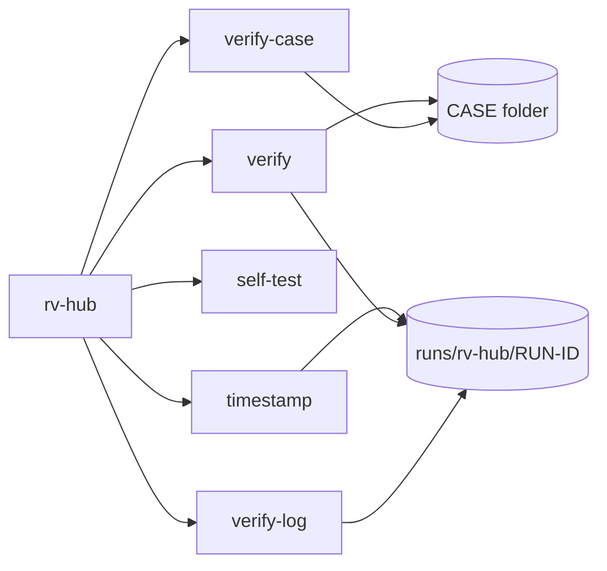

# Command-line reference

<!-- Generated by `rv-hub docs-cli`. Do not edit by hand: CI fails if this file differs. -->



## rv-hub

```text
DESCRIPTION:
  rv-hub verify checks a Rakvor case folder as a whole, without changing anything in it:
    1. the case log (case-log.jsonl): hash chain, case.json and the evidence-registry digest;
    2. every run folder runs/<TOOL>/<RUN-ID>: its audit.jsonl chain, its link with the case log
       (case_linked <-> run_started, the audit head recorded at run_finished), its RFC 3161
       timestamp tokens and, when present, its review.jsonl (anchored to run_finished);
    3. with --rehash, every registered evidence file, read again and compared with the registry.
  With --crosscheck auto (default) each run is also verified by the run's own tool
  (<tool> verify-log <run>/logs) when that tool is installed and signed by Rakvor; a different
  verdict is a high-severity finding (TOOL_VERIFY_DISAGREES).
  The verification is itself a run: reports and a hash-chained audit log are written to
  <CASE>/runs/rv-hub/<RUN-ID>/ and the run is recorded in the case log. No evidence input is
  needed: --case-dir is the only required option.

Usage: rv-hub <COMMAND>

Commands:
  verify       Verify a whole case folder (case log, every run, optionally the evidence) and
               cross-check each run with its own tool
  verify-log   Verify an audit log (audit.jsonl): edited, deleted or re-ordered entries, and
               truncation
  self-test    Check every hash algorithm against known-answer test vectors
  timestamp    Add an RFC 3161 timestamp to a finished run (e.g. after working offline)
  verify-case  Verify a whole case folder: case log, evidence registry and every run's audit log
  help         Print this message or the help of the given subcommand(s)

Options:
  -h, --help
          Print help (see a summary with '-h')

  -V, --version
          Print version

Run `rv-hub <COMMAND> --help` for the options, examples and exit codes of each command.
```

## rv-hub verify

```text
DESCRIPTION:
  rv-hub verify checks a Rakvor case folder as a whole, without changing anything in it:
    1. the case log (case-log.jsonl): hash chain, case.json and the evidence-registry digest;
    2. every run folder runs/<TOOL>/<RUN-ID>: its audit.jsonl chain, its link with the case log
       (case_linked <-> run_started, the audit head recorded at run_finished), its RFC 3161
       timestamp tokens and, when present, its review.jsonl (anchored to run_finished);
    3. with --rehash, every registered evidence file, read again and compared with the registry.
  With --crosscheck auto (default) each run is also verified by the run's own tool
  (<tool> verify-log <run>/logs) when that tool is installed and signed by Rakvor; a different
  verdict is a high-severity finding (TOOL_VERIFY_DISAGREES).
  The verification is itself a run: reports and a hash-chained audit log are written to
  <CASE>/runs/rv-hub/<RUN-ID>/ and the run is recorded in the case log. No evidence input is
  needed: --case-dir is the only required option.

Usage: rv-hub verify [OPTIONS] --case-dir <DIR>

Options:
      --case-dir <DIR>
          The case folder to verify (the one that holds case.json). Required.
          
          Default: none. Example: --case-dir E:\CASE-014

      --rehash
          Also read every registered evidence file again and compare its digests with the registry.
          
          Default: off (the registry's own digest is still checked). Example: --rehash

  -E, --evidence <IDS>
          Re-hash only these registered evidence ids (implies --rehash), comma-separated or
          repeated.
          
          Default: none (every registered item with --rehash). Example: --evidence E0001,E0007

      --evidence-dir <DIR>
          Folder where registered evidence files are now, when they are not at their registered path
          (looked up by file name). Repeat for several. Only used with --rehash.
          
          Default: none (only the registered paths). Example: --evidence-dir F:\copies

      --crosscheck <MODE>
          Cross-check every run with its own tool (`<tool> verify-log <run>/logs`): auto or off.
          
          Default: auto. Example: --crosscheck off

      --tool-exe <NAME=PATH>
          Executable to use for a tool's cross-check, whatever its signature: NAME=PATH. Repeat for
          several.
          
          Default: none (installed, Rakvor-signed tools only).
          Example: --tool-exe rv-pdfauth=D:\portable\rv-pdfauth.exe

  -H, --hash <ALGO>
          Hash algorithm(s) for the digests of the verified logs and of the hub's own files: one or
          two of
          md5, sha1, sha256, sha512, sha3-256, blake3. Evidence is always compared with the
          registry's.
          Default: sha256. Example: --hash sha256,blake3

  -o, --out <DIR>
          Folder for logs/ and reports/ only when the case log fails verification (a broken case is
          never extended). Otherwise the run goes to <CASE>/runs/rv-hub/<RUN-ID>/.
          Default: ./rakvor-out. Example: --out D:\verifications

  -l, --lang <LANG>
          Report language: en, es, fr, or all (one HTML and PDF per language). JSON is
          language-neutral.
          
          Default: en. Example: --lang es   or   --lang all

  -a, --actor <NAME>
          Name of the examiner, written in every audit entry and report.
          
          Default: the operating-system user name. Example: --actor "Ana Ruiz"

  -c, --case <ID>
          Expected case id: the run stops (exit 2) when case.json names another case.
          
          Default: none (any case). Example: --case CASE-2026-014

  -p, --progress <MODE>
          How progress is shown: bar, jsonl or none.
          
          Default: bar (hidden automatically when stderr is not a terminal).
          Example: --progress jsonl

          Possible values:
          - bar:   Progress bar with elapsed time, throughput and ETA on stderr
          - jsonl: One JSON event per line on stdout (for scripts and other tools)
          - none:  No progress output; only the final summary

  -j, --jurisdiction <CC>
          Custody form per item: co (Colombia, Fiscalía style, Spanish) or fr (France, scellés,
          French).
          An English copy is always added. The case's own jurisdiction (case.json) applies when it
          has one.
          Default: co
          Example: --jurisdiction fr

      --tsa-url <URL>
          RFC 3161 time-stamping authority for the audit chain head.
          Default: http://timestamp.digicert.com
          Example: --tsa-url https://freetsa.org/tsr

      --no-timestamp
          Do not request a trusted timestamp (offline labs). Also set by RV_NO_TIMESTAMP=1.
          Default: off (a timestamp is requested)
          Example: --no-timestamp

      --sign-cert <P12>
          Examiner's certificate (.p12/.pfx, RSA) used to sign every PDF report. The password is
          read from
          the environment variable named by --sign-pass-env, or asked for interactively.
          Default: none (PDFs are not signed)
          Example: --sign-cert C:\certs\ana-ruiz.p12

      --sign-pass-env <VAR>
          Environment variable holding the certificate password.
          Default: RV_SIGN_PASSWORD
          Example: --sign-pass-env CERT_PASS

  -h, --help
          Print help (see a summary with '-h')

EXAMPLES:
  Verify a case folder (logs and links; English reports):
    rv-hub verify --case-dir E:\CASE-014
  Also re-hash every registered evidence file, Spanish reports, for the examiner Ana Ruiz:
    rv-hub verify --case-dir E:\CASE-014 --rehash --lang es --actor "Ana Ruiz"
  The evidence copies were moved to another drive: look them up there by file name:
    rv-hub verify --case-dir E:\CASE-014 --rehash --evidence-dir F:\copies
  Re-hash two items only, without asking the tools, machine-readable progress:
    rv-hub verify --case-dir E:\CASE-014 -E E0001,E0002 --crosscheck off --progress jsonl
  Cross-check with a tool that is not installed (e.g. a portable copy, any signature):
    rv-hub verify --case-dir E:\CASE-014 --tool-exe rv-pdfauth=D:\portable\rv-pdfauth.exe

EXIT CODES:
  0    Completed; no high-severity finding (the case verifies).
  1    Runtime error (case log locked by another tool, output not writable, ...).
  2    Usage error (unknown option, bad value, not a case folder, --case of another case,
       unknown evidence id, malformed --tool-exe).
  3    Completed with at least one high-severity finding: a broken case log, run log or review
       log, a run missing from the case log, evidence that differs from the registry or cannot
       be found (--rehash), or a tool whose own verify-log disagrees with RV Hub.
  130  Cancelled with Ctrl+C. Partial reports and the cancellation are written to the audit log.

FILES WRITTEN:
  <CASE>/runs/rv-hub/<RUN-ID>/logs/audit.jsonl       Hash-chained log of every check (JSON Lines).
  <CASE>/runs/rv-hub/<RUN-ID>/logs/audit.log         The same actions, human-readable.
  <CASE>/runs/rv-hub/<RUN-ID>/logs/hashes.csv        Hash register of every file verified.
  <CASE>/runs/rv-hub/<RUN-ID>/logs/environment.json  Tool and dependency versions, OS, host, user.
  <CASE>/runs/rv-hub/<RUN-ID>/logs/timestamp-<SEQ>.tsr|.json  RFC 3161 token for the chain head.
  <CASE>/runs/rv-hub/<RUN-ID>/reports/statistics.json|.<LANG>.html|.<LANG>.pdf  Verification report.
  <CASE>/runs/rv-hub/<RUN-ID>/reports/items/<NNNNN>-<ITEM>/technical|summary|custody
  .json/.html/.pdf
                                                      One folder per item (case log, run, evidence).
  <CASE>/case-log.jsonl                              run_started and run_finished of this run are
                                                      appended (under case-log.lock); nothing else
                                                      in the case is written.
  When the case log itself fails verification it is never extended: logs/ and reports/ go to
  <OUT>/logs/<RUN-ID>/ and <OUT>/reports/<RUN-ID>/ instead (--out).

FORENSIC NOTES:
  - The case folder is read-only for RV Hub: every file is opened for reading; only the hub's own
    run folder and two case-log entries are written, after re-verifying the case log under the lock.
  - The checks use the same verifier code as the tools (hash chain, case log, timestamps, review
    log), and each run's own tool is asked for its verdict: one verifier lineage, checked twice.
  - Verification proves integrity, not content: an intact run log does not make a tool's findings
    correct, and a matching evidence hash does not make the evidence authentic.
  - Signatures of the tools are checked on Windows (Authenticode, chain to the Rakvor root); on
    other systems no tool is Rakvor-signed for the cross-check unless given with --tool-exe.
  - Each audit entry stores the SHA-256 of the previous one; editing, deleting or re-ordering any
    line is detected by `verify-log`. Removing the last lines is detected against the case log.
  - MD5 and SHA-1 are accepted for compatibility with older case files; pair them with SHA-256 or
  BLAKE3.
  - The chain head is timestamped by an RFC 3161 authority (proves when the log existed). Offline?
  The run
    finishes with `timestamp_pending`; run `rv-hub timestamp <LOG>` later.
  - With --sign-cert every PDF is signed with the examiner's certificate; the password is never
  logged.
```

## rv-hub verify-log

```text
Verify an audit log (audit.jsonl): edited, deleted or re-ordered entries, and truncation

Usage: rv-hub verify-log <LOG>

Arguments:
  <LOG>
          Path to audit.jsonl, or to the run's log folder that contains it.
          
          Example: rakvor-out/logs/20261019T101500Z-a1b2c3

Options:
  -h, --help
          Print help (see a summary with '-h')

CHECKS:
  - every entry links to the previous one (hash chain): an edited, deleted or re-ordered entry
    breaks it;
  - every timestamp token (timestamp-<SEQ>.tsr) covers the hash of the entry it names, and every
    timestamp_obtained entry still has its token file;
  - review.jsonl in the same folder (viewing after the run, written by rv-imgauth), when present,
    is an intact chain anchored to the run's run_finished entry ("review entries: N");
  - truncation: a chain alone cannot show that entries were removed from its end. The log must
    still contain the entry covered by its RFC 3161 timestamp (covers_seq) and, for a run inside
    a case folder (<CASE>/runs/<TOOL>/<RUN-ID>/logs), end with the audit head that the case log
    recorded at run_finished (only timestamp_obtained may follow). Entries after the last
    anchored one are listed as not provable; with neither record the output says
    "truncation not detectable without a timestamp or case record".

EXAMPLES:
  rv-hub verify-log rakvor-out/logs/20261019T101500Z-a1b2c3/audit.jsonl
  rv-hub verify-log rakvor-out/logs/20261019T101500Z-a1b2c3
  rv-hub verify-log E:\CASE-014\runs\rv-hub\20261019T101500Z-a1b2c3\logs

EXIT CODES:
  0  The chain is intact and agrees with its timestamps and case record (if any).
  1  The log cannot be read.
  3  The chain is broken (an entry was edited, deleted or re-ordered), a timestamp does not
     match, or the log is shorter than its timestamp or case record says (truncated).
```

## rv-hub self-test

```text
Check every hash algorithm against known-answer test vectors

Usage: rv-hub self-test

Options:
  -h, --help
          Print help (see a summary with '-h')

EXAMPLES:
  rv-hub self-test

EXIT CODES:
  0  All algorithms give the published answer for the input "abc".
  1  At least one algorithm failed: do not use this build for evidence.
```

## rv-hub timestamp

```text
Add an RFC 3161 timestamp to a finished run (e.g. after working offline)

Usage: rv-hub timestamp [OPTIONS] <LOG>

Arguments:
  <LOG>
          The run's log folder (or its audit.jsonl).
          
          Example: rakvor-out/logs/20261019T101500Z-a1b2c3

Options:
      --tsa-url <URL>
          RFC 3161 time-stamping authority.
          Default: http://timestamp.digicert.com
          Example: --tsa-url https://freetsa.org/tsr

  -a, --actor <NAME>
          Name written in the new audit entry.
          Default: the operating-system user name
          Example: --actor "Ana Ruiz"

  -h, --help
          Print help (see a summary with '-h')

EXAMPLES:
  rv-hub timestamp rakvor-out/logs/20261019T101500Z-a1b2c3
  rv-hub timestamp rakvor-out/logs/20261019T101500Z-a1b2c3 --tsa-url https://freetsa.org/tsr

EXIT CODES:
  0  Timestamp obtained and logged.
  1  The TSA could not be reached (nothing changed; try again).
  3  The log is missing or broken: no timestamp is added.
```

## rv-hub verify-case

```text
Verify a whole case folder: case log, evidence registry and every run's audit log

Usage: rv-hub verify-case [OPTIONS] <CASE>

Arguments:
  <CASE>
          The case folder (the one that holds case.json).
          
          Example: E:\CASE-014

Options:
      --rehash
          Also re-hash every registered item still reachable and compare it with the registry.
          Default: off (only the registry's digest is checked)
          Example: --rehash

  -h, --help
          Print help (see a summary with '-h')

CHECKS:
  - case-log.jsonl is an intact hash chain starting with case_created; case.json is unchanged;
  - evidence/registry.json has the SHA-256 recorded at the last registry change;
  - every run announced in the case log has an intact audit.jsonl (and valid timestamp
    tokens), its case_linked entry points to its run_started entry, and the audit head
    recorded at run_finished is its final entry (only timestamp_obtained may follow);
  - with --rehash: every registered item still reachable at its registered path is read again
    and its digests are compared with the registry (the latest registration of a path).

EXAMPLES:
  rv-hub verify-case E:\CASE-014
  rv-hub verify-case E:\CASE-014 --rehash

EXIT CODES:
  0  The case folder is intact (warnings, e.g. a run still in progress or an item not
     reachable for --rehash, are printed).
  1  The folder is not a case folder (no case.json).
  3  At least one check failed: the case was edited, truncated or re-ordered, or (--rehash)
     an evidence file differs from the registry.
```

