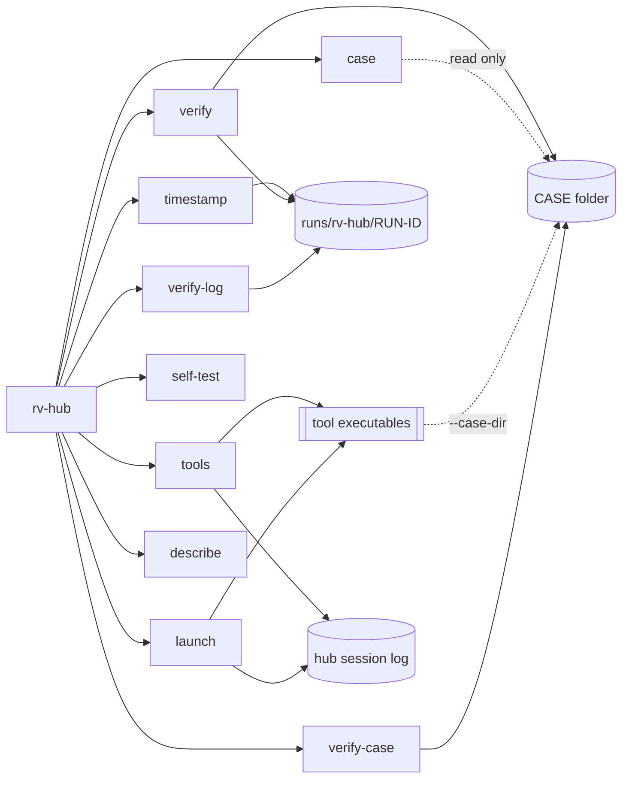

# Command-line reference

<!-- Generated by `rv-hub docs-cli`. Do not edit by hand: CI fails if this file differs. -->



## rv-hub

```text
RV Hub, the main app of the Rakvor tools (rv-hashinv, rv-pdfauth, rv-imgauth, rv-rsmf,
rv-certcheck). Everything the desktop app does can be done here, without a display:
  verify    verify a whole case folder and cross-check each run with its own tool (main verb)
  tools     list the installed tools with their version, source and signature
  case      read-only summary of a case folder, with suggested next steps
  launch    open a tool's desktop app on a case folder
Only `verify` writes into a case folder (its own run folder and two case-log entries); `tools`
and `launch` write only the hub's session log; `case` writes nothing.

Usage: rv-hub <COMMAND>

Commands:
  verify       Verify a whole case folder (case log, every run, optionally the evidence) and
               cross-check each run with its own tool
  tools        List the installed Rakvor tools with their version, source and signature status
  case         Read-only summary of a case folder: evidence, runs, findings, problems, next steps
  launch       Open a tool's desktop app on a case folder (refused for a tool not signed by Rakvor)
  verify-log   Verify an audit log (audit.jsonl): edited, deleted or re-ordered entries, and
               truncation
  self-test    Check every hash algorithm against known-answer test vectors
  timestamp    Add an RFC 3161 timestamp to a finished run (e.g. after working offline)
  verify-case  Verify a whole case folder: case log, evidence registry and every run's audit log
  help         Print this message or the help of the given subcommand(s)

Options:
  -h, --help
          Print help (see a summary with '-h')

  -V, --version
          Print version

Run `rv-hub <COMMAND> --help` for the options, examples and exit codes of each command.
```

## rv-hub verify

```text
DESCRIPTION:
  rv-hub verify checks a Rakvor case folder as a whole, without changing anything in it:
    1. the case log (case-log.jsonl): hash chain, case.json and the evidence-registry digest;
    2. every run folder runs/<TOOL>/<RUN-ID>:
       - its audit log (logs/audit.jsonl): hash chain, no edited, deleted or re-ordered entry;
       - its review log (logs/review.jsonl, rv-imgauth), when present: chain and anchor to
         the run's run_finished entry;
       - its links with the case log: case_linked <-> run_started, and the audit head that the
         case log recorded at run_finished (a run folder the case log never announced is a
         finding);
       - its RFC 3161 timestamp tokens (logs/timestamp-<SEQ>.tsr): imprint and the TSA's CMS
         signature; the TSA certificate chain only with --tsa-ca (otherwise "chain not
         checked"); or a pending timestamp;
    3. with --rehash, every registered evidence file, read again and compared with the
       registry digests (--evidence-dir: where the copies are now, looked up by file name).
  Cross-check (--crosscheck auto|off): with auto (default) each run is also verified by the
  run's own tool (<tool> verify-log <run>/logs) when that tool is installed (or found in an
  --add-folder folder) and signed by Rakvor, or given with --tool-exe NAME=PATH; a different verdict
  is a high-severity finding
  (TOOL_VERIFY_DISAGREES), a tool that cannot be asked is CROSSCHECK_UNAVAILABLE (info).
  Outputs: the verification is itself a run. Reports and a hash-chained audit log go to
  <CASE>/runs/rv-hub/<RUN-ID>/ and the run is recorded in the case log; when the case log
  itself is broken it is never extended and the outputs go to --out instead.
  No evidence input is needed: --case-dir is the only required option.

Usage: rv-hub verify [OPTIONS] --case-dir <DIR>

Options:
      --case-dir <DIR>
          The case folder to verify (the one that holds case.json). Required.
          
          Default: none. Example: --case-dir E:\CASE-014

      --rehash
          Also read every registered evidence file again and compare its digests with the registry.
          
          Default: off (the registry's own digest is still checked). Example: --rehash

  -E, --evidence <IDS>
          Re-hash only these registered evidence ids (implies --rehash), comma-separated or
          repeated.
          
          Default: none (every registered item with --rehash). Example: --evidence E0001,E0007

      --evidence-dir <DIR>
          Folder where registered evidence files are now, when they are not at their registered path
          (looked up by file name). Repeat for several. Only used with --rehash.
          
          Default: none (only the registered paths). Example: --evidence-dir F:\copies

      --crosscheck <MODE>
          Cross-check every run with its own tool (`<tool> verify-log <run>/logs`): auto or off.
          
          Default: auto. Example: --crosscheck off

      --add-folder <DIR>
          Also look for the tools of the cross-check in this folder and its subfolders (e.g.
          portable
          copies on a USB stick), as `tools --add-folder` does. Only Rakvor-signed executables found
          there are asked. Repeat for several. Recorded in run_started.
          
          Default: none (registry, install folder, PATH). Example: --add-folder E:\usb

      --tool-exe <NAME=PATH>
          Executable to use for a tool's cross-check, whatever its signature: NAME=PATH. Repeat for
          several.
          
          Default: none (installed, Rakvor-signed tools only).
          Example: --tool-exe rv-pdfauth=D:\portable\rv-pdfauth.exe

  -H, --hash <ALGO>
          Hash algorithm(s) for the digests of the verified logs and of the hub's own files: one or
          two of
          md5, sha1, sha256, sha512, sha3-256, blake3. Evidence is always compared with the
          registry's.
          Default: sha256. Example: --hash sha256,blake3

  -o, --out <DIR>
          Folder for logs/ and reports/ only when the case log fails verification (a broken case is
          never extended). Otherwise the run goes to <CASE>/runs/rv-hub/<RUN-ID>/.
          Default: ./rakvor-out. Example: --out D:\verifications

  -l, --lang <LANG>
          Report language: en, es, fr, or all (one HTML and PDF per language). JSON is
          language-neutral.
          
          Default: en. Example: --lang es   or   --lang all

  -a, --actor <NAME>
          Name of the examiner, written in every audit entry and report.
          
          Default: the operating-system user name. Example: --actor "Ana Ruiz"

  -c, --case <ID>
          Expected case id: the run stops (exit 2) when case.json names another case.
          
          Default: none (any case). Example: --case CASE-2026-014

  -p, --progress <MODE>
          How progress is shown: bar, jsonl or none.
          
          Default: bar (hidden automatically when stderr is not a terminal).
          Example: --progress jsonl

          Possible values:
          - bar:   Progress bar with elapsed time, throughput and ETA on stderr
          - jsonl: One JSON event per line on stdout (for scripts and other tools)
          - none:  No progress output; only the final summary

  -j, --jurisdiction <CC>
          Custody form per item: co (Colombia, Fiscalía style, Spanish) or fr (France, scellés,
          French).
          An English copy is always added. The case's own jurisdiction (case.json) applies when it
          has one.
          Default: co
          Example: --jurisdiction fr

      --tsa-url <URL>
          RFC 3161 time-stamping authority for the audit chain head.
          Default: http://timestamp.digicert.com
          Example: --tsa-url https://freetsa.org/tsr

      --tsa-ca <PEM>
          CA bundle (PEM or DER) that the TSA certificate of every run's timestamp tokens must chain
          to,
          at the token's genTime. Its path and SHA-256 are recorded in run_started.
          Default: none (each token's TSA signature is checked, its chain is not: "chain not
          checked")
          Example: --tsa-ca C:\certs\tsa-roots.pem

      --no-timestamp
          Do not request a trusted timestamp (offline labs). Also set by RV_NO_TIMESTAMP=1.
          Default: off (a timestamp is requested)
          Example: --no-timestamp

      --sign-cert <P12>
          Examiner's certificate (.p12/.pfx, RSA) used to sign every PDF report. The password is
          read from
          the environment variable named by --sign-pass-env, or asked for interactively.
          Default: none (PDFs are not signed)
          Example: --sign-cert C:\certs\ana-ruiz.p12

      --sign-pass-env <VAR>
          Environment variable holding the certificate password.
          Default: RV_SIGN_PASSWORD
          Example: --sign-pass-env CERT_PASS

  -h, --help
          Print help (see a summary with '-h')

EXAMPLES:
  Verify a case folder (logs and links; English reports):
    rv-hub verify --case-dir E:\CASE-014
  Also re-hash every registered evidence file, Spanish reports, for the examiner Ana Ruiz:
    rv-hub verify --case-dir E:\CASE-014 --rehash --lang es --actor "Ana Ruiz"
  The evidence copies were moved to another drive: look them up there by file name:
    rv-hub verify --case-dir E:\CASE-014 --rehash --evidence-dir F:\copies
  Re-hash two items only, without asking the tools, machine-readable progress:
    rv-hub verify --case-dir E:\CASE-014 -E E0001,E0002 --crosscheck off --progress jsonl
  Cross-check with the Rakvor-signed tools of a portable folder too:
    rv-hub verify --case-dir E:\CASE-014 --add-folder E:\rakvor-portable
  Cross-check with a tool that is not installed (e.g. a portable copy, any signature):
    rv-hub verify --case-dir E:\CASE-014 --tool-exe rv-pdfauth=D:\portable\rv-pdfauth.exe

EXIT CODES:
  0    Completed; no high-severity finding (the case verifies).
  1    Runtime error (case log locked by another tool, output not writable, --tsa-ca unreadable,
       ...).
  2    Usage error (unknown option, bad value, not a case folder, --case of another case,
       unknown evidence id, malformed --tool-exe).
  3    Completed with at least one high-severity finding: a broken case log, run log or review
       log, a run missing from the case log, evidence that differs from the registry or cannot
       be found (--rehash), or a tool whose own verify-log disagrees with RV Hub.
  130  Cancelled with Ctrl+C. Partial reports and the cancellation are written to the audit log.

FILES WRITTEN:
  <CASE>/runs/rv-hub/<RUN-ID>/logs/audit.jsonl       Hash-chained log of every check (JSON Lines).
  <CASE>/runs/rv-hub/<RUN-ID>/logs/audit.log         The same actions, human-readable.
  <CASE>/runs/rv-hub/<RUN-ID>/logs/hashes.csv        Hash register of every file verified.
  <CASE>/runs/rv-hub/<RUN-ID>/logs/environment.json  Tool and dependency versions, OS, host, user.
  <CASE>/runs/rv-hub/<RUN-ID>/logs/timestamp-<SEQ>.tsr|.json  RFC 3161 token for the chain head.
  <CASE>/runs/rv-hub/<RUN-ID>/reports/statistics.json|.<LANG>.html|.<LANG>.pdf  Verification report.
  <CASE>/runs/rv-hub/<RUN-ID>/reports/items/<NNNNN>-<ITEM>/technical|summary|custody
  .json/.html/.pdf
                                                      One folder per item (case log, run, evidence).
  <CASE>/case-log.jsonl                              run_started and run_finished of this run are
                                                      appended (under case-log.lock); nothing else
                                                      in the case is written.
  When the case log itself fails verification it is never extended: logs/ and reports/ go to
  <OUT>/logs/<RUN-ID>/ and <OUT>/reports/<RUN-ID>/ instead (--out).

FORENSIC NOTES:
  - The case folder is read-only for RV Hub: every file is opened for reading; only the hub's own
    run folder and two case-log entries are written, after re-verifying the case log under the lock.
  - The hub never edits, moves or deletes another tool's files: a broken run stays as it is, for
    the examiner to explain; RV Hub only reports it.
  - The checks use the same verifier code as the tools (hash chain, case log, timestamps, review
    log), and each run's own tool is asked for its verdict: one verifier lineage, checked twice.
  - Verification proves integrity, not content: an intact run log does not make a tool's findings
    correct, and a matching evidence hash does not make the evidence authentic.
  - Signatures of the tools are checked on Windows (Authenticode, chain to the Rakvor root); on
    other systems no tool is Rakvor-signed for the cross-check unless given with --tool-exe.
  - Each audit entry stores the SHA-256 of the previous one; editing, deleting or re-ordering any
    line is detected by `verify-log`. Removing the last lines is detected against the case log.
  - MD5 and SHA-1 are accepted for compatibility with older case files; pair them with SHA-256 or
  BLAKE3.
  - The chain head is timestamped by an RFC 3161 authority (proves when the log existed). Offline?
  The run
    finishes with `timestamp_pending`; run `rv-hub timestamp <LOG>` later.
  - With --sign-cert every PDF is signed with the examiner's certificate; the password is never
  logged.
```

## rv-hub tools

```text
DESCRIPTION:
  Lists the Rakvor tools installed on this workstation, as a table: tool, version, source,
  signature status and folder. Tools are found, in this order, in:
    - the Windows uninstall registry (the tools' installer AppIds; source "registry");
    - %LOCALAPPDATA%\Programs\Rakvor\<tool>\ (source "install folder");
    - the folders of PATH (the five known tools only; source "PATH");
    - the folders given with --add-folder, and their subfolders (source "folder").
  The same folder found twice is listed once. Each tool's own `describe --json` gives its
  version and what it accepts; it is run only for a Rakvor-signed executable (or where the
  signature cannot be checked). Older versions without `describe` are described from the
  built-in table ("+builtin", version unknown). Known tools that are not found are listed as
  "not installed".
  Signatures (Windows): Authenticode, and the signer's chain must end at the Rakvor root. Every
  call is recorded in the hub's session log (tools_listed). --json prints the inventory as
  one rakvor.hub-tools/1 object (schemas/hub-tools.schema.json).

Usage: rv-hub tools [OPTIONS]

Options:
      --json
          Print the inventory as one JSON object (schema rakvor.hub-tools/1) instead of the table.
          
          Default: off (table). Example: --json

      --check-signatures
          Also print the signature of every executable (CLI and GUI): status, finding code and
          severity, reason or root thumbprint. Signatures are always checked; this shows the
          details.
          
          Default: off (one status per tool in the table). Example: --check-signatures

  -a, --actor <NAME>
          Name written in the hub's session log.
          
          Default: the operating-system user name. Example: --actor "Ana Ruiz"

  -l, --lang <LANG>
          Language of the printed text: en, es or fr (help texts are in English).
          
          Default: en. Example: --lang fr

      --add-folder <DIR>
          Also look for tools in this folder and its subfolders (e.g. portable copies on a USB
          stick). Repeat for several. Used for this call only.
          
          Default: none (registry, install folder, PATH). Example: --add-folder E:\usb

  -h, --help
          Print help (see a summary with '-h')

EXAMPLES:
  List the installed tools:
    rv-hub tools
  Also look in a portable folder on a USB stick, with the details of every signature:
    rv-hub tools --add-folder E:\rakvor-portable --check-signatures
  Machine-readable inventory, Spanish warnings:
    rv-hub tools --json --lang es > tools.json

EXIT CODES:
  0  Inventory printed; no executable has a bad signature (unsigned executables, e.g.
     developer builds, give a warning line on stderr but still exit 0).
  1  Runtime error (the session log cannot be written).
  2  Usage error (unknown option, bad value).
  3  At least one executable is signed under another root (TOOL_SIGNED_OTHER_ROOT) or has a
     signature that does not verify (TOOL_SIGNATURE_INVALID): do not use that copy.

FILES WRITTEN:
  <HUB-DATA>/logs/<SESSION-ID>/audit.jsonl       Hub session log (hash chain): session_started,
                                                 environment_recorded, tools_listed.
  <HUB-DATA>/logs/<SESSION-ID>/audit.log         The same, human-readable.
  <HUB-DATA>/logs/<SESSION-ID>/environment.json  Hub version, OS, host, user.
  <HUB-DATA> is %LOCALAPPDATA%\Rakvor\RV Hub (Windows), $XDG_DATA_HOME/rakvor/rv-hub or
  ~/.local/share/rakvor/rv-hub (Linux), or RV_HUB_DATA_DIR. No case folder is written.

FORENSIC NOTES:
  - The inventory records the SHA-256 of every executable: a report can name exactly which
    build of a tool was used.
  - An executable that is not Rakvor-signed is never run, not even for `describe`.
  - On other systems than Windows the signature is "not checked"; that is not a valid
    signature (limitation SIGNATURE_CHECK_WINDOWS_ONLY).
```

## rv-hub case

```text
DESCRIPTION:
  Prints a read-only summary of a case folder, as the desktop app's Case tab shows it:
    - case id, jurisdiction (co: Colombia, fr: France) and creation date (case.json);
    - the number of registered evidence items (evidence/registry.json);
    - a quick check of the case log chain (case-log.jsonl);
    - the runs table: tool, run id, start time, status, findings by severity
      (high/medium/low/info, from reports/statistics.json) and trusted-timestamp status;
    - the problems found while reading (missing or malformed files, run folders the case log
      never announced, ...);
    - the suggested next steps, each with its reason in the --lang language: which tool
      should still examine which registered items (by extension or first bytes, using each
      installed tool's `describe`, else the built-in table), and runs whose timestamp is
      pending. A .txt file is suggested to rv-rsmf only when its content is a WhatsApp export
      (a line like "12/03/26, 09:14 - Name: ..." or "[12/03/26 09:14:05] Name: ..."). An
      item counts as examined by a tool only through a completed run (a failed, cancelled or
      unfinished run does not). Evidence files are read at their registered path, else by file
      name in the --evidence-dir folders.
  This is a summary, not a verification: `rv-hub verify` checks every chain and link. --json
  prints one rakvor.hub-case/1 object (schemas/hub-case.schema.json).

Usage: rv-hub case [OPTIONS] --case-dir <DIR>

Options:
      --case-dir <DIR>
          The case folder to summarise (the one that holds case.json). Required.
          
          Default: none. Example: --case-dir E:\CASE-014

      --json
          Print the summary as one JSON object (schema rakvor.hub-case/1) instead of text.
          
          Default: off (text). Example: --json

      --evidence-dir <DIR>
          Folder where registered evidence files are now, when they are not at their registered path
          (looked up by file name), for the suggestions. Repeat for several.
          
          Default: none (only the registered paths). Example: --evidence-dir F:\copies

  -l, --lang <LANG>
          Language of the printed text: en, es or fr (help texts are in English).
          
          Default: en. Example: --lang fr

      --add-folder <DIR>
          Also look for tools in this folder and its subfolders (e.g. portable copies on a USB
          stick). Repeat for several. Used for this call only.
          
          Default: none (registry, install folder, PATH). Example: --add-folder E:\usb

  -h, --help
          Print help (see a summary with '-h')

EXAMPLES:
  Summary of a case:
    rv-hub case --case-dir E:\CASE-014
  In French, with the tools of a portable folder for the suggestions:
    rv-hub case --case-dir E:\CASE-014 --lang fr --add-folder E:\rakvor-portable
  The evidence copies are on another drive (read there to recognise their type):
    rv-hub case --case-dir E:\CASE-014 --evidence-dir F:\copies
  Machine-readable:
    rv-hub case --case-dir E:\CASE-014 --json > case.json

EXIT CODES:
  0  Summary printed (problems, if any, are listed: they do not change the exit code; use
     `rv-hub verify` for a verdict).
  1  The folder has no case.json (not a case yet); the summary is still printed.
  2  Usage error (unknown option, bad value, the folder does not exist).

FILES WRITTEN:
  None. The case folder is only read (evidence files: at most their first 4 KiB, to recognise
  their type); no session log is written either.

FORENSIC NOTES:
  - Nothing in the case changes, so the summary can be taken at any time, even while a tool
    is running on the case.
  - Findings and timestamp states are read from the tools' own reports and logs as they are;
    an edited report would show edited numbers: only `rv-hub verify` proves integrity.
```

## rv-hub launch

```text
DESCRIPTION:
  Opens a tool's desktop app on a case folder: <tool>-gui.exe --case-dir CASE, started on its
  own (RV Hub does not wait for it). Before it starts, the executable is hashed (SHA-256) and
  must be the one just inventoried, and its signature is checked again. A tool that is not
  signed by Rakvor (another root, invalid signature, unsigned, or not checkable on this
  system) is refused unless --yes-untrusted is given; that confirmation is recorded first.
  Analysis tools need an existing case (case.json); only the intake tool (rv-hashinv) may
  open a folder that is not a case yet, because the hub never creates case.json itself.
  When a tool is installed more than once, the Rakvor-signed copy is used first, then the
  registry install, the install folder, PATH and the added folders. The pid is printed.

Usage: rv-hub launch [OPTIONS] --case-dir <DIR> <TOOL>

Arguments:
  <TOOL>
          The tool to open: rv-hashinv, rv-pdfauth, rv-imgauth, rv-rsmf or rv-certcheck (or another
          rv-* tool found in an added folder). Required.
          
          Default: none. Example: rv-pdfauth

Options:
      --case-dir <DIR>
          The case folder the tool opens (passed as --case-dir). Required.
          
          Default: none. Example: --case-dir E:\CASE-014

      --yes-untrusted
          Launch even when the tool is not signed by Rakvor (developer builds). The confirmation
          is recorded in the session log before the tool starts.
          
          Default: off (an untrusted tool is refused, exit 3). Example: --yes-untrusted

  -a, --actor <NAME>
          Name written in the hub's session log.
          
          Default: the operating-system user name. Example: --actor "Ana Ruiz"

  -l, --lang <LANG>
          Language of the printed text: en, es or fr (help texts are in English).
          
          Default: en. Example: --lang fr

      --add-folder <DIR>
          Also look for tools in this folder and its subfolders (e.g. portable copies on a USB
          stick). Repeat for several. Used for this call only.
          
          Default: none (registry, install folder, PATH). Example: --add-folder E:\usb

  -h, --help
          Print help (see a summary with '-h')

EXAMPLES:
  Open RV PDFAuth on a case:
    rv-hub launch rv-pdfauth --case-dir E:\CASE-014
  Start a new case with the intake tool:
    rv-hub launch rv-hashinv --case-dir E:\CASE-015
  A developer build (not signed) from a portable folder, Spanish messages:
    rv-hub launch rv-imgauth --case-dir E:\CASE-014 --add-folder D:\dev --yes-untrusted -l es

EXIT CODES:
  0  The tool was started (its pid is printed).
  1  Runtime error: the tool is not installed, it could not be started, or the session log
     cannot be written.
  2  Usage error: unknown tool name, or the folder is not a case (no case.json) for an
     analysis tool.
  3  Refused: the tool is not Rakvor-signed and --yes-untrusted was not given, or its
     executable changed since it was inventoried.

FILES WRITTEN:
  <HUB-DATA>/logs/<SESSION-ID>/audit.jsonl|audit.log|environment.json  Hub session log:
      tool_launched (tool, version, exe SHA-256, signature, case, pid), and before it
      tool_untrusted_confirmed (--yes-untrusted) or, when refused, tool_launch_refused.
  No case folder is written by RV Hub; the launched tool writes its own run as usual.

FORENSIC NOTES:
  - The session log proves which executable (SHA-256) was started on which case, when and by
    whom, and whether an untrusted build was knowingly used.
  - --yes-untrusted is for developer builds only: reports of a run made with an untrusted
    build should say so.
```

## rv-hub verify-log

```text
Verify an audit log (audit.jsonl): edited, deleted or re-ordered entries, and truncation

Usage: rv-hub verify-log [OPTIONS] <LOG>

Arguments:
  <LOG>
          Path to audit.jsonl, or to the run's log folder that contains it.
          
          Example: rakvor-out/logs/20261019T101500Z-a1b2c3

Options:
      --tsa-ca <PEM>
          CA bundle (PEM with one or more certificates, or one DER certificate) that the TSA
          certificate of every timestamp token must chain to, at the token's genTime.
          
          Default: none (the TSA signature is checked, the chain is not).
          Example: --tsa-ca C:\certs\tsa-roots.pem

  -h, --help
          Print help (see a summary with '-h')

CHECKS:
  - every entry links to the previous one (hash chain): an edited, deleted or re-ordered entry
    breaks it;
  - every timestamp token (timestamp-<SEQ>.tsr) covers the hash of the entry it names, and every
    timestamp_obtained entry still has its token file;
  - the TSA's CMS signature of every token: signer certificate in the token, ESS
    signing-certificate binding, message digest over TSTInfo, RSA signature, timeStamping key
    usage. With --tsa-ca, also the TSA certificate chain up to that CA bundle at the token's
    genTime; without it the output says "chain not checked". Revocation is never checked;
  - review.jsonl in the same folder (viewing after the run, written by rv-imgauth), when present,
    is an intact chain anchored to the run's run_finished entry ("review entries: N");
  - truncation: a chain alone cannot show that entries were removed from its end. The log must
    still contain the entry covered by its RFC 3161 timestamp (covers_seq) and, for a run inside
    a case folder (<CASE>/runs/<TOOL>/<RUN-ID>/logs), end with the audit head that the case log
    recorded at run_finished (only timestamp_obtained may follow). Entries after the last
    anchored one are listed as not provable; with neither record the output says
    "truncation not detectable without a timestamp or case record".

EXAMPLES:
  rv-hub verify-log rakvor-out/logs/20261019T101500Z-a1b2c3/audit.jsonl
  rv-hub verify-log rakvor-out/logs/20261019T101500Z-a1b2c3
  rv-hub verify-log E:\CASE-014\runs\rv-hub\20261019T101500Z-a1b2c3\logs
  rv-hub verify-log rakvor-out/logs/20261019T101500Z-a1b2c3 --tsa-ca digicert-tsa-roots.pem

EXIT CODES:
  0  The chain is intact and agrees with its timestamps and case record (if any).
  1  The log or the --tsa-ca file cannot be read.
  3  The chain is broken (an entry was edited, deleted or re-ordered), a timestamp does not
     match or does not verify (altered token, invalid TSA signature, chain not trusted by
     --tsa-ca), or the log is shorter than its timestamp or case record says (truncated).
```

## rv-hub self-test

```text
Check every hash algorithm against known-answer test vectors

Usage: rv-hub self-test

Options:
  -h, --help
          Print help (see a summary with '-h')

EXAMPLES:
  rv-hub self-test

EXIT CODES:
  0  All algorithms give the published answer for the input "abc".
  1  At least one algorithm failed: do not use this build for evidence.
```

## rv-hub timestamp

```text
Add an RFC 3161 timestamp to a finished run (e.g. after working offline)

Usage: rv-hub timestamp [OPTIONS] <LOG>

Arguments:
  <LOG>
          The run's log folder (or its audit.jsonl).
          
          Example: rakvor-out/logs/20261019T101500Z-a1b2c3

Options:
      --tsa-url <URL>
          RFC 3161 time-stamping authority.
          Default: http://timestamp.digicert.com
          Example: --tsa-url https://freetsa.org/tsr

  -a, --actor <NAME>
          Name written in the new audit entry.
          Default: the operating-system user name
          Example: --actor "Ana Ruiz"

  -h, --help
          Print help (see a summary with '-h')

EXAMPLES:
  rv-hub timestamp rakvor-out/logs/20261019T101500Z-a1b2c3
  rv-hub timestamp rakvor-out/logs/20261019T101500Z-a1b2c3 --tsa-url https://freetsa.org/tsr

EXIT CODES:
  0  Timestamp obtained and logged.
  1  The TSA could not be reached (nothing changed; try again).
  3  The log is missing or broken: no timestamp is added.
```

## rv-hub verify-case

```text
Verify a whole case folder: case log, evidence registry and every run's audit log

Usage: rv-hub verify-case [OPTIONS] <CASE>

Arguments:
  <CASE>
          The case folder (the one that holds case.json).
          
          Example: E:\CASE-014

Options:
      --rehash
          Also re-hash every registered item still reachable and compare it with the registry.
          Default: off (only the registry's digest is checked)
          Example: --rehash

  -h, --help
          Print help (see a summary with '-h')

CHECKS:
  - case-log.jsonl is an intact hash chain starting with case_created; case.json is unchanged;
  - evidence/registry.json has the SHA-256 recorded at the last registry change;
  - every run announced in the case log has an intact audit.jsonl (and valid timestamp
    tokens), its case_linked entry points to its run_started entry, and the audit head
    recorded at run_finished is its final entry (only timestamp_obtained may follow);
  - with --rehash: every registered item still reachable at its registered path is read again
    and its digests are compared with the registry (the latest registration of a path).

EXAMPLES:
  rv-hub verify-case E:\CASE-014
  rv-hub verify-case E:\CASE-014 --rehash

EXIT CODES:
  0  The case folder is intact (warnings, e.g. a run still in progress or an item not
     reachable for --rehash, are printed).
  1  The folder is not a case folder (no case.json).
  3  At least one check failed: the case was edited, truncated or re-ordered, or (--rehash)
     an evidence file differs from the registry.
```

## rv-hub describe

```text
Describe RV Hub as JSON (schema rakvor.describe/1), as every Rakvor tool does

Usage: rv-hub describe [OPTIONS]

Options:
      --json
          Print JSON: one pretty-printed object with sorted keys.
          Default: on (JSON is the only format)
          Example: --json

  -h, --help
          Print help (see a summary with '-h')

DESCRIPTION:
  Prints what RV Hub is, in the same rakvor.describe/1 schema as every Rakvor tool
  (schemas/describe.schema.json): schema, tool, title, version, role (analysis: the hub's
  verification runs are recorded in the case log as analysis runs), main_verb (verify),
  accepts (the case folder's JSON and JSON Lines files), case_formats, log_formats, cli_exe,
  gui_exe, exit_codes. Nothing is read or written; no session log is created.

EXAMPLES:
  rv-hub describe --json

EXIT CODES:
  0  The description was printed.
```

