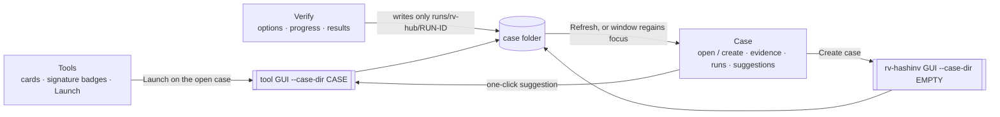
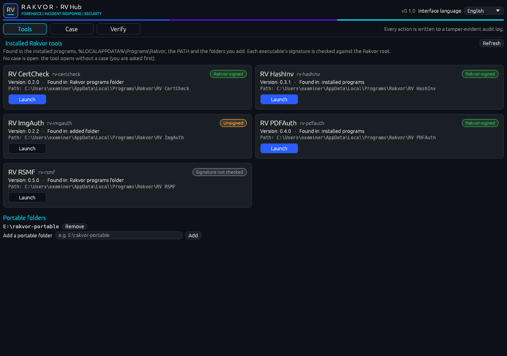
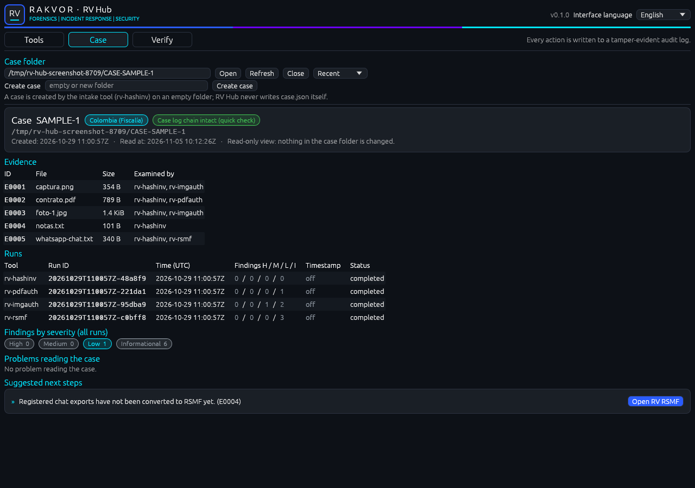

# Using the desktop app (Windows 10/11)

Start **RV Hub** from the Start menu ("Rakvor") or double-click `rv-hub-gui.exe` (portable zip). The app also runs
on virtual machines without a graphics driver (software rendering). `rv-hub-gui.exe --case-dir E:\CASE-014`, or a
case folder dropped on the icon, opens that case at start.

One window, three tabs: **Tools** (which Rakvor tools are installed and trustworthy), **Case** (what has been done
and what is next) and **Verify** (whole-case verification). The interface language (English, Español, Français) is
chosen top right and changes every label at once; it is independent of the report language.

## Tools

One card per tool found in the installed programs, `%LOCALAPPDATA%\Programs\Rakvor`, the `PATH` and the folders you
add. A known tool that is not found is shown dimmed as *not installed*. Each card shows the version, where it was
found, the install path and the signature badge of the GUI executable:

| Badge | Meaning | Launch |
| --- | --- | --- |
| green **Rakvor-signed** | valid Authenticode signature chaining to the Rakvor root | starts at once |
| amber **Unsigned** | no signature (e.g. a developer build) | asks first, stating the risk |
| red **Signed by another root** | signed, but not published by Rakvor | asks first, stating the risk |
| red **Invalid signature** | modified after signing, or broken | asks first, stating the risk |
| grey **Signature not checked** | not Windows, or the file could not be checked | asks first, stating the risk |

**Launch** opens the tool on the open case (`--case-dir`). With no case open, it opens the tool without one, after
asking. The executable is hashed and its signature checked again at launch; if it changed since the list was made,
you are asked again or the launch is refused (refresh the list).

**Add a portable folder** (a text field, plus *Browse…* on Windows) adds e.g. an unzipped release on a USB stick;
**Refresh** looks again. Added folders are remembered.

## Case

- **Open** a case folder (the folder with `case.json`): type or paste it, use *Browse…*, pick one of the **Recent**
  cases, or drop the folder on the window.
- **Create case** starts rv-hashinv on an empty (or new) folder: the intake tool creates `case.json`. RV Hub never
  writes `case.json` itself.
- The header shows the case id, the jurisdiction (custody form) and a quick check of the case-log chain.
- **Evidence**: id, file, size and the tools whose runs examined each item.
- **Runs**: tool, run id, time (UTC), findings High / Medium / Low / Info, timestamp (obtained, pending, off) and
  status.
- **Findings by severity** over all runs, and any **problems** reading the folder.
- **Suggested next steps**, each with its reason and a one-click button that opens the suggested tool on the case.

The view is read-only: nothing in the case folder is changed. It is read again with **Refresh** and whenever the
window regains the focus (for example after closing a tool that added a run).

## Verify

The options of `rv-hub verify`: the case folder (follows the open case), *re-hash the registered evidence* (with an
optional folder where the copies are now), the cross-check (ask each run's own installed, Rakvor-signed tool to
verify its logs too), 1 or 2 hash algorithms, the report language, the examiner and case id, and the trust section
(trusted timestamp, PDF signing certificate and password — kept in memory only — and the custody form).

**Start verification** shows progress, the elapsed time (always moving), the estimated time remaining and **Cancel**.
The results table has one row per item — the case log, each run, each re-hashed evidence file — with its verdict
(ok, attention, problem) and its finding codes. **Open report** opens the statistics page in your language; **Open
run folder** opens `<case>/runs/rv-hub/<RUN-ID>`.

## What the app records

Every action is written, with its time (`at_utc`), to the hub's session log
(`%LOCALAPPDATA%\Rakvor\RV Hub\logs\<SESSION-ID>\audit.jsonl`, a hash chain). Verify options also go into the
verification run's own audit log, as in every Rakvor tool.

| Action | Logged as |
| --- | --- |
| Switch tab / interface language | `ui_tab_selected`, `ui_interface_language_changed` |
| Refresh tools, add / remove a folder | `ui_tools_refreshed`, `ui_tools_listed`, `ui_folder_added`, `ui_folder_removed` |
| Launch | `ui_launch_clicked`, then the core's `tool_launched` (tool, version, exe SHA-256, signature, case, pid) |
| Confirm an untrusted tool | `ui_launch_untrusted_confirmed`, then the core's `tool_untrusted_confirmed` |
| Confirm a launch without a case / cancel the dialog | `ui_launch_without_case_confirmed`, `ui_launch_cancelled` |
| Open / refresh / close a case, create a case | `ui_case_opened`, `ui_case_refreshed`, `ui_case_closed`, `ui_create_case_clicked` |
| Change a Verify option | `ui_rehash_changed`, `ui_crosscheck_changed`, `ui_hash_selection_changed`, … |
| Start / cancel a verification | `ui_verify_started` (+ `ui_start_clicked` in the run), `ui_cancel_clicked` |
| Open the report / the run folder | `ui_report_opened`, `ui_run_folder_opened` |

## Settings

Added folders, recent cases and the interface language are saved in `settings.json` in the hub data folder
(`%LOCALAPPDATA%\Rakvor\RV Hub`; override with `RV_HUB_DATA_DIR`). When that folder cannot be written, a folder in
the temp directory is used instead and the window says so; when neither can be written, settings last for the
session only. When no session log can be created, launching is disabled (it must be audited).

## Same results as the command line

The Verify tab calls the same engine as `rv-hub verify`; `environment.json` records `"frontend": "gui"`.
