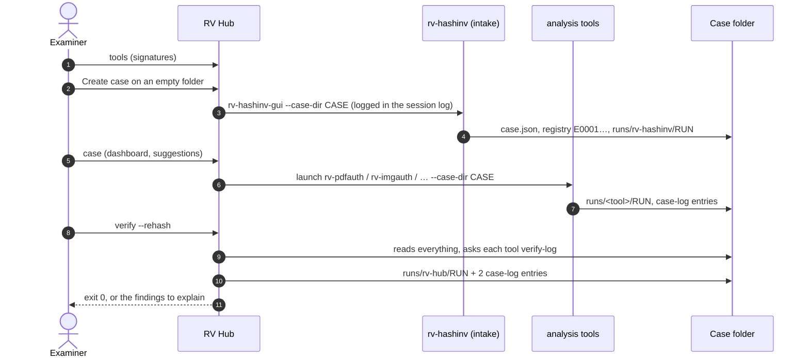

# Usage guide: from the first start to a verified case

This is the end-to-end guide for an examiner using RV Hub. It walks through one case: checking the tools, opening
the case, launching the tools, reading the dashboard, verifying the whole case, and reading the result. Option
lists are not repeated here:

- every command, option, default, example and exit code: [usage-cli.md](usage-cli.md) (generated from `--help`);
- the desktop app, tab by tab: [usage-gui.md](usage-gui.md);
- what the hub reads and writes in a case: [case-folder.md](case-folder.md);
- why each check works: [theory.md](theory.md); legal weight and limits: [admissibility.md](admissibility.md);
- installing and verifying the hub: [installation.md](installation.md).



## 1. Before you start

| Check | Why | How |
| --- | --- | --- |
| The hub is the genuine release | "How do you know what you ran?" | [installation.md](installation.md) steps 2–4 and 6 |
| Work on **verified working copies** of the evidence | The tools are read-only in software, not write blockers | Imaging tool + write blocker; note model and serial |
| Windows workstation for verification | Signatures are checked on Windows only | Elsewhere every tool is *not checked* and the cross-check has no signed tool to ask |
| The case's tools are installed and signed | The cross-check needs them | `rv-hub tools --check-signatures` |
| Clock | Every log uses the workstation clock | Check Windows time sync |
| Timestamp | Online TSA by default for `verify` | `--no-timestamp` offline, then `rv-hub timestamp` later; `--tsa-url` for a qualified TSA |

## 2. Walkthrough

The example uses the sample case of [`examples/sample/`](../examples/README.md) (`SAMPLE-1`, Colombian jurisdiction):
a real case folder made by rv-hashinv, rv-pdfauth, rv-imgauth and rv-rsmf. Outputs below come from real runs of the
current build; paths are shortened.

### 2.1 Check the tools

```powershell
rv-hub tools --check-signatures
```

The table lists each tool with version, source (`registry`, `install folder`, `PATH`, `folder`), signature status
and folder; `--check-signatures` adds one line per executable with its finding code. What to look for:

- every tool you will use is `TOOL_SIGNED_RAKVOR`;
- `+builtin` / version `-`: that version has no `describe` (or was not run because it is not Rakvor-signed);
  each tool's version and inputs come from its own `<tool> describe --json` (`rakvor.describe/1`), and `rv-hub
  describe --json` describes the hub the same way (it takes no `--case-dir`: it reads nothing);
- the warning *"installed under the AppId shared by RV PDFAuth and RV ImgAuth 0.2.0"*: reinstall RV PDFAuth if you
  installed RV ImgAuth 0.2.0 after it;
- exit code 3: an executable is signed under another root or its signature is broken. Do not use that copy.

Save the inventory with the case: `rv-hub tools --json > D:\cases\CASE-2026-014\..\tools-2026-11-05.json` (keep it
next to the case, not inside it: the hub never adds files to a case outside its own run folder, and you should not
either).

A portable copy on a USB stick: `rv-hub tools --add-folder E:\rakvor-portable` (for this call; `verify` takes the
same option for its cross-check), or *Tools → Add a
portable folder* in the GUI (remembered).

### 2.2 Create the case (intake)

The hub never creates a case. In the GUI, *Case → Create case* on an empty folder starts rv-hashinv on it; from the
command line:

```powershell
rv-hub launch rv-hashinv --case-dir D:\cases\CASE-2026-014
```

rv-hashinv opens with the case folder preset; register the evidence there (see rv-hashinv's own usage guide). The
hub's session log records `tool_launched` with the executable's SHA-256 and the pid.

An analysis tool on a folder without `case.json` is refused (exit 2): *"is not a case folder yet (no case.json):
open it with the intake tool first"*.

### 2.3 Read the case

```powershell
rv-hub case --case-dir D:\cases\CASE-2026-014
```

```text
Case SAMPLE-1  jurisdiction: Colombia  created: 2026-10-29T11:00:57.077Z
  D:\cases\CASE-2026-014
Evidence items: 5
Case log: intact (quick check; `rv-hub verify` verifies the whole case)
Findings: high 0, medium 0, low 1, info 6

Runs:
  TOOL        RUN ID                   STARTED (UTC)             STATUS     FINDINGS H/M/L/I  TIMESTAMP
  rv-hashinv  20261029T110057Z-48a8f9  2026-10-29T11:00:57.104Z  completed  0/0/0/0           off
  rv-pdfauth  20261029T110057Z-221da1  2026-10-29T11:00:57.182Z  completed  0/0/0/1           off
  rv-imgauth  20261029T110057Z-95dba9  2026-10-29T11:00:57.273Z  completed  0/0/1/2           off
  rv-rsmf     20261029T110057Z-c0bff8  2026-10-29T11:00:57.396Z  completed  0/0/0/3           off

Problems: none

Suggested next steps:
  No suggestion: every registered item has been examined.
```

The numbers come from the tools' own `statistics.json`, as they are: this is a summary, not a verification. A
suggestion is a prompt, not a finding. Only completed runs count as having examined an item. A `.txt` file is
suggested to rv-rsmf only when its content is a WhatsApp export; when the evidence is no longer at its registered
path, give its folder so the hub can look inside: `rv-hub case --case-dir D:\cases\CASE-2026-014 --evidence-dir
F:\copies` ([theory.md B10](theory.md#b10-the-dashboard-and-the-suggestion-rules)). Decide yourself; ignoring a
suggestion has no effect on the case.

### 2.4 Launch the analysis tools

```powershell
rv-hub launch rv-pdfauth --case-dir D:\cases\CASE-2026-014
```

Before it starts, the hub hashes the GUI executable (it must be the one just inventoried) and checks its signature
again. A tool that is not Rakvor-signed is refused (exit 3) unless `--yes-untrusted`; the confirmation is recorded
before the tool starts, and a refusal is recorded too. Report a run made with an untrusted build as such.

In the GUI: *Launch* on a tool card, or the button of a suggestion. An untrusted tool, or a launch without an open
case, asks first.

### 2.5 Verify the whole case

```powershell
rv-hub verify --case-dir D:\cases\CASE-2026-014 --rehash --evidence-dir F:\copies --actor "Ana Ruiz"
```

On the sample (Linux, so no signed tool to cross-check; no timestamp):

```text
DONE  run 20261105T103427Z-706d96
  items: 10  bytes: 69404  errors: 0  elapsed: 0.3 s
  findings: high 0, medium 0, low 0, info 8
  codes: CROSSCHECK_UNAVAILABLE, RUN_LOG_INTACT
  timestamp: off
  report: case/runs/rv-hub/20261105T103427Z-706d96/reports/statistics.en.html
  logs:   case/runs/rv-hub/20261105T103427Z-706d96/logs
  case:   SAMPLE-1 (run recorded in the case log) | runs 4 (intact 4, broken 0, not in case log 0) | evidence re-hashed 5 (match 5, differ 0, missing 0) | cross-check agree 0, disagree 0, not done 4
```

Ten items: the case log, the four runs, the five evidence files. Exit code 0.

- `--rehash` reads every registered evidence file again; `--evidence E0001,E0002` selects some. Without it, only the
  registry's own digest is checked.
- `--evidence-dir` tells the hub where the copies are now, when they are not at their registered path (looked up by
  file name). The sample needs it: its registry records the temporary folder the evidence had at intake.
- `--crosscheck auto` (default) asks each run's own installed, Rakvor-signed tool. `--tool-exe NAME=PATH` uses a
  specific executable whatever its signature (recorded as an override). `--crosscheck off` skips it.
- `--lang all` writes HTML and PDF reports in English, Spanish and French; `--sign-cert` signs every PDF.

In the GUI: the **Verify** tab has the same options; *Start verification*, then *Open report*.

### 2.6 Read the result

Start with the summary line, then the statistics report, then the technical report of any item that is not `ok`.

| Line | Meaning |
| --- | --- |
| `(run recorded in the case log)` | the case log was intact; the verification is linked as `runs/rv-hub/<RUN-ID>` |
| `(case log broken: not extended)` | the case log failed; nothing was appended and the run went to `--out` |
| `runs N (intact …, broken …, not in case log …)` | one count per run folder; read the codes of each broken run |
| `evidence re-hashed N (match, differ, missing)` | `--rehash` results |
| `cross-check agree, disagree, not done` | the second opinion of each run's own tool |

The same case with tampering, from `tests/samples/make_tampered.py` (expected codes in
[`examples/sample/expected_findings.json`](../examples/sample/expected_findings.json)):

| Variant | Codes | Exit |
| --- | --- | :-: |
| clean, `--rehash` | `RUN_LOG_INTACT` ×4 | 0 |
| a case-log line edited | `CASE_LOG_BROKEN` (the runs: no code; the case log cannot vouch for their length) | 3 |
| an audit entry of the rv-pdfauth run edited | `RUN_LOG_BROKEN`, `RUN_LOG_INTACT` ×3 | 3 |
| the rv-pdfauth run folder deleted | `RUN_LOG_BROKEN`, `RUN_LOG_INTACT` ×3 | 3 |
| the last run removed from the case log (re-chained) | `RUN_NOT_IN_CASE_LOG`, `RUN_LOG_INTACT` ×3 | 3 |
| rv-imgauth review log re-anchored | `REVIEW_LOG_BROKEN`, `RUN_LOG_INTACT` ×3 | 3 |
| one byte of `contrato.pdf` changed, `--rehash` | `EVIDENCE_REHASH_MISMATCH`, `RUN_LOG_INTACT` ×4 | 3 |

The technical report of a broken run says what failed, e.g.
`RUN_LOG_BROKEN: audit.jsonl line 1: entry_hash does not match its content (edited entry)`.

## 3. Interpreting each finding

| Code | Severity | What to do |
| --- | --- | --- |
| `CASE_LOG_BROKEN` | high | Find what changed (the technical report names it). The case is not extended until it is explained and restored from a verified copy; do not hand it over as is. |
| `RUN_LOG_BROKEN` | high | That run's reports cannot be relied on until explained; if a copy of the run folder exists elsewhere (e.g. the hand-over copy), compare. Re-running the tool creates a new run; it does not repair the old one. |
| `REVIEW_LOG_BROKEN` | high | Only the record of what was viewed after the run is in doubt; the run's own log is checked separately. |
| `RUN_NOT_IN_CASE_LOG` | high | A run folder the case never announced: copied in from elsewhere, or its case-log entries removed. Find its origin. |
| `TOOL_VERIFY_DISAGREES` | high | Two implementations of the same check disagree. Do not rely on the case until a developer has examined both; report it to Rakvor engineering with the run folder. |
| `EVIDENCE_REHASH_MISMATCH` | high | The file found is not bit-identical to the registered item. Check that `--evidence-dir` points to the right copies; if it does, the evidence changed after intake. |
| `EVIDENCE_MISSING` | high | Not found or unreadable. Give its folder with `--evidence-dir`, or explain where the item is. |
| `UNKNOWN_LOG_FORMAT` | medium | A log the hub does not know; not checked. Identify which tool wrote it. |
| `TIMESTAMP_PENDING` | low | Run `<tool> timestamp <run>/logs` (or `rv-hub timestamp` for a hub run) when online. |
| `CROSSCHECK_UNAVAILABLE` | info | Install the tool (signed) on the verifying workstation, or accept that only the hub's check applies; state it. |
| `RUN_LOG_INTACT` | info | The run's record is unchanged. Read the other codes of the same run too. |

The cross-check reason "same verdict at chain level; this tool's verify-log does not check truncation against the
case log" is not a problem: it is the known difference between tools (rv-hub#21), given only for rv-pdfauth and
rv-imgauth (every other tool is compared with the full verdict), see
[theory.md B6](theory.md#b6-the-cross-check-rule-two-verdicts).

Full wording (shows / does not prove) of every code: [reports.md](reports.md#finding-codes).

## 4. Timestamps

**The timestamp is on by default.** At the end of every `verify` run the hub sends its own chain head (a SHA-256,
nothing else from the case) to the TSA, default `http://timestamp.digicert.com` (`--tsa-url` for another, e.g. a
qualified TSA). That request is the only network access of `verify`; `--no-timestamp` or `RV_NO_TIMESTAMP=1` turns it
off for offline labs. When the TSA cannot be reached, the run completes with `timestamp_pending`; later:

```powershell
rv-hub timestamp D:\cases\CASE-2026-014\runs\rv-hub\<RUN-ID>\logs
```

For every run's tokens the hub checks the hash they cover and the TSA's CMS signature. The TSA certificate chain is
validated only against a CA bundle you give; without it the output says "chain not checked". Revocation is not
checked ([theory.md B9](theory.md#b9-timestamps-what-the-hub-checks-and-what-it-does-not)):

```powershell
rv-hub verify --case-dir D:\cases\CASE-2026-014 --tsa-ca C:\certs\tsa-roots.pem
rv-hub verify-log D:\cases\CASE-2026-014\runs\rv-hub\<RUN-ID>\logs --tsa-ca C:\certs\tsa-roots.pem
```

`verify-case` checks the TSA signature too, never the chain.

## 5. Verifying a log, the hub's own record, a case quickly

```powershell
rv-hub verify-log D:\cases\CASE-2026-014\runs\rv-hub\<RUN-ID>\logs      # chain, timestamps, review log, truncation
rv-hub verify-log "$env:LOCALAPPDATA\Rakvor\RV Hub\logs\<SESSION-ID>"   # a hub session log
rv-hub verify-case D:\cases\CASE-2026-014                               # quick, write-free case check
python3 tests\verify_chain.py D:\cases\CASE-2026-014\runs\rv-hub\<RUN-ID>\logs   # independent check
```

`verify-log` on a run in a case also prints the truncation line, e.g.
`truncation: the final entry #47 is anchored by the case log (run_finished)`. On a session log it says
`truncation not detectable without a timestamp or case record`. `verify-case` differs from `verify` on one point that
matters: it reports an unannounced run folder as a warning (exit 0), where `verify` raises `RUN_NOT_IN_CASE_LOG`
(exit 3) ([case-folder.md](case-folder.md#verify-and-verify-case)).

## 6. Troubleshooting

### Exit codes

| Code | `verify` | `tools` | `case` | `launch` |
| :-: | --- | --- | --- | --- |
| 0 | no high finding | inventory printed | summary printed | tool started |
| 1 | runtime error (case log locked, output not writable) | session log not writable | the folder has no `case.json` (summary still printed) | not installed, could not start, session log not writable |
| 2 | usage error (not a case folder, wrong `--case`, unknown evidence id, malformed `--tool-exe`) | usage error | folder does not exist | unknown tool, or no `case.json` for an analysis tool |
| 3 | at least one high finding | a signature under another root, or invalid | — | refused: untrusted without `--yes-untrusted`, or executable changed |
| 130 | cancelled (partial reports written) | | | |

### Messages

| Message | Cause and fix |
| --- | --- |
| `… is not a case folder (no case.json)` | Wrong folder, or the case was never created: create it with rv-hashinv. |
| `the case folder … belongs to case X, not Y` | `--case` names another case. |
| `stale case lock … held by … for more than 10 minutes` | A tool crashed while appending. If no tool is working on the case, delete `case-log.lock` by hand. |
| `the case log fails verification: a broken case is never extended` | Expected with `CASE_LOG_BROKEN`; the run is in `--out`. |
| `the executable is not Rakvor-signed (unsigned): confirm to launch it anyway` | Developer build or unsigned release; use a signed release, or `--yes-untrusted` knowingly. |
| `the executable changed since it was inventoried` | The file was replaced after the list was made: refresh (*Refresh*, or run the command again). |
| `CROSSCHECK_UNAVAILABLE … is not installed on this workstation` | Install the tool, or `--tool-exe`. On Linux every tool is "not Rakvor-signed". |
| `verify-log exited with N` | That tool's `verify-log` returned neither 0 nor 3 (usage error, older version): cross-check not done. |
| Every tool *Invalid signature* on a Rakvor workstation | Possibly the Rakvor root is not reachable for chain building on this machine ([installation.md](installation.md#4-check-the-signatures-against-the-rakvor-root)). |
