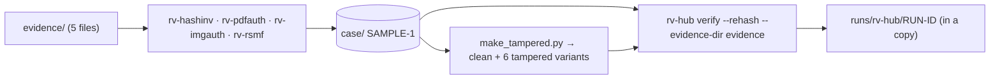

# Examples

## `sample/`: a real case folder made by the Rakvor tools

`sample/case/` is a case folder (`SAMPLE-1`, jurisdiction `co`) written by the tools themselves, not by hand:
`tests/samples/make_case.sh` ran, offline and with fixed examiner names,

1. `rv-hashinv scan` (intake: creates the case and registers the five files as E0001…E0005),
2. `rv-pdfauth analyze` on the PDF, `rv-imgauth analyze` on the two images, `rv-rsmf convert` on the chat export.

The tool versions and the SHA-256 of each executable used are in `sample/case-tools.json`: rv-hashinv 0.3.1 (with
`describe`), rv-pdfauth 0.3.0, rv-imgauth 0.1.0 and rv-rsmf 0.1.0 (built from their repositories at the time, without
`describe`). rv-certcheck has no run in the sample.

| Evidence (`sample/evidence/`, synthetic, no real personal data) | Id | Examined by |
| --- | --- | --- |
| `captura.png` (Pillow) | E0001 | rv-hashinv, rv-imgauth |
| `contrato.pdf` (one-page PDF) | E0002 | rv-hashinv, rv-pdfauth |
| `foto-1.jpg` (Pillow) | E0003 | rv-hashinv, rv-imgauth |
| `notas.txt` (plain text) | E0004 | rv-hashinv |
| `whatsapp-chat.txt` (WhatsApp-style export, invented names) | E0005 | rv-hashinv, rv-rsmf |

- `expected_hashes.csv`: the digests of the five files, computed independently with Python's `hashlib`.
- `expected_findings.json`: the exact finding codes, with counts, and the exit code that `rv-hub verify` must give on
  the case and on each tampered copy written by `tests/samples/make_tampered.py`.



## Run it

On a copy in `sample/out/`; the committed case is never changed:

```bash
examples/sample/run.sh target/release/rv-hub          # Linux / macOS
```

```powershell
.\examples\sample\run.ps1 -Bin .\rv-hub.exe          # Windows
```

The scripts run `self-test`, then `rv-hub verify --rehash --evidence-dir sample/evidence --hash sha256,md5 --lang all
--crosscheck off`, then `verify-log` on the hub's run, and compare the hub's `hashes.csv` with
`expected_hashes.csv`. Set `RV_NO_TIMESTAMP=1` to skip the TSA request. Expected: exit code 0; **10 items** (the
case log, four runs, five evidence files); codes `RUN_LOG_INTACT` (four runs); five evidence files matching the
registry; `hashes.csv matches expected_hashes.csv (5 files: size, SHA-256, MD5)`.

The registry records the paths the evidence had when it was registered (a temporary folder), so `--rehash` finds the
copies only with `--evidence-dir examples/sample/evidence`. For the same reason `rv-hub case` cannot read the files,
and suggests rv-rsmf for `notas.txt` by its `.txt` extension; that suggestion is expected here.

## Tampered variants

```bash
python3 tests/samples/make_tampered.py /tmp/variants          # prints {variant: path}
rv-hub verify --case-dir /tmp/variants/run_unlinked/case --evidence-dir /tmp/variants/run_unlinked/evidence \
       --crosscheck off --no-timestamp
```

| Variant | What was changed | Expected codes | Exit |
| --- | --- | --- | :-: |
| `clean` (with `--rehash`) | nothing | `RUN_LOG_INTACT` ×4 | 0 |
| `case_log_line_edited` | the actor of rv-pdfauth's `run_started` in the case log | `CASE_LOG_BROKEN`, `RUN_LOG_INTACT` ×4 | 3 |
| `run_audit_entry_edited` | the actor of rv-pdfauth's `run_started` in its audit log | `RUN_LOG_BROKEN`, `RUN_LOG_INTACT` ×3 | 3 |
| `run_folder_deleted` | the rv-pdfauth run folder removed | `RUN_LOG_BROKEN`, `RUN_LOG_INTACT` ×3 | 3 |
| `run_unlinked` | the last run's entries removed from the case log, which is re-chained | `RUN_NOT_IN_CASE_LOG`, `RUN_LOG_INTACT` ×3 | 3 |
| `review_reanchored` | a `review.jsonl` added to the rv-imgauth run, anchored to `run_started` instead of `run_finished` | `REVIEW_LOG_BROKEN`, `RUN_LOG_INTACT` ×3 | 3 |
| `evidence_byte_changed` (with `--rehash`) | one byte of the copy of `contrato.pdf` | `EVIDENCE_REHASH_MISMATCH`, `RUN_LOG_INTACT` ×4 | 3 |

With `--crosscheck auto` and a tool given with `--tool-exe`, `case_log_line_edited` shows the cross-check rule: the
hub's full verdict of the rv-pdfauth run is *broken* (the case log cannot vouch for its length), its chain-only
verdict *intact*; rv-pdfauth's `verify-log` answers *intact*, which agrees at chain level
([docs/theory.md B6](../docs/theory.md#b6-the-cross-check-rule-two-verdicts)).
