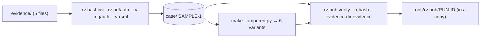

# Examples

## `sample/` — a real case folder made by the four Rakvor tools

`sample/case/` is a case folder (`SAMPLE-1`, jurisdiction `co`) written by the tools themselves, not by hand:
`tests/samples/make_case.sh` ran, offline and with fixed examiner names,

1. `rv-hashinv scan` (intake: registers the five files as E0001…E0005),
2. `rv-pdfauth analyze` on the PDF, `rv-imgauth analyze` on the two images, `rv-rsmf convert` on the chat export.

The exact tool versions and executable digests are in `sample/case-tools.json`.

| Evidence (`sample/evidence/`, synthetic, no real personal data) | Examined by |
| --- | --- |
| `contrato.pdf` (one-page PDF) | rv-hashinv, rv-pdfauth |
| `foto-1.jpg`, `captura.png` (Pillow) | rv-hashinv, rv-imgauth |
| `whatsapp-chat.txt` (WhatsApp-style export, invented names) | rv-hashinv, rv-rsmf |
| `notas.txt` (plain text) | rv-hashinv |

`expected_hashes.csv` holds the digests of the five files, computed independently with Python's `hashlib`.
`expected_findings.json` lists the exact finding codes `rv-hub verify` must report on the case and on each
tampered copy written by `tests/samples/make_tampered.py`.



Run it (on a copy in `sample/out/`; the committed case is never changed):

```bash
examples/sample/run.sh target/release/rv-hub          # Linux / macOS
```

```powershell
.\examples\sample\run.ps1 -Bin .\rv-hub.exe          # Windows
```

Expected: exit code 0, codes `RUN_LOG_INTACT` (four runs), five evidence files matching the registry.
The registry records the paths the evidence had when it was registered (a temporary folder), so `--rehash`
finds the copies with `--evidence-dir examples/sample/evidence`.
